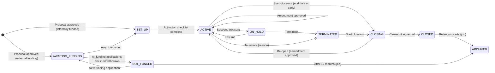
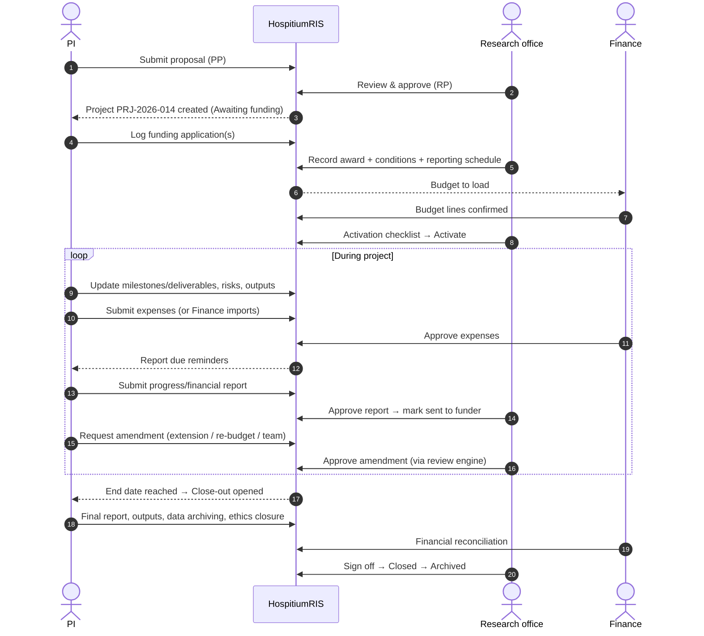
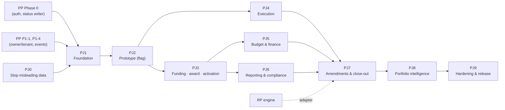

# HospitiumRIS — Project Management (Proposal → Close-out): Implementation Plan

**Scope:** Project management end to end, researcher side and institution side: from an approved proposal through funding, award, activation, execution, budget, reporting, amendments and close-out, to archive.
**Prepared for:** Stephen Gaita, HospitiumRIS
**Date:** 14 October 2026
**Companion document:** `project-management-lifecycle-analysis.md`. Finding IDs `PM-1 … PM-29` refer to its register.
**Depends on:** `proposals-implementation-plan.md` ("PP"), the Review Process roadmap ("RP"), and the Security & Data-Privacy gap analysis ("SEC"). This plan does **not** repeat work those plans already own. Where an item depends on one of them, it says so (for example "needs PP P1-1").

---

## 1. Approach

### 1.1 Understanding → workflow → prototype → production

Following your working preference, the plan runs in this order:

1. The **application and the workflow** are pinned down first (§2: actors, lifecycle, transition rules).
2. **Misleading data and open holes** are removed with minimal change (Phase 0).
3. A **server-side project domain** is built and tested (Phase 1).
4. A **thin vertical prototype** goes in front of a research office and some PIs, behind a feature flag (Phase 2), before the full build.
5. **Lifecycle capabilities** are built stage by stage (Phases 3–7).
6. **Portfolio intelligence, hardening and rollout** follow (Phases 8–9).

### 1.2 Stack decisions

| Concern | Decision |
|---|---|
| Frontend | Next.js 16 App Router, **JavaScript**, **MUI 7** (no Tailwind), the theme tokens from PP P2-1 |
| Backend | Next.js route handlers now. Domain logic goes in **framework-agnostic modules** (`src/lib/projects/`) so it ports 1:1 to Python/FastAPI when `docs/PYTHON_BACKEND_MIGRATION.md` proceeds. The contract is kept in OpenAPI (`docs/openapi/projects.yaml`). |
| Database | Postgres via Prisma 6. Migrations are additive only until the contract phase; every migration has a backfill script, verification queries and a rollback note. |
| Files | Reuse the existing **stored-files / R2 layer** (`src/lib/storage/*`). Add `StoredFileModule` values `PROJECT_DOCUMENT`, `PROJECT_REPORT`, `PROJECT_EXPENSE_RECEIPT`, `PROJECT_AWARD`, `PROJECT_CLOSEOUT` with their policies in `storage/policy.js`. |
| Validation | `zod`, shared by client and server (same as PP) |
| Server state | `@tanstack/react-query` (same as PP) |
| Tests | Keep the repo's existing **`node:test`** runner for unit and integration tests (`npm test` already runs `tests/**/*.test.js`), plus `@playwright/test` and `@axe-core/playwright` for E2E and accessibility. *PP proposed Vitest. Pick one runner for both plans (decision D-9); this plan's estimates do not depend on which.* |
| Scheduling | No scheduler exists today. Add a **protected jobs endpoint** (`POST /api/jobs/:name`, shared-secret header) called by a small cron container in `docker-compose.yml`. Jobs are idempotent and keep a run log. |
| Exports | `xlsx` (already a dependency) for spreadsheet exports; server-rendered HTML → PDF for reports and close-out bundles (`jspdf` is present; a headless-Chromium render gives better fidelity and is optional). |
| Feature flag | Add `projectsV2` alongside the existing `institution.enabledModules` keys: per institution, default off. |
| Branching | Trunk-based with short-lived branches; one work item = one PR with its tests |

### 1.3 How this plan fits with the Proposals plan and the RP roadmap

Do these **once**, not twice:

| Needed here | Owned by | Note |
|---|---|---|
| Auth and policy on `api/proposals/**` (GET/PATCH/DELETE, submit) | **PP P0-2, P0-3** | PJ0-3 only covers the project-specific routes and checks that PP has landed |
| `ownerId`, `institutionId`, `awardedAmount` on `Proposal` | **PP P1-1, P0-3** | Projects copy these at creation; the backfill (PJ1-6) needs them |
| `ProposalEvent` (shared with RP `ReviewEvent`) | **PP P1-4 / RP P1-3** | Projects use **the same event table** with a nullable `projectId` column (D-3), so there is one activity log for the whole lifecycle |
| Award recording on the proposal | **PP P4-5** | **Superseded here** by PJ3-3 (`Award` record owned by the project). Agree with the PP owner to build PJ3-3 instead of P4-5. |
| Review engine (routing, stages, decisions) | **RP** | Amendments (PJ7-2) and report approvals (PJ6-2) call the engine through an adapter, as PP P4 does |
| Notification service | **RP P0-4** | Consumed in PJ3-7 and PJ6-4 |
| Design tokens, `ConfirmDialog`, `useSnackbar`, `EmptyState`, `ErrorState`, `ActivityTimeline` | **PP P2-1, P3-1, P4-7** | Reused; project-specific components are new |

**Ordering rule:** PJ Phase 0 can start **now**, in parallel with PP Phase 0. **PJ Phase 1 starts after PP P1-1 and P1-4 are merged**, because projects need proposal ownership, tenancy and the event table.

---

## 2. The application and workflow (target)

### 2.1 Actors and roles

| Actor | Account type / role | Main responsibilities |
|---|---|---|
| **Principal Investigator (PI)** | `RESEARCHER`, project member `PI` | Owns delivery: work plan, team, reports, expenses, outputs, amendment and close-out requests |
| **Co-investigator / team member** | `RESEARCHER`, project member `CO_I` / `STAFF` / `STUDENT` | Updates assigned milestones/deliverables, uploads evidence, registers outputs; edit rights set per member |
| **Grants officer / research office** | `RESEARCH_ADMIN` | Records awards, runs activation, reviews reports, approves amendments, monitors compliance, signs off close-out |
| **Finance officer** | new permission `FINANCE` (D-5) | Loads the budget, approves or imports expenses, reconciles at close-out |
| **Institution admin** | `INSTITUTION_ADMIN` | Configures checklists, report templates, categories and reminders; has all research-office rights |
| **Ethics committee** (existing module) | `ETHICS_*` roles | Source of ethics approval status and expiry; receives closure reports |
| **Global admin** | `GLOBAL_ADMIN` | Support only; no business actions |

### 2.2 Lifecycle



### 2.3 Transition rules (the state machine the service enforces)

| From → To | Who | Preconditions (server-checked) | Side effects |
|---|---|---|---|
| *(none)* → `AWAITING_FUNDING` / `SET_UP` | System on proposal approval (PP/RP engine), or research office manually for legacy data | Proposal `APPROVED`; no project exists for the proposal | Project created with ref `PRJ-YYYY-NNN`; members copied from the proposal; milestones/deliverables copied; event; notify PI |
| `AWAITING_FUNDING` → `SET_UP` | Research office | ≥ 1 `Award` recorded | Budget lines seeded from the proposal (if none); reporting schedule generated; notify PI and finance |
| `AWAITING_FUNDING` → `NOT_FUNDED` | System (last application declined) or research office | No open funding application | Notify PI |
| `SET_UP` → `ACTIVE` | Research office | Activation checklist: ethics valid (if required), contract signed, budget loaded, team confirmed, cost centre set, conditions acknowledged. Each item can be waived with a reason. | `activatedAt`; reminders scheduled; notify team |
| `ACTIVE` ↔ `ON_HOLD` | Research office (PI can request) | Reason required | Reminders paused while on hold; event |
| `ACTIVE`/`ON_HOLD` → `TERMINATED` | Research office | Reason + effective date | Close-out opened in "terminated" mode |
| `ACTIVE`/`TERMINATED` → `CLOSING` | PI requests, research office confirms; or automatic N days after end date (configurable, default 30) | — | Close-out checklist instantiated from the institution template |
| `CLOSING` → `CLOSED` | Research office sign-off | All blocking checklist items complete or waived | `closedAt`; final health snapshot; archive scheduled |
| `CLOSING` → `ACTIVE` | Research office | An approved amendment (e.g. no-cost extension) | Close-out checklist kept but suspended |
| `CLOSED`/`NOT_FUNDED` → `ARCHIVED` | Job | Retention start reached | Becomes read-only; export bundle generated |

**Rules that never change:** `Project.status` is written **only** by `projects/service.transition()` inside a transaction that also writes the event. The proposal record is read-only once its project exists.

### 2.4 End-to-end flow (who does what)



---

## 3. Phase overview

| Phase | Goal | Work items | Effort (dev-weeks) | Calendar with 2 devs | Exit criteria (summary) |
|---|---|---|---|---|---|
| **0 — Stop misleading data** | Nothing false on screen; no open project writes | 9 | 4.6 | ≈ 2.5 wks | Budget mock hidden; status mapping gone; institution health correct; regression tests |
| **1 — Project foundation** | `Project` entity, tables, domain service, API, backfill | 10 | 9.4 | ≈ 5 wks | Projects exist for every approved proposal; one health formula; Co-I access; tests ≥ 85 % |
| **2 — Prototype slice** | Workspace + portfolio on the new model, flagged | 6 | 4.8 | ≈ 2.5 wks | Demo and usability sessions done; decisions recorded |
| **3 — Funding, award & activation** | Funding applications, award, conditions, schedule, activation | 7 | 5.0 | ≈ 2.5–3 wks | Approved → awarded → activated through the UI |
| **4 — Execution** | Work plan, team, risks, ethics link, outputs, update requests | 6 | 5.6 | ≈ 3 wks | PI and Co-Is run the project day to day |
| **5 — Budget & finance** | Budget lines, expenses, approvals, import, burn rate | 7 | 6.0 | ≈ 3 wks | Real budget vs actual; no mock code left |
| **6 — Reporting & compliance** | Reports, review, calendar, reminders job | 5 | 4.8 | ≈ 2.5 wks | Reports due, submitted, approved; reminders sent |
| **7 — Amendments & close-out** | Amendments, hold/terminate, close-out, archive | 6 | 6.2 | ≈ 3 wks | A project closes with sign-off and an export bundle |
| **8 — Portfolio intelligence** | Analytics, exports, insights, dashboard | 4 | 3.4 | ≈ 2 wks | Research-office reporting needs met |
| **9 — Hardening & release** | a11y, i18n, E2E, security, performance, rollout, contract | 7 | 6.0 | ≈ 3 wks + 2-wk staged rollout | Production checklist (§22) complete |
| **Total** | | **67** | **≈ 55.8** (range ≈ 39–73 at ±30 %) | **≈ 6.5–7 months** with two developers | |

Effort scale (same as PP): **S** = 2 d · **S–M** = 3 d · **M** = 4 d · **M–L** = 6 d · **L** = 8 d · **XL** = 15 d, for one experienced full-stack developer. The totals are the sum of the work-item estimates (Appendix C.2). They **exclude** work owned by PP/RP (§1.3).

### 3.1 Where to stop if time is short

| Slice | Contents | Effort | What you get |
|---|---|---|---|
| **A — Honest** | Phase 0 | ≈ 4.6 dev-weeks | No fake numbers, no status corruption, correct institution indicators. **Do regardless.** |
| **B — Real projects** | Phases 0–2 | ≈ 18.8 dev-weeks | A project record with work plan, team access, one health score, new portfolio |
| **C — Funded & running** | Phases 0–5 | ≈ 35.4 dev-weeks | Award, activation, execution and real budget tracking |
| **D — Full lifecycle** | Phases 0–7 | ≈ 46.4 dev-weeks | Reporting, amendments and close-out; the lifecycle is complete |
| **E — Production-grade** | Phases 0–9 | ≈ 55.8 dev-weeks | Analytics, hardening, measured quality, staged rollout |

### 3.2 Dependencies



With two developers, **PJ3 and PJ4 run in parallel** (one developer each), as do **PJ5 and PJ6**.

---

## 4. Phase 0 — Stop misleading data (≈ 4.6 dev-weeks)

**Rule:** smallest change that removes the defect; no redesign. Each item starts with a failing `node:test` test against a scratch database (reuse the PP P0-0 harness).

| ID | Work item | Resolves | Effort |
|---|---|---|---|
| PJ0-1 | **Hide the budget screens.** Put `researcher/projects/budget/**` behind `projectsV2` and show an "In development" empty state otherwise. Remove the budget nav item when the flag is off. Delete `Math.random` and `generateMockExpenses` from production code paths (keep only in a dev fixture if wanted). | PM-9 (interim) | S |
| PJ0-2 | **Stop the status-mapping corruption.** `PATCH /api/proposals/[id]/status` no longer writes `Proposal.status`. Add an interim nullable column `Proposal.executionStatus` (`ACTIVE`, `ON_HOLD`, `COMPLETED`) plus `executionStatusAt`, writable **only** by research office / institution admin of the same institution, and only when the proposal is `APPROVED`. Write an event (to `ProposalEvent` when PP P1-4 lands; until then a dedicated `proposal_status_log` table, **not** `otherRelatedFiles`). In the tracking page, the PI's dropdown becomes "Request status change" (creates a note and notifies the research office). | PM-2, PM-3 | S–M |
| PJ0-3 | **Auth on project-specific routes.** `api/grants/applications/**`: session user only, ignore `userId` from the query or body, ownership check. `api/researcher/project-health`: fail closed when the user has no ORCID or owner match; use the Prisma singleton; remove PII `console.log`. Confirm PP P0-2 covers `GET/PATCH/DELETE /api/proposals/[id]` and `submit`; if PP Phase 0 has not merged, carry those four handlers here. | PM-4, PM-5, PM-22 | S–M |
| PJ0-4 | **Tenant-scope admin access.** `canAccessProposal`: `INSTITUTION_ADMIN` / `RESEARCH_ADMIN` only for proposals whose PI/owner belongs to their institution (reuse `getInstitutionProposalScope`). Add tests for a cross-tenant 404. | PM-11 | S |
| PJ0-5 | **Institution portfolio correctness.** (a) Milestone completion = `status === 'completed'` (normalised), not `m.completed`. (b) The portfolio lists `APPROVED` proposals only; pending proposals move to a separate "In review" count linking to the review page. (c) Replace auto-`COMPLETED` with **"Past end date — not closed"** (amber) unless `executionStatus = COMPLETED`. (d) No department fallback to the institution name; show "—". | PM-12, PM-13, PM-27 | S |
| PJ0-6 | **Researcher tracking page lists real projects only.** Filter to `APPROVED` (no drafts as "Planning", no rejected as "On hold"); read the execution status from the new column; server-side `?status=APPROVED` instead of `limit=100`. | PM-18, PM-16 (interim) | S |
| PJ0-7 | **One interim health function.** `src/lib/projects/health-interim.js`: schedule-based (milestones due vs completed) plus a "past end date" check, returning `{ level, reasons[] }`. Used by `project-health`, the institution projects API and the tracking page, so all three show the same answer until PJ1-4 replaces it. | PM-14 (interim) | S–M |
| PJ0-8 | **Regression tests** for PJ0-1…7 (status mapping gone, cross-tenant 404, grant-applications IDOR, health parity across the three endpoints, portfolio excludes pending). | quality | M |
| PJ0-9 | **AI insights opt-in.** Add `aiInsights` to institution settings (default **off**); `projectsInsightsService` returns the rule-based fallback when off; no project data leaves the platform without opt-in. | PM-26 | S |

**Exit criteria (Phase 0)**

- [ ] No screen shows a generated or random number; the budget pages are hidden for non-flagged institutions.
- [ ] `PATCH …/status` can no longer change `Proposal.status` (test); a researcher cannot set execution status (test).
- [ ] An approved project with completed milestones is **not** shown as Delayed/At risk (test with fixture).
- [ ] Researcher dashboard, tracking page and institution portfolio return the same health level for the same project (parity test).
- [ ] `api/grants/applications?userId=<other>` returns only the caller's data or 401.

---

## 5. Phase 1 — Project foundation (≈ 9.4 dev-weeks)

**Goal:** a real `Project` record that owns everything after approval, a server-side domain module that enforces §2.3, and a backfill so every approved proposal becomes a project.

**Principles:** *expand → migrate → contract*. Legacy pages keep working through dual-write until Phase 9. `src/lib/projects/` imports nothing from Next.js. Every function takes `(actor, input)` and returns data or throws `HttpError` (reuse PP's `withApi`).

| ID | Work item | Resolves | Effort |
|---|---|---|---|
| PJ1-1 | **Migration P1 — core tables.** `Project` (id, `proposalId` unique, `institutionId`, `referenceNumber` unique per institution `PRJ-YYYY-NNN`, `title`, `piUserId`, `status` enum `ProjectStatus`, `fundingType` INTERNAL/EXTERNAL/MIXED, planned and actual start/end, `activatedAt`, `closedAt`, `archivedAt`, `retentionUntil`, `costCentre`, `grantsOfficerId`, `currency`, `version`, timestamps, `deletedAt`). `ProjectMember` (userId nullable, name, email, orcid, role, `canEdit`, `effortPct`, start/end, `invitedAt`, `acceptedAt`). Event table: add nullable `projectId` + index to the shared `ProposalEvent` (D-3). Reference counter per institution (reuse PP's counter pattern). | PM-1 | M |
| PJ1-2 | **Migration P2 — work plan tables.** `ProjectMilestone` (projectId, title, description, ownerMemberId, dueDate, completedAt, status enum, progressPct, completionCriteria, blockers, sortOrder, `version`), `ProjectDeliverable` (same plus type and `milestoneId`), `ProjectEvidence` (polymorphic: milestone/deliverable, `storedFileId`). New `StoredFileModule` values and policies (§1.2). | PM-8 | M |
| PJ1-3 | **Domain module** `src/lib/projects/`: `schema.js` (zod), `states.js` (transition table §2.3 as data: from, to, roles, guards, effects), `policy.js` (`can(user, action, project)` + `allowedActions`, §15), `service.js` (`createFromProposal`, `update`, `transition`, member CRUD, milestone/deliverable CRUD with `If-Match` versioning), `mappers.js`. Every write goes through one transaction with the event. | PM-1, PM-2, PM-3, PM-8, PM-10 | L |
| PJ1-4 | **Health service.** `health.js` implements §16 (schedule, budget, compliance → level + reasons). A nightly snapshot table `ProjectHealthSnapshot(projectId, date, level, scheduleScore, budgetScore, complianceScore, reasons JSON)` enables trends. Replaces `health-interim.js`. | PM-14, PM-16 | M |
| PJ1-5 | **API v1** (`/api/projects/**`, Appendix A): list (slim projection, server-side filters/sort/pagination ≤ 100, counts by status and health), get (with `allowedActions`), patch, `transition`, members, milestones, deliverables, evidence, events. Uniform error body (same as PP). | PM-15 (API), PM-18 | L |
| PJ1-6 | **Backfill + rehearsal.** For every `APPROVED` proposal: create a `Project` (status from `executionStatus`/end date: `ACTIVE`, or `CLOSING` if past end date — never auto-`CLOSED`); copy members (match users by ORCID/email, else unlinked); JSON milestones/deliverables → tables (keep the JSON untouched); legacy `status_change` entries in `otherRelatedFiles` → events. Idempotent and batch-wise, with a verification report (counts equal, no orphans, ambiguous member matches listed). Rehearse on a scrubbed production copy. | PM-1, PM-8 | M–L |
| PJ1-7 | **Co-investigator access.** Policy by `ProjectMember.userId`; invitation flow for unlinked members (e-mail invite → claim on sign-up, reusing the manuscript-invitation claiming pattern); PI controls `canEdit`. | PM-10 | M |
| PJ1-8 | **Dual-write adapter.** Legacy `api/proposals/[id]/{milestones,deliverables}` write through the project service when a project exists (no more index-based array edits); legacy pages keep working. | PM-8 | S–M |
| PJ1-9 | **Tests.** Unit (states table: every from/to × role × guard; policy matrix; health scoring cases), integration against Postgres (transitions are atomic with events; version conflict → 409; cross-tenant → 404). Coverage gate ≥ 85 % on `src/lib/projects/`. | quality | M |
| PJ1-10 | **OpenAPI** `docs/openapi/projects.yaml` + a contract test that responses validate | portability | S |

**Exit criteria (Phase 1)**

- [ ] Every approved proposal in a production copy has exactly one project; the verification report is signed off.
- [ ] No code outside `projects/service` writes `Project.status` (CI grep + test).
- [ ] A Co-I with `canEdit` can update an assigned milestone; a Co-I without it cannot (tests).
- [ ] Two concurrent milestone edits → second gets 409 (test).
- [ ] Health from `health.js` is used by all three legacy screens.

---

## 6. Phase 2 — Prototype slice (behind `projectsV2`) (≈ 4.8 dev-weeks)

**Slice:** *research office opens the new portfolio → filters → opens a project workspace → sees Overview and Work plan → PI opens the same project → updates a milestone with evidence → health updates on both sides.* Other tabs show "coming soon" but are routed.

| ID | Work item | Resolves | Effort |
|---|---|---|---|
| PJ2-1 | **Project workspace shell** (one component, two contexts): header (ref, title, status chip, PI, funder, dates, health with reasons), status-dependent action bar from `allowedActions`, tabs with `?tab=` deep links: Overview · Work plan · Team · Funding & award · Budget · Reports · Amendments · Compliance · Outputs · Activity · Close-out. Routes: `/researcher/projects/[id]` and `/institution/projects/[id]`. | PM-15 | M–L |
| PJ2-2 | **Overview + Work plan tabs** on the new tables: milestone/deliverable list with owner, due date, status, evidence upload, inline status change with completion date, timeline strip. | PM-8, PM-19 (part) | M |
| PJ2-3 | **Institution portfolio v2**: projects only; server-side filters (status, health, department, funder, PI, year, "ending in 90 days", "report overdue"); columns ref · title · PI · funder · awarded · spent % (blank until PJ5) · health · next due item; saved views; CSV export. | PM-15, PM-27, PM-28 (part) | M |
| PJ2-4 | **Researcher "My projects" v2**, replacing `tracking/status`: the projects where I am a member, grouped by status, health with reasons, next item due. Proposals stay in the proposals list. | PM-18 | M |
| PJ2-5 | **Prototype QA and sessions.** Playwright smoke + axe on the three screens; **five moderated sessions** (three PIs, two research-office staff) with scripted tasks (find at-risk projects, update a milestone with evidence, understand why a project is at risk). Findings ticketed. | validation | M |
| PJ2-6 | **Decision checkpoint.** Close D-1…D-12 (§18) or accept the defaults; record them in `docs/decisions/projects-v2.md`; re-baseline Phases 3–7. | governance | S |

**Exit criteria (Phase 2)**

- [ ] Demo recorded end to end on the new model, flag on for the test institution only.
- [ ] axe: 0 critical/serious on workspace, portfolio and My projects (light and dark).
- [ ] Decisions recorded; go/no-go for Phase 3.

**Prototype wireframes**

```
INSTITUTION · Projects                                                  [ Export ▾ ]
┌ Active 42 ┐┌ At risk 6 ┐┌ Reports overdue 3 ┐┌ Ending ≤ 90 d 8 ┐┌ Closing 4 ┐┌ Awaiting funding 9 ┐
[ Search ref, title, PI… ] [ Status ▾ ] [ Health ▾ ] [ Dept ▾ ] [ Funder ▾ ] [ Year ▾ ]  [ Saved views ▾ ]
Ref           Title                         PI           Funder     Awarded     Spent  Health       Next due
PRJ-2026-014  Genomic Epidemiology of AMR   S. Gaita     Wellcome   $420,000    38 %   ● On track   Q3 progress report · 12 Nov
PRJ-2026-009  AI-Driven Cardiovascular …    A. Otieno    NIH        $310,000    71 %   ▲ At risk    2 milestones overdue
```

```
PRJ-2026-014 · Genomic Epidemiology of Antimicrobial Resistance            ● Active   ● On track
PI Stephen Gaita · Wellcome Trust 223456/Z/26 · 1 Sep 2026 – 31 Aug 2029 · Grants officer: J. Mwangi
[ Request amendment ] [ Submit report ▾ ] [ … ]                      ← from allowedActions
Overview │ Work plan │ Team │ Funding & award │ Budget │ Reports │ Amendments │ Compliance │ Outputs │ Activity │ Close-out
┌ Schedule 8/12 milestones ┐┌ Budget 38 % spent / 41 % time ┐┌ Next report 12 Nov ┐┌ Ethics valid to 30 Jun 2027 ┐
Why this health: no overdue milestones · burn within ±10 % of time · no overdue reports
```

---

## 7. Phase 3 — Funding, award & activation (≈ 5.0 dev-weeks)

| ID | Work item | Resolves | Effort |
|---|---|---|---|
| PJ3-1 | **Consolidate funding applications.** New `FundingApplication` (projectId, funder, programme/call, reference, amountRequested, currency, submittedOn, decisionOn, status `PREPARING/SUBMITTED/UNDER_REVIEW/INFO_REQUESTED/AWARDED/DECLINED/WITHDRAWN`, followUpUserId, notes). Backfill from `Proposal.grantTracking*` and any `GrantApplication` rows; move `GrantCommunication` under it. Mark `GrantApplication`/`GrantMilestone` deprecated (dropped in PJ9-7). | PM-6 | M |
| PJ3-2 | **Grant tracker v2** (Funding & award tab + researcher list): several applications per project; history from events; the "Awarded" status triggers the "Record award" prompt for the research office instead of a silent status. Liaison email threads stay attached. | PM-6, PM-21 | M |
| PJ3-3 | **Award record (institution).** `Award` (projectId, fundingApplicationId, funder, grantNumber, amountAwarded, currency, awardDate, periodStart/End, indirectRatePct, contractSignedOn, awardLetterFileId). "Record award" dialog; requested vs awarded shown everywhere; **replaces PP P4-5** (agree with the PP owner). | PM-7 | M |
| PJ3-4 | **Conditions and reporting schedule.** `AwardCondition` (text, dueDate, status, evidence) and `ReportingRequirement` (type PROGRESS/FINANCIAL/FINAL/OTHER, frequency or explicit dates, recipient FUNDER/INSTITUTION, template). A generator creates due instances from frequency + award period (editable). | PM-7, PM-29 | M |
| PJ3-5 | **Activation checklist + Activate.** Template per institution (default: ethics valid if human participants · contract signed · budget loaded · team confirmed · cost centre set · conditions acknowledged). Each item is auto-checked where data exists (ethics status from `ProposalEthicsLink`, award contract date, budget lines) or manual with evidence; waive with reason. `SET_UP → ACTIVE` blocked until complete. | PM-24 (part), PM-1 | M |
| PJ3-6 | **Project creation trigger.** On proposal approval (engine event or PP service), call `projects.createFromProposal` (idempotent). `fundingType` decides `AWAITING_FUNDING` vs `SET_UP`. All applications declined → `NOT_FUNDED`. | PM-21 | S–M |
| PJ3-7 | **Notifications** for created / award recorded / ready to activate / activated, through the RP notification service with templates and deep links. | PM-21 | S |

**Exit criteria (Phase 3):** Journey J2 (Appendix B) passes: approve → project created → application logged → award recorded with schedule → activation checklist → Active, with no direct DB edits.

---

## 8. Phase 4 — Execution (≈ 5.6 dev-weeks)

| ID | Work item | Resolves | Effort |
|---|---|---|---|
| PJ4-1 | **Work plan complete:** dependencies (milestone → milestone), owners, reorder, bulk status update, Gantt-style timeline (MUI + SVG, no new chart library), overdue highlighting, "my items" filter for Co-Is, evidence required for completion where `completionCriteria` says so. | PM-8, PM-19 (part) | L |
| PJ4-2 | **Team management:** add/remove members with start/end dates, role and effort %; invite flow (PJ1-7); change of PI routed as an amendment (PJ7-1); team history in Activity. | PM-10 | M |
| PJ4-3 | **Risks & issues log:** `ProjectRisk` (title, category, likelihood, impact, owner, mitigation, status, reviewDate); open high risks feed health "Needs attention"; the research office can add risks too. | PM-14 (input) | M |
| PJ4-4 | **Ethics as a control:** Compliance tab shows linked ethics applications with status and expiry; activation guard (PJ3-5); reminders 60/30/7 days before expiry; the project becomes "At risk" on expiry; links to `EthicsAmendment` when a project amendment changes protocol. | PM-24 | M |
| PJ4-5 | **Outputs register:** `ProjectOutput` (type PUBLICATION/DATASET/SOFTWARE/PATENT/POLICY/TRAINING/MEDIA/OTHER, title, date, DOI/URL, `publicationId` FK when it is a HospitiumRIS publication, `manuscriptId`, notes). Suggest matches from the PI's publications library; outputs carry over after close. | PM-23 | M |
| PJ4-6 | **Update requests & comments:** the research office can "Request update" (due date, message) → task for the PI → response with attachments; threaded comments per project with @mentions; all in Activity. | PM-15 | M |

**Exit criteria (Phase 4):** Journeys J3 and J4 pass; Co-I edits are scoped to assigned items; health reflects overdue milestones, high risks and ethics expiry, with reasons.

---

## 9. Phase 5 — Budget & finance (≈ 6.0 dev-weeks)

**Principle:** **never estimate spend.** If no expenditure data exists, show "No expenditure recorded" — not 0 % and not a guess.

| ID | Work item | Resolves | Effort |
|---|---|---|---|
| PJ5-1 | **Budget lines.** `BudgetLine` (projectId, category from an institution-managed list, period/year, amount, currency, justification, `budgetVersion`). Seeded from proposal budget lines (PP P3-6) or from the award total as a single line. Budget editor (finance + PI draft); versioned on each approved re-budget. | PM-9 | M–L |
| PJ5-2 | **Expenditures.** `Expenditure` (projectId, budgetLineId, date, description, amount, currency, fxRate, payee, receiptFileId, status `DRAFT/SUBMITTED/APPROVED/REJECTED`, source `MANUAL/IMPORT`, externalRef, approvedBy). PI submits claims with receipt upload; finance approves or rejects with reason; events. | PM-9 | L |
| PJ5-3 | **Import from finance.** CSV/XLSX upload with column mapping, cost-centre/budget-line matching, preview, dedupe on `externalRef`, error report; imported rows arrive `APPROVED`. (ERP connector later, D-6.) | PM-9 | M |
| PJ5-4 | **Commitments (optional, flag).** Purchase orders/contracts not yet paid; shown as "committed" in budget vs actual. | PM-9 | S–M |
| PJ5-5 | **Budget vs actual.** Per line and total: budget, committed, spent, remaining, % spent vs % time elapsed; variance thresholds (institution setting, default ±15 %) feed health; currency-correct formatting via `Intl`. | PM-9, PM-14 | M |
| PJ5-6 | **Replace legacy budget pages.** `budget/view` and `budget/view/[id]` become the Budget tab and a "My budgets" summary on the new model; delete the mock generators and the `expenses` redirect. | PM-9, PM-25 | S |
| PJ5-7 | **Finance permission.** Add a `FINANCE` permission (D-5) assignable by the institution admin; policy rows for budget and expenditure actions; finance users see budget/expense data only, not the scientific content. | PM-9 | S–M |

**Exit criteria (Phase 5):** Journey J5 passes; no `Math.random` in `src/app/**`; budget vs actual figures reconcile with the imported test ledger to the cent (test).

---

## 10. Phase 6 — Reporting & compliance (≈ 4.8 dev-weeks)

| ID | Work item | Resolves | Effort |
|---|---|---|---|
| PJ6-1 | **Reports.** `ProjectReport` (replaces unused `GrantReport`): requirementId, type, period, dueDate, status `NOT_STARTED/DRAFT/SUBMITTED/RETURNED/APPROVED/SENT_TO_FUNDER`, content (structured sections from a template), attachments, `submittedAt`, `approvedBy`, `sentOn`. Templates per institution (progress, financial, final) prefilled with milestones completed in the period, budget vs actual, outputs and risks. | PM-19 | L |
| PJ6-2 | **Report review flow.** Submit → research office review (through the RP engine adapter when configured, otherwise a single reviewer) → approve or return with comments → "Mark sent to funder" with date and evidence. | PM-19 | M |
| PJ6-3 | **Compliance calendar.** Institution view: every report due, award condition, ethics expiry, contract end, project end and close-out due, across the portfolio (list + month view, filters, iCal export). Researcher view: "Due for me". | PM-29 | M |
| PJ6-4 | **Scheduler + reminders.** `POST /api/jobs/:name` (shared secret, run log, idempotency key per run) + a cron service in `docker-compose.yml`. Jobs: `project-reminders` (30/14/7/1 days before due, then overdue weekly, to PI and grants officer), `health-snapshot` (nightly), `auto-closing` (end date + N days → `CLOSING`), `archive` (retention). Paused for `ON_HOLD`. | PM-29, PM-13 | M |
| PJ6-5 | **PDF export of reports** (server-rendered from the same data, institution letterhead/logo). | PM-19 | M |

**Exit criteria (Phase 6):** Journey J6 passes; running the reminders job twice sends no duplicates (test); the calendar shows the same items as the reminder job selects.

---

## 11. Phase 7 — Amendments, hold/terminate, close-out & archive (≈ 6.2 dev-weeks)

| ID | Work item | Resolves | Effort |
|---|---|---|---|
| PJ7-1 | **Amendment requests.** `ProjectAmendment` (type `NO_COST_EXTENSION/REBUDGET/PI_CHANGE/TEAM_CHANGE/SCOPE_CHANGE/OTHER`, justification, `before`/`after` JSON, funderApprovalRequired, funderApprovalFileId, status `DRAFT/SUBMITTED/UNDER_REVIEW/APPROVED/REJECTED/WITHDRAWN`). The request UI shows a side-by-side diff (dates, budget lines, team). | PM-20 | L |
| PJ7-2 | **Amendment routing and apply.** Submitted amendments go through the RP engine adapter (`engine.startReview(entity='amendment')`), falling back to single-approver. On approval the service **applies the change atomically** (end date, budget version, team, PI) and records the event. A no-cost extension from `CLOSING` re-opens to `ACTIVE`. | PM-20 | M |
| PJ7-3 | **Hold / resume / terminate** transitions with reason, effective date and notifications; reminders paused while on hold; termination opens close-out in "terminated" mode. | PM-20, PM-1 | S–M |
| PJ7-4 | **Close-out checklist.** `CloseOutTemplate` per institution (default §17) and `CloseOutItem` per project (owner role, blocking flag, status, evidence file, notes, completedBy/At, waivedReason). Auto-checks: all milestones complete or waived; all reports `SENT_TO_FUNDER`/`APPROVED`; final report approved; outputs ≥ 1 or "none" with reason; ethics closure filed (status from the ethics module). | PM-17 | L |
| PJ7-5 | **Financial reconciliation step.** Awarded vs spent vs committed per line; unspent-funds handling (return / carry-forward / institutional) with evidence; finance sign-off is a blocking close-out item. | PM-17 | M |
| PJ7-6 | **Sign-off, Closed, Archive.** Research-office sign-off → `CLOSED` (`closedAt`, final health snapshot); export bundle (PDF summary + reports + key files, zip in the R2 private bucket) generated by a job; `retentionUntil` from institution policy; `ARCHIVED` = read-only, bundle downloadable. | PM-17 | M |

**Exit criteria (Phase 7):** Journeys J7 and J8 pass: a project can be extended, re-budgeted and closed; closed projects are read-only; the bundle opens and matches the database.

---

## 12. Phase 8 — Portfolio intelligence (≈ 3.4 dev-weeks)

| ID | Work item | Resolves | Effort |
|---|---|---|---|
| PJ8-1 | **Portfolio analytics** (institution): funding by funder/department/year, application success rate, awarded value, burn rate vs time, projects by health over time (from snapshots), overdue reports, outputs per project, ending soon. Charts follow the platform's chart conventions; every chart has a table view. | PM-28 | L |
| PJ8-2 | **Exports:** portfolio, budget vs actual, reports register and outputs as CSV/XLSX (respecting policy and filters). | PM-28 | S–M |
| PJ8-3 | **Rewire researcher analytics** (`analytics/progress`, `projectsMetrics.js`) to the project model; AI insights use the same metrics and stay opt-in (PJ0-9). Remove the `GrantApplication` reads. | PM-14, PM-6, PM-26 | M |
| PJ8-4 | **Dashboard widgets:** the researcher "Project health" and institution home cards use `health.js` and link to the workspace. | PM-14, PM-22 | S |

---

## 13. Phase 9 — Hardening & release (≈ 6.0 dev-weeks)

| ID | Work item | Resolves | Effort |
|---|---|---|---|
| PJ9-1 | **Accessibility, i18n, dark mode** for all new screens: axe 0 critical/serious in light and dark at 360/768/1280 px; keyboard pass on the workspace, timeline, dialogs and tables; strings under `projects.*` keys; `Intl` dates/currency; RTL check. | quality | M–L |
| PJ9-2 | **E2E suite** for journeys J1–J9 (Appendix B) on a seeded database; PR smoke + nightly full run. | quality | L |
| PJ9-3 | **Security review:** authorisation matrix test (every `/api/projects/**` route × role × status), IDOR sweep, finance-data isolation, upload abuse cases, jobs endpoint secret and replay protection, rate limits. | PM-4, PM-5, PM-11 | M |
| PJ9-4 | **Performance:** seed 5,000 projects / 50,000 milestones / 200,000 expenditures; portfolio p95 < 500 ms; workspace p95 < 400 ms; indexes verified; no N+1 queries. | quality | S–M |
| PJ9-5 | **Staged rollout + production migration + runbooks:** snapshot → migrations → backfills → verification → pilot institution → 10/50/100 %; runbooks for failed backfill, stuck job, reminder storm, mass flag rollback. | ops | M |
| PJ9-6 | **Documentation:** PI guide, research-office guide, finance guide, admin configuration guide (templates, checklists, categories, reminders), release notes. | adoption | S |
| PJ9-7 | **Contract phase** (after one stable release): drop `Proposal.executionStatus`, `grantTracking*` columns, `GrantApplication`/`GrantMilestone`/`GrantAward`/`GrantReport`, JSON milestones/deliverables on `Proposal`, legacy routes (`tracking/status`, `budget/*`, `liason`), dual-write adapter. | PM-6, PM-25 | S–M |

**Exit criteria (Phase 9):** production checklist (§22) complete; flag at 100 % for two weeks with no Sev-1/2; contract migration merged.

---

## 14. Data model (Prisma sketch, additive, illustrative)

```prisma
enum ProjectStatus { AWAITING_FUNDING SET_UP ACTIVE ON_HOLD CLOSING CLOSED TERMINATED NOT_FUNDED ARCHIVED }
enum WorkItemStatus { PENDING IN_PROGRESS BLOCKED COMPLETED WAIVED }

model Project {
  id              String        @id @default(cuid())
  proposalId      String        @unique
  institutionId   String
  referenceNumber String
  title           String
  piUserId        String?
  grantsOfficerId String?
  status          ProjectStatus
  fundingType     String        // INTERNAL | EXTERNAL | MIXED
  plannedStart    DateTime?
  plannedEnd      DateTime?
  actualStart     DateTime?
  actualEnd       DateTime?
  activatedAt     DateTime?
  closedAt        DateTime?
  archivedAt      DateTime?
  retentionUntil  DateTime?
  costCentre      String?
  currency        String        @default("USD")
  version         Int           @default(1)
  createdAt       DateTime      @default(now())
  updatedAt       DateTime      @updatedAt
  deletedAt       DateTime?

  members         ProjectMember[]
  milestones      ProjectMilestone[]
  deliverables    ProjectDeliverable[]
  applications    FundingApplication[]
  awards          Award[]
  reportingReqs   ReportingRequirement[]
  reports         ProjectReport[]
  budgetLines     BudgetLine[]
  expenditures    Expenditure[]
  risks           ProjectRisk[]
  outputs         ProjectOutput[]
  amendments      ProjectAmendment[]
  closeOutItems   CloseOutItem[]
  healthSnapshots ProjectHealthSnapshot[]

  @@unique([institutionId, referenceNumber])
  @@index([institutionId, status, deletedAt])
  @@index([piUserId, status])
}

model ProjectMember {
  id         String   @id @default(cuid())
  projectId  String
  userId     String?
  name       String
  email      String?
  orcid      String?
  role       String   // PI | CO_I | STAFF | STUDENT | COLLABORATOR
  canEdit    Boolean  @default(false)
  effortPct  Int?
  startDate  DateTime?
  endDate    DateTime?
  invitedAt  DateTime?
  acceptedAt DateTime?
  project    Project  @relation(fields: [projectId], references: [id], onDelete: Cascade)
  @@index([projectId])
  @@index([userId])
}

model ProjectMilestone {
  id                 String         @id @default(cuid())
  projectId          String
  title              String
  description        String?        @db.Text
  ownerMemberId      String?
  dueDate            DateTime?
  completedAt        DateTime?
  status             WorkItemStatus @default(PENDING)
  progressPct        Int            @default(0)
  completionCriteria String?
  blockers           String?
  dependsOnId        String?
  sortOrder          Int            @default(0)
  version            Int            @default(1)
  project            Project        @relation(fields: [projectId], references: [id], onDelete: Cascade)
  @@index([projectId, status, dueDate])
}
// ProjectDeliverable: same shape + type, milestoneId

model FundingApplication {
  id              String   @id @default(cuid())
  projectId       String
  funder          String
  programme       String?
  reference       String?
  amountRequested Decimal  @db.Decimal(15, 2)
  currency        String
  submittedOn     DateTime?
  decisionOn      DateTime?
  status          String   // PREPARING | SUBMITTED | UNDER_REVIEW | INFO_REQUESTED | AWARDED | DECLINED | WITHDRAWN
  followUpUserId  String?
  notes           String?  @db.Text
  project         Project  @relation(fields: [projectId], references: [id], onDelete: Cascade)
}

model Award {
  id                   String   @id @default(cuid())
  projectId            String
  fundingApplicationId String?  @unique
  funder               String
  grantNumber          String?
  amountAwarded        Decimal  @db.Decimal(15, 2)
  currency             String
  awardDate            DateTime
  periodStart          DateTime
  periodEnd            DateTime
  indirectRatePct      Decimal? @db.Decimal(5, 2)
  contractSignedOn     DateTime?
  awardLetterFileId    String?
  project              Project  @relation(fields: [projectId], references: [id], onDelete: Cascade)
}

model ReportingRequirement { id String @id @default(cuid()) projectId String awardId String? type String recipient String frequency String? templateId String? project Project @relation(fields: [projectId], references: [id], onDelete: Cascade) reports ProjectReport[] }
model ProjectReport { id String @id @default(cuid()) projectId String requirementId String? type String periodStart DateTime? periodEnd DateTime? dueDate DateTime status String content Json? submittedAt DateTime? approvedById String? sentOn DateTime? project Project @relation(fields: [projectId], references: [id], onDelete: Cascade) requirement ReportingRequirement? @relation(fields: [requirementId], references: [id]) @@index([projectId, status, dueDate]) }

model BudgetLine  { id String @id @default(cuid()) projectId String category String period String amount Decimal @db.Decimal(15, 2) currency String justification String? budgetVersion Int @default(1) project Project @relation(fields: [projectId], references: [id], onDelete: Cascade) @@index([projectId, budgetVersion]) }
model Expenditure { id String @id @default(cuid()) projectId String budgetLineId String? date DateTime description String amount Decimal @db.Decimal(15, 2) currency String fxRate Decimal? @db.Decimal(12, 6) payee String? receiptFileId String? status String source String externalRef String? approvedById String? project Project @relation(fields: [projectId], references: [id], onDelete: Cascade) @@unique([projectId, externalRef]) @@index([projectId, status, date]) }

model ProjectRisk      { id String @id @default(cuid()) projectId String title String category String likelihood Int impact Int ownerMemberId String? mitigation String? status String reviewDate DateTime? project Project @relation(fields: [projectId], references: [id], onDelete: Cascade) }
model ProjectOutput    { id String @id @default(cuid()) projectId String type String title String date DateTime? doi String? url String? publicationId String? manuscriptId String? notes String? project Project @relation(fields: [projectId], references: [id], onDelete: Cascade) }
model ProjectAmendment { id String @id @default(cuid()) projectId String type String justification String @db.Text before Json after Json funderApprovalRequired Boolean @default(false) funderApprovalFileId String? status String decidedById String? decidedAt DateTime? project Project @relation(fields: [projectId], references: [id], onDelete: Cascade) }
model CloseOutItem     { id String @id @default(cuid()) projectId String key String label String ownerRole String blocking Boolean status String evidenceFileId String? notes String? completedById String? completedAt DateTime? waivedReason String? project Project @relation(fields: [projectId], references: [id], onDelete: Cascade) @@unique([projectId, key]) }
model ProjectHealthSnapshot { id String @id @default(cuid()) projectId String date DateTime level String scheduleScore Int? budgetScore Int? complianceScore Int? reasons Json project Project @relation(fields: [projectId], references: [id], onDelete: Cascade) @@unique([projectId, date]) }

// Shared event table (PP P1-4 / RP P1-3): add
//   projectId String?  + @@index([projectId, at])
// Institution-level configuration (templates, checklists, categories, reminder offsets) lives in
// InstitutionProjectSettings (one row per institution, JSON columns with zod-validated shapes).
```

---

## 15. Policy matrix (summary)

Same-institution rule applies to every admin role. ✔ = allowed, ◐ = request only (creates a request the research office acts on), — = not allowed.

| Action | PI | Co-I (canEdit) | Co-I (view) | Research office | Finance | Inst. admin |
|---|---|---|---|---|---|---|
| View project (science + plan) | ✔ | ✔ | ✔ | ✔ | — | ✔ |
| View budget & expenditures | ✔ | ✔ | — | ✔ | ✔ | ✔ |
| Edit milestones / deliverables | ✔ | assigned only | — | ✔ | — | ✔ |
| Manage team | ✔ (non-PI members) | — | — | ✔ | — | ✔ |
| Log funding application | ✔ | ✔ | — | ✔ | — | ✔ |
| Record award / conditions / schedule | — | — | — | ✔ | — | ✔ |
| Activate / hold / resume / terminate | ◐ | — | — | ✔ | — | ✔ |
| Edit budget lines | ◐ (draft) | — | — | ✔ | ✔ | ✔ |
| Submit expenditure | ✔ | ✔ | — | ✔ | ✔ | ✔ |
| Approve expenditure / import ledger | — | — | — | — | ✔ | ✔ |
| Draft / submit report | ✔ | ✔ (draft) | — | ✔ | ✔ (financial) | ✔ |
| Approve report / mark sent | — | — | — | ✔ | — | ✔ |
| Request amendment | ✔ | — | — | ✔ | — | ✔ |
| Decide amendment | — | — | — | ✔ (via engine) | — | ✔ |
| Register outputs | ✔ | ✔ | — | ✔ | — | ✔ |
| Close-out items | owner role | owner role | — | ✔ | finance items | ✔ |
| Sign off close-out | — | — | — | ✔ | — | ✔ |
| Configure templates & settings | — | — | — | — | — | ✔ |

```js
// src/lib/projects/policy.js (sketch; framework-agnostic)
export function can(user, action, project, ctx = {}) {
  if (!user || !project || project.deletedAt) return false;
  const sameInst = project.institutionId === user.institutionId;
  const member = project.members?.find((m) => m.userId === user.id);
  const isPI = member?.role === 'PI';
  const isEditor = isPI || member?.canEdit;
  const ro = sameInst && ['RESEARCH_ADMIN', 'INSTITUTION_ADMIN'].includes(user.accountType);
  const fin = sameInst && user.permissions?.includes('FINANCE');
  const readOnly = ['CLOSED', 'ARCHIVED'].includes(project.status);
  if (readOnly && !['view', 'view-budget', 'download', 'export'].includes(action)) return false;
  switch (action) {
    case 'view':              return !!member || ro;
    case 'view-budget':       return isEditor || ro || fin;
    case 'edit-workitem':     return ro || isPI || (member?.canEdit && ctx.item?.ownerMemberId === member.id);
    case 'record-award':
    case 'activate':
    case 'approve-report':
    case 'decide-amendment':
    case 'sign-off':          return ro;
    case 'approve-expense':   return fin || (ro && user.accountType === 'INSTITUTION_ADMIN');
    case 'request-amendment': return isPI || ro;
    default:                  return false;
  }
}
```

---

## 16. Health formula (single source, `health.js`)

| Dimension | Score | Rule | Level contribution |
|---|---|---|---|
| **Schedule** | % of milestones due by today that are completed; −10 per milestone overdue > 30 days | ≥ 90 → ok; 70–89 → attention; < 70 or any overdue > 60 d → risk | worst wins |
| **Budget** | % spent ÷ % time elapsed (only when expenditure exists) | within ±15 % → ok; ±15–30 % → attention; > 30 % over, or > 40 % under after 50 % time → risk; **no data → not scored** | worst wins |
| **Compliance** | reports, conditions, ethics | any report overdue > 14 d, ethics expired or condition overdue → risk; due ≤ 7 d not started → attention | worst wins |
| **Risks** | open risks with likelihood × impact ≥ 15 | ≥ 1 → attention | worst wins |
| **Lifecycle** | past `plannedEnd` while `ACTIVE` with no extension | → attention; > 60 d → risk | worst wins |

Output: `{ level: 'ON_TRACK' | 'NEEDS_ATTENTION' | 'AT_RISK' | 'NOT_STARTED' | 'CLOSED', reasons: [{ code, message, link }] }`. Thresholds are institution settings with these defaults. Every screen shows the **reasons**, never just a colour.

---

## 17. Default close-out checklist (configurable per institution)

```json
[
  { "key": "workplan",      "label": "All milestones and deliverables completed or waived", "ownerRole": "PI",       "blocking": true,  "auto": "workplanComplete" },
  { "key": "final_report",  "label": "Final technical report approved",                     "ownerRole": "PI",       "blocking": true,  "auto": "finalReportApproved" },
  { "key": "funder_reports","label": "All scheduled funder reports sent",                   "ownerRole": "RO",       "blocking": true,  "auto": "allReportsSent" },
  { "key": "financial",     "label": "Financial reconciliation and unspent funds resolved",  "ownerRole": "FINANCE",  "blocking": true },
  { "key": "ethics_closure","label": "Ethics study closure filed",                           "ownerRole": "PI",       "blocking": true,  "when": "humanParticipants", "auto": "ethicsClosed" },
  { "key": "data_archive",  "label": "Data deposited/archived per data management plan",     "ownerRole": "PI",       "blocking": true,  "when": "hasDMP" },
  { "key": "outputs",       "label": "Outputs registered (or 'none' with reason)",           "ownerRole": "PI",       "blocking": false, "auto": "outputsRegistered" },
  { "key": "assets",        "label": "Equipment and assets transferred or disposed",         "ownerRole": "PI",       "blocking": false },
  { "key": "ip",            "label": "IP / invention disclosures reviewed",                  "ownerRole": "RO",       "blocking": false },
  { "key": "lessons",       "label": "Lessons learned / PI feedback",                        "ownerRole": "PI",       "blocking": false }
]
```

---

## 18. Decisions needed

| # | Decision | Recommended default | Needed by |
|---|---|---|---|
| D-1 | When is a project created? | On internal approval: `AWAITING_FUNDING` (external) or `SET_UP` (internal) | Phase 1 |
| D-2 | Who changes project status? | Research office only; the PI requests | Phase 0 |
| D-3 | One event table for proposal + project? | **Yes** — add `projectId` to the shared `ProposalEvent`/`ReviewEvent` table (rename to `LifecycleEvent` at the PP contract phase) | Phase 1 |
| D-4 | Co-I default rights | View + edit assigned items; PI grants full edit | Phase 1 |
| D-5 | Finance role | New `FINANCE` permission on the user (not a new account type), assigned by the institution admin | Phase 5 |
| D-6 | Source of expenditure data | v1: manual claims + CSV/XLSX import; ERP connector later per institution | Phase 5 |
| D-7 | Close-out start | Automatic `CLOSING` 30 days after planned end (configurable) + manual early start | Phase 6 |
| D-8 | Retention period | Institution setting; default 7 years after close | Phase 7 |
| D-9 | Test runner across PP and PJ | Keep `node:test` (already in repo) + Playwright; drop Vitest from PP | Before Phase 1 |
| D-10 | AI insights | Off by default; institution opt-in | Phase 0 |
| D-11 | Staffing | Two full-stack devs; designer for Phase 2 sessions; a research-office "product owner" | Before Phase 0 |
| D-12 | Pilot institution | Named by the product owner | Before Phase 2 |

---

## 19. Migration, rollout and rollback

| Step | Change | Reversible by |
|---|---|---|
| Expand | Add new tables/enums/columns (PJ0-2, PJ1-1, PJ1-2, PJ3-1, PJ3-3, PJ3-4, PJ5-1, PJ5-2, PJ6-1, PJ7-1, PJ7-4) | Old code ignores them; snapshot restore if a migration fails |
| Backfill | PJ1-6 (projects, members, work items, events), PJ3-1 (funding applications). Idempotent, batched, verification report | Re-run; sources untouched |
| Dual-write | Legacy milestone/deliverable routes write through the service (PJ1-8) | Flag off → legacy pages still read JSON (kept in sync) |
| Switch | `projectsV2` per institution: internal → pilot → 10/50/100 % (≥ 3 days per step) | Flag off per institution, minutes |
| Contract | PJ9-7 drops legacy columns, models and pages after one stable release | Only after a fresh snapshot |

**Advance the rollout only if:** no data-loss report; job error rate < 1 %; no duplicate reminders; portfolio p95 within target; no open Sev-1/2.

| Failure | Action | Time |
|---|---|---|
| UI or workflow problem | Flag off for the institution (legacy pages with the Phase 0 fixes) | minutes |
| Bad backfill | Restore the pre-migration snapshot; nothing dropped | ≈ 1 h |
| Reminder storm / job bug | Disable the cron service or the job via env var; jobs are idempotent | minutes |
| Import created wrong expenditures | Imports are batched with a batch id; "revert batch" action (finance) | minutes |

---

## 20. Test strategy

| Layer | What it proves | Tooling | Gate |
|---|---|---|---|
| Unit | State machine (every transition × role × guard), policy matrix, health scoring, schedule generator, import parser, reconciliation maths | `node:test` | ≥ 85 % lines on `src/lib/projects/`; 100 % of state × role cells |
| Integration | Service + routes against Postgres: atomic transition + event, 401/403/404, 409 conflicts, idempotent jobs, import dedupe | `node:test` + Docker Postgres | all green |
| Contract | Responses validate against `docs/openapi/projects.yaml` | `ajv` | all green |
| E2E | Journeys J1–J9 | Playwright | PR smoke; nightly full; 7 green nights before rollout |
| Accessibility | 0 critical/serious, keyboard, focus | `@axe-core/playwright` + manual | every PR (axe) |
| Performance | Portfolio/workspace p95, job duration at 5,000 projects | k6/autocannon | before rollout |
| Security | Authorisation matrix, IDOR, finance isolation, jobs secret | `node:test` matrix + review | no High/Critical open |

**Rule:** every defect from the analysis gets a failing test first (Phase 0), so it cannot quietly return.

---

## 21. Risk register

| # | Risk | Likelihood | Impact | Mitigation |
|---|---|---|---|---|
| R1 | PP Phase 0–1 slips, blocking PJ1 | Med | High | PJ0 is independent; PJ1-1/1-2 can be drafted against a branch of PP P1-1; weekly sync; one schema owner |
| R2 | Backfill mis-maps members or creates duplicate projects | Med | High | `proposalId` unique; idempotent backfill; ambiguous matches listed, not guessed; rehearsal on a scrubbed copy |
| R3 | Finance data sensitivity / access mistakes | Med | High | Separate `view-budget` action; finance cannot see science; matrix tests; audit events on every expenditure change |
| R4 | Institutions' finance exports vary widely | High | Med | Column-mapping UI with saved mappings per institution; pilot with one finance office first |
| R5 | Reminder fatigue → users ignore notifications | Med | Med | Digest option (reuse `EmailDigestFrequency`); per-user preferences; offsets configurable |
| R6 | Scope creep toward a full grants ERP | High | Med | Slices A–E; ERP integration explicitly out of scope for v1; decision log |
| R7 | Two plans editing `Proposal` and the event table at once | High | Med | One migration owner and branch (PP D3 extended) |
| R8 | Estimates ±30 %; PJ5 and PJ7 are the largest | Med | Med | Prototype de-risks the workspace; re-baseline at PJ2-6 |
| R9 | Scheduler container not running in some deployments | Med | Med | Health endpoint shows the last job run; admin banner if > 26 h; runbook |

---

## 22. Definition of Done and production checklist

**Definition of Done (every work item)**

- [ ] Acceptance criteria met; failing test first for defect fixes.
- [ ] Unit/integration tests added; coverage gate green; lint clean.
- [ ] No `new PrismaClient()`, no hex literals, no `alert(`/`confirm(`, no PII in logs, no `Math.random` in business data.
- [ ] Status and finance writes only through `projects/service`, each with an event.
- [ ] Strings via `t()`; keyboard and screen-reader checked; light/dark checked.
- [ ] OpenAPI and docs updated; migrations have backfill + rollback notes.

**Production-readiness checklist**

| Area | Check | ☐ |
|---|---|---|
| Security | All `/api/projects/**` and `/api/jobs/**` authenticated/authorised; matrix test green; tenant isolation verified; finance isolation verified | ☐ |
| Data | Backfill verified on production copy; every approved proposal has one project; snapshot taken | ☐ |
| Correctness | State machine enforced server-side; single status writer (CI check); health identical across screens | ☐ |
| Lifecycle | J1–J9 pass: approval → award → activation → execution → budget → reports → amendment → close-out → archive | ☐ |
| Jobs | Reminders idempotent; last-run monitor; pause on hold; runbook drilled | ☐ |
| Finance | Budget vs actual reconciles with test ledger; import revert works | ☐ |
| UX & a11y | axe 0 critical/serious on all new screens (light/dark, 3 widths); manual keyboard pass | ☐ |
| i18n | `projects.*` keys complete in `en`; pilot locales translated; currency/dates via `Intl` | ☐ |
| Performance | Portfolio p95 < 500 ms, workspace p95 < 400 ms at 5,000 projects | ☐ |
| Operations | Flag rollback rehearsed; docs and release notes published; support trained | ☐ |

---

## 23. Automation and improvement opportunities

- **Make the jobs endpoint generic.** Ethics expiry, training certificates and manuscript deadlines need the same scheduler, so build `/api/jobs` once (PJ6-4) and let other modules register jobs.
- **Configuration over code.** Activation checklist, close-out checklist, report templates, budget categories and reminder offsets are institution settings (JSON validated by zod). Onboarding a new institution then means configuration, not development.
- **Guardrail CI greps:** `Math.random` under `src/app/**`, writes to `.status` outside `lib/*/service.js`, `new PrismaClient(`, and `otherRelatedFiles` used for anything but files.
- **Reusable skill.** The analysis → implementation-plan pair now has a stable recipe (findings register, lifecycle coverage table, phase/work-item tables with effort scale, traceability appendix). That is a good candidate for a Claude Skill you can run on the Ethics, Training and Clinical-trials modules. Remember to update your Skills/preferences once you've used it a couple of times.

---

## Appendix A — API v1 contract (summary)

All routes are authenticated (401) and policy-checked (404 when not visible), with JSON in/out, an `X-Request-Id`, and errors as `{ error: { code, message, fields? } }`. Mutations on versioned resources need `If-Match: <version>` (409 on conflict).

| Method & path | Purpose | Policy action |
|---|---|---|
| `GET /api/projects` | Portfolio / my projects (`scope=mine\|institution`, filters, sort, page ≤ 100, counts) | view |
| `GET /api/projects/:id` | Workspace data + `allowedActions` + health with reasons | view |
| `PATCH /api/projects/:id` | Edit editable fields (cost centre, grants officer, dates in SET_UP) | edit-project |
| `POST /api/projects/:id/transition` | `{ to, reason?, effectiveDate? }` → state machine | per transition |
| `GET/POST/PATCH/DELETE /api/projects/:id/members[/:mid]` | Team | manage-team |
| `GET/POST/PATCH /api/projects/:id/milestones[/:mid]`, `…/deliverables[/:did]` | Work plan (versioned) | edit-workitem |
| `POST /api/projects/:id/{milestones,deliverables}/:wid/evidence` | Evidence upload (stored files) | edit-workitem |
| `GET/POST/PATCH /api/projects/:id/funding-applications[/:aid]` | Funding applications | log-application |
| `POST /api/projects/:id/awards`, `PATCH …/awards/:awid` | Record/edit award, conditions, reporting requirements | record-award |
| `GET/POST /api/projects/:id/activation` | Checklist state / complete item / waive | activate |
| `GET/PUT /api/projects/:id/budget` | Budget lines (versioned) | edit-budget |
| `GET/POST/PATCH /api/projects/:id/expenditures[/:eid]`, `POST …/expenditures/:eid/{approve,reject}` | Expenses | submit-/approve-expense |
| `POST /api/projects/expenditures/import` (preview + commit), `POST …/import/:batchId/revert` | Ledger import | approve-expense |
| `GET/POST/PATCH /api/projects/:id/reports[/:rid]`, `POST …/reports/:rid/{submit,approve,return,mark-sent}` | Reporting | draft-/approve-report |
| `GET/POST/PATCH /api/projects/:id/risks[/:rid]` | Risks | edit-workitem / ro |
| `GET/POST/PATCH/DELETE /api/projects/:id/outputs[/:oid]` | Outputs | register-output |
| `GET/POST /api/projects/:id/amendments`, `POST …/amendments/:amid/{submit,withdraw,decide}` | Amendments | request-/decide-amendment |
| `GET /api/projects/:id/close-out`, `PATCH …/close-out/:key`, `POST …/close-out/sign-off` | Close-out | close-out items / sign-off |
| `GET /api/projects/:id/events` | Activity (author-visible filter for researchers) | view |
| `GET /api/projects/:id/export` | PDF summary / archive bundle | export |
| `GET /api/projects/calendar` | Compliance calendar (`scope`, date range; `.ics` variant) | view |
| `GET /api/projects/analytics` | Portfolio analytics | ro |
| `POST /api/jobs/:name` | Scheduled jobs (shared secret, idempotency key) | system |

## Appendix B — Acceptance journeys (Playwright)

| # | Journey | Must prove |
|---|---|---|
| J1 | **Portfolio truth.** Research office opens the portfolio → filters At risk → reasons shown → opens a project | Health identical to the researcher's view; pending proposals not listed |
| J2 | **Approval to activation.** Approve proposal → project `AWAITING_FUNDING` → PI logs an application → RO records award with a reporting schedule → finance confirms budget → activation checklist → `ACTIVE` | No direct DB edits; events for each step; notifications sent |
| J3 | **Run the work plan.** PI assigns milestones; Co-I completes an assigned one with evidence; a Co-I cannot edit an unassigned item; an overdue milestone changes health with a reason | Policy; versioning; health reasons |
| J4 | **Ethics control.** Linked ethics expires → project At risk, reminder sent; activation blocked for a new project without valid ethics | Compliance link |
| J5 | **Budget.** Finance imports a ledger CSV (with one duplicate) → preview → commit → budget vs actual updates; PI submits a claim with a receipt → finance approves; revert batch works | Dedupe; reconciliation to the cent |
| J6 | **Reporting.** Reminder job creates due notices (run twice, no duplicates) → PI drafts a prefilled progress report → submit → RO returns with comments → resubmit → approve → mark sent | Idempotent jobs; review flow |
| J7 | **Amendment.** PI requests a 6-month no-cost extension with funder approval → RO approves → end date and reporting schedule update atomically | Atomic apply; diff shown |
| J8 | **Close-out.** End date + 30 days → `CLOSING` → checklist with auto-checks → finance reconciliation → sign-off → `CLOSED` read-only → archive bundle downloadable | Lifecycle complete |
| J9 | **Authorisation.** Anonymous → 401; other institution's admin → 404; finance cannot read the science tabs; researcher cannot record award or change status; jobs endpoint rejects a missing secret | PM-3, PM-4, PM-5, PM-11 |

Every journey also runs axe in light and dark and is repeated at 360 px.

## Appendix C — Traceability and effort check

### C.1 Every finding maps to at least one work item

| Finding | Sev | Summary | Work items |
|---|---|---|---|
| PM-1 | Critical | No Project entity | PJ1-1, PJ1-3, PJ1-6, PJ3-5, PJ7-3 |
| PM-2 | Critical | Project status mapping corrupts proposal status | PJ0-2, PJ1-3 |
| PM-3 | Critical | Status change without ownership check or audit | PJ0-2, PJ1-3, PJ9-3 |
| PM-4 | Critical | Proposal API GET/PATCH/DELETE unauthenticated (institution detail reads through it) | PJ0-3 (with PP P0-2), PJ9-3 |
| PM-5 | High | Grant-applications IDOR; submit unauthenticated; list fails open | PJ0-3, PJ9-3 |
| PM-6 | High | Two parallel grant models | PJ3-1, PJ3-2, PJ8-3, PJ9-7 |
| PM-7 | High | Award cannot be recorded | PJ3-3, PJ3-4 |
| PM-8 | High | Milestones/deliverables as JSON arrays by index | PJ1-2, PJ1-3, PJ1-6, PJ1-8, PJ2-2, PJ4-1 |
| PM-9 | Critical | Budget module is mock data | PJ0-1, PJ5-1 … PJ5-7 |
| PM-10 | High | Co-investigators locked out | PJ1-3, PJ1-7, PJ4-2 |
| PM-11 | High | Admin access not tenant-scoped | PJ0-4, PJ9-3 |
| PM-12 | Critical | Institution milestone progress always 0 % | PJ0-5 |
| PM-13 | High | Completed = end date passed | PJ0-5, PJ6-4 |
| PM-14 | Medium | Four health formulas | PJ0-7, PJ1-4, PJ4-3, PJ5-5, PJ8-3, PJ8-4 |
| PM-15 | High | Institution portfolio read-only | PJ1-5, PJ2-1, PJ2-3, PJ4-6 |
| PM-16 | Medium | Execution status read inconsistently | PJ0-6, PJ1-4 |
| PM-17 | Critical | No close-out process | PJ7-4, PJ7-5, PJ7-6 |
| PM-18 | High | Tracking page lists drafts/rejected as projects | PJ0-6, PJ1-5, PJ2-4 |
| PM-19 | High | No reporting cycle | PJ2-2, PJ4-1, PJ6-1, PJ6-2, PJ6-5 |
| PM-20 | High | No amendment/extension/re-budget path | PJ7-1, PJ7-2, PJ7-3 |
| PM-21 | Medium | Grant tracker not connected to execution | PJ3-2, PJ3-6, PJ3-7 |
| PM-22 | Medium | Project-health widget fails open | PJ0-3, PJ8-4 |
| PM-23 | Medium | Outputs only captured at proposal time | PJ4-5 |
| PM-24 | Medium | Ethics is a link, not a control | PJ3-5, PJ4-4 |
| PM-25 | Low | Dead/redirect routes, misspelt URL | PJ5-6, PJ9-7 |
| PM-26 | Low | AI insights send data to a third party | PJ0-9, PJ8-3 |
| PM-27 | High | Pending proposals mixed into portfolio | PJ0-5, PJ2-3 |
| PM-28 | Medium | No portfolio analytics | PJ2-3, PJ8-1, PJ8-2 |
| PM-29 | Medium | No compliance calendar | PJ3-4, PJ6-3, PJ6-4 |

### C.2 Effort totals (sum of the work-item estimates)

Scale: S = 2 d, S–M = 3 d, M = 4 d, M–L = 6 d, L = 8 d, XL = 15 d.

| Phase | Work items | Person-days | Dev-weeks |
|---|---|---|---|
| 0 | 9 | 23 | 4.6 |
| 1 | 10 | 47 | 9.4 |
| 2 | 6 | 24 | 4.8 |
| 3 | 7 | 25 | 5.0 |
| 4 | 6 | 28 | 5.6 |
| 5 | 7 | 30 | 6.0 |
| 6 | 5 | 24 | 4.8 |
| 7 | 6 | 31 | 6.2 |
| 8 | 4 | 17 | 3.4 |
| 9 | 7 | 30 | 6.0 |
| **Total** | **67** | **279** | **55.8** |

**Combined view with the Proposals plan:** PP ≈ 53 dev-weeks (minus ≈ 0.8 for P4-5, superseded by PJ3-3) + PJ ≈ 55.8 ≈ **108 dev-weeks** for the full proposal-to-close-out platform. With two developers that is ≈ 12–13 months. With four developers (two per plan, one shared schema owner) it is ≈ 7 months, because PJ Phase 1 waits only on PP Phases 0–1.

## Appendix D — File-by-file change map

| Path (under `src/` unless noted) | Change | Phase |
|---|---|---|
| `app/api/proposals/[id]/status/route.js` | Stop writing `Proposal.status`; execution status (RO only) + log table | 0 |
| `app/api/grants/applications/**` | Session auth; then replaced by `/api/projects/:id/funding-applications` | 0 → 3 |
| `app/api/researcher/project-health/route.js` | Fail closed, singleton, shared health | 0 → 8 |
| `app/api/institution/projects/route.js` | Completion field, approved only, no auto-complete → replaced by `/api/projects?scope=institution` | 0 → 2 |
| `lib/proposal-files.js` (`canAccessProposal`) | Tenant-scoped admin access | 0 |
| `lib/projects/{schema,states,policy,service,health,mappers,schedule,import,closeout,jobs}.js` (new) | Domain layer | 1–7 |
| `lib/storage/policy.js`, `prisma/schema.prisma` (`StoredFileModule`) | New project file modules | 1 |
| `app/api/projects/**` (new), `app/api/jobs/[name]/route.js` (new) | API v1, jobs | 1–7 |
| `app/researcher/projects/[id]/page.js`, `app/institution/projects/[id]/page.js` | Workspace (shared `components/Projects/Workspace/*`) | 2 |
| `app/institution/projects/page.js` | Portfolio v2 | 2 |
| `app/researcher/projects/tracking/status/page.js` | Phase 0 fixes → replaced by My projects v2 → removed | 0 → 2 → 9 |
| `app/researcher/projects/budget/**` | Hidden → replaced by Budget tab → removed | 0 → 5 → 9 |
| `app/researcher/projects/proposals/grant-tracker/page.js` | Grant tracker v2 on `FundingApplication` | 3 |
| `app/institution/projects/calendar/page.js`, `app/institution/projects/analytics/page.js` (new) | Compliance calendar, analytics | 6, 8 |
| `components/Projects/{ProjectStatusChip,HealthBadge,WorkPlanTable,Timeline,ActivationChecklist,BudgetTable,ExpenditureTable,ImportWizard,ReportEditor,AmendmentDiff,CloseOutChecklist}.js` (new) | Shared UI | 2–7 |
| `lib/projectsMetrics.js`, `services/projectsInsightsService.js` | Rewire to the project model; opt-in AI | 0, 8 |
| `docker-compose.yml` | `cron` service calling `/api/jobs/*` | 6 |
| `locales/*/projects.json` | New namespace | 9 |
| `scripts/{backfill-projects,verify-projects,seed-projects}.js` (new) | Data tooling | 1, 9 |
| `docs/openapi/projects.yaml`, `docs/decisions/projects-v2.md`, runbooks (new) | Documentation | 1–9 |

---

*End of plan.*
