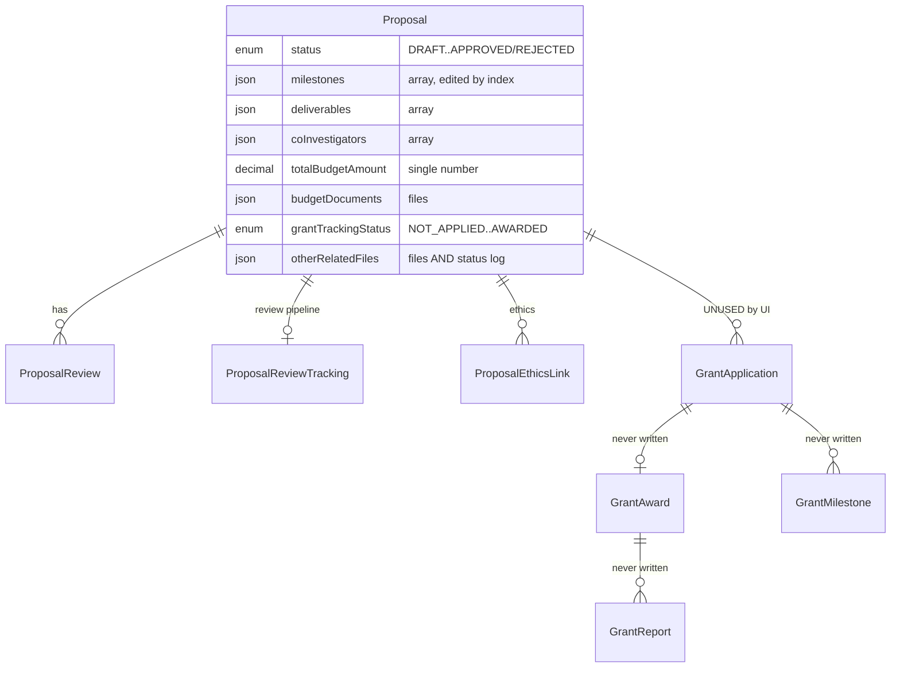
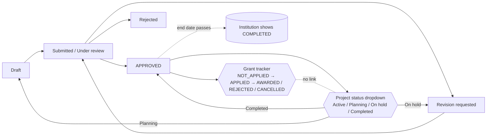
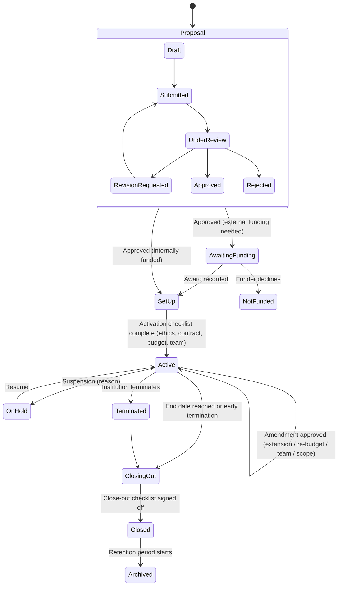

# HospitiumRIS — Project Management Module: Lifecycle Gap Analysis (Proposal → Close-out)

**Scope:** Researcher side (`/researcher/projects/**`) and institution side (`/institution/projects/**`, plus the proposal-review and grant-tracking screens where they feed project management)
**Prepared for:** Stephen Gaita, HospitiumRIS
**Date:** 14 October 2026
**Builds on:** *Researcher Proposals Module: Production-Readiness Analysis* (19 Sep 2026, "PR report"), *Review Process Analysis & Target-State Design* ("RP report"), *Security & Data-Privacy Gap Analysis* ("SEC report"). Proposal-form findings already covered there are cross-referenced, not repeated. This report covers the full project lifecycle and the **post-approval** part that the earlier reports did not cover.

---

## 0. Method and limits

| Item | Detail |
|---|---|
| **Code reviewed** | Prisma schema (`Proposal`, `Grant*`, review-pipeline models); researcher pages: proposals list/create/edit/view, `grant-tracker`, `tracking/status`, `budget/view`, `budget/view/[id]`, `budget/expenses`, `liason`; institution pages: `projects`, `projects/[id]`; APIs: `api/proposals/**`, `api/institution/projects`, `api/researcher/{project-health,grant-tracker,deadlines}`, `api/grants/applications/**`; libraries: `projectsMetrics.js`, `grant-tracker.js`, `proposal-budget.js`, `proposal-files.js`, `projectsInsightsService.js`. Git history since 15 Sep 2026 checked to see what has changed since the PR report. |
| **Not done** | The app was **not run** and no data was changed. All findings are from reading the code (equivalent to tag **C** in the PR report). Large pages (1,500–3,400 lines) were searched for data loading, actions and state handling, not read line by line. |
| **Severity** | *Critical* = corrupts data, breaks access control, or shows false information as fact. *High* = a lifecycle stage cannot be completed. *Medium* = usable but wrong, inconsistent or incomplete. *Low* = polish. |

---

## 1. Executive summary

### 1.1 Verdict

**The module covers the front of the lifecycle (proposal → internal review → "did we apply for a grant?") reasonably, but stops at approval.** After a proposal is approved there is no project record, no award set-up, no real budget or expense tracking, no reporting cycle, no amendments, and **no close-out at all**. What looks like post-award project management on screen is built on the proposal record, with project states squeezed into proposal statuses, and the budget screens show **randomly generated spending figures**.

The institution side is a **read-only portfolio view** with no actions. Its health indicators are computed from a milestone field that the researcher side never writes, so approved projects are systematically shown as *Delayed* or *At risk*, and a project counts as *Completed* only because its end date has passed.

### 1.2 Lifecycle coverage at a glance

| # | Lifecycle stage | Researcher side | Institution side | Rating |
|---|---|---|---|---|
| 1 | Idea / pre-proposal / notice of intent | None | None | ❌ Missing |
| 2 | Proposal development | 7-step wizard, auto-save, ORCID team search | — | 🟡 Partial (see PR report) |
| 3 | Internal review & approval | Status view, revision dialog | Review pipeline, reviewer assignment, review pages | 🟡 Partial (see RP report) |
| 4 | Ethics / regulatory clearance | Link ethics application to proposal | Ethics module (separate) | 🟡 Linked at proposal time only, not enforced or monitored during the project |
| 5 | External funding application | Grant tracker (status, amount applied, follow-up person, notes) | None | 🟡 Partial |
| 6 | Award & contracting | Tracker can be set to "Awarded" — nothing else | None | ❌ Missing (schema `GrantAward` exists, unused) |
| 7 | Project set-up / activation | None — approval = "Active" | None | ❌ Missing |
| 8 | Work-plan execution (milestones, deliverables) | Tracking page: edit milestones/deliverables, documents, blockers | Read-only list, wrong completion field | 🟡 Partial |
| 9 | Budget & expenditure | **Mock data** (random spend, fake expenses, unsaved "Add Expense") | Budget total only | ❌ Missing (screens misleading) |
| 10 | Team & roles during the project | Co-investigators as JSON text; Co-Is cannot open the project | Read-only | ❌ Missing |
| 11 | Monitoring, risk & issues | Derived "health" chip; free-text blockers | Derived status (Ongoing/Delayed/At risk/Completed) | 🟡 Partial, inconsistent formulas |
| 12 | Progress & financial reporting | "Reports" tab = a table of projects | None | ❌ Missing (schema `GrantReport` exists, unused) |
| 13 | Amendments, extensions, re-budgeting, suspension | Status dropdown only (Planning / Active / On hold / Completed) | None | ❌ Missing |
| 14 | Close-out (final reports, financial reconciliation, data archiving, sign-off) | "Completed" option in dropdown, stored as `APPROVED` | Auto-"Completed" when end date passes | ❌ Missing |
| 15 | Outputs & impact capture (publications, datasets, IP, policy) | Publications linked at proposal time only | None | ❌ Missing |
| 16 | Archive / retention | None | None | ❌ Missing |

**Of 16 stages: 0 complete, 6 partial, 10 missing.**

### 1.3 Ten findings that matter most

| # | Finding | ID |
|---|---|---|
| 1 | **There is no Project entity.** A "project" is a `Proposal` row; project states are mapped back onto proposal statuses, so *Completed* is saved as `APPROVED`, *Planning* as `DRAFT`, *On hold* as `REVISION_REQUESTED`. Completing a project is not recorded as a state, and setting a funded project to "Planning" turns it back into a draft. | PM-1, PM-2 |
| 2 | **Any signed-in user can change the status of any proposal/project** (`PATCH /api/proposals/[id]/status` checks login, not ownership), and the history is written into the *file list* (`otherRelatedFiles`). | PM-3 |
| 3 | **The budget screens are fake.** Spend is `Math.random()` × budget (20–60 %), expenses are generated, "Add Expense" only updates browser state, and the numbers change on every reload. | PM-9 |
| 4 | **No close-out process exists** — no closing state, final report, financial reconciliation, outputs capture, data archiving, or institutional sign-off. | PM-17 |
| 5 | **Institution health indicators are wrong**: they count `milestone.completed` (a field nothing writes), so milestone progress is always 0 % and approved projects are flagged *Delayed/At risk*; *Completed* = end date passed. | PM-12, PM-13 |
| 6 | **Four different progress/health formulas** on four screens produce different numbers for the same project. | PM-14 |
| 7 | **Two parallel grant models.** The UI uses grant-tracking fields on `Proposal`; the richer `GrantApplication / GrantAward / GrantReport / GrantMilestone` models have no UI, and three of them are never referenced in code. Award amount, award dates, grant number, contract and reporting schedule therefore cannot be recorded. | PM-6, PM-7 |
| 8 | **Proposal API still partly unauthenticated**: `GET /api/proposals/[id]`, `PATCH` (approve + overwrite budget) and `DELETE` have no auth; the list fails open for users without an ORCID; `api/grants/applications` trusts a `userId` query parameter. The institution project detail page reads through the unauthenticated `GET`. | PM-4, PM-5 |
| 9 | **Co-investigators are locked out** — access is "PI's ORCID equals my ORCID"; Co-Is cannot view or update the projects they work on. Institution admins, meanwhile, pass `canAccessProposal` for **every** proposal regardless of institution. | PM-10, PM-11 |
| 10 | **The institution side has no actions** — it cannot record an award, activate a project, request a report, approve an amendment, flag a risk or close a project. | PM-15 |

### 1.4 What has improved since the 19 Sep report (keep and build on)

| Area | Change observed in code |
|---|---|
| Edit no longer resets status | `PUT /api/proposals/[id]` is now authenticated, checks `canAccessProposal`, and preserves status for in-review / approved / rejected proposals (PR E-1 largely fixed). |
| Next.js 16 params | `submit`, `milestones`, `deliverables`, `status`, `[id]` routes now `await params` (PR X-3 fixed for these routes). |
| Submit starts the pipeline | `submit` and `PUT` call `ensureProposalInReviewPipeline` (PR C-2 progressing; `submit` itself still has no auth). |
| Milestones & deliverables | Dedicated authenticated routes with sanitised document upload to stored files (R2). Rich fields: progress %, completion criteria, blockers, linked deliverables, evidence documents. |
| Grant tracker | Authenticated, institution-scoped colleague list, server-side validation, history entries with actor. A good pattern for the rest of the module. |
| Budget fields | `budgetCurrency` and `budgetDocuments` migrated (26 Sep). |
| Reviewer comms | Review-pipeline communications and reviewer assignment added (26 Sep). |

---

## 2. Module map (as built)

### 2.1 Screens

| Side | Route | Lines | What it does |
|---|---|---|---|
| Researcher | `projects/proposals/list` · `create` · `edit/[id]` · `view/[id]` | 1,454 · 3,430 · 2,475 · 817 | Proposal register and wizard (PR report) |
| Researcher | `projects/proposals/grant-tracker` | 636 | Approved proposals: grant status, amount applied, applied-on date, follow-up colleague, notes |
| Researcher | `projects/proposals/liason` | 5 | Redirect → grant tracker (email-thread sub-page remains) |
| Researcher | `projects/tracking/status` | 1,545 | "Project status": 4 tabs (All projects, Timeline, Teams, Reports), status-change dialog, milestone & deliverable editors |
| Researcher | `projects/budget/view` · `view/[id]` | 446 · 732 | Budget overview and per-project budget (overview, expenses, analysis, financial reports) — **mock data** |
| Researcher | `projects/budget/expenses` | 23 | Redirect → budget view |
| Researcher | Dashboard widget (`api/researcher/project-health`), analytics progress page (`projectsMetrics.js` + AI insights) | — | Health scores and insights |
| Institution | `institution/projects` | 791 | Portfolio list: stats, status/department filters, table |
| Institution | `institution/projects/[id]` | 828 | Read-only project detail (overview, milestones, team) |
| Institution | `institution/proposals/review/**`, `administration/proposal-review-pipeline` | — | Review side (RP report) |

### 2.2 Data model behind "projects"

Key facts:

- **No `Project` table, no owner (`userId`) and no `institutionId` on `Proposal`** (schema still has `// TODO: Add userId when authentication is implemented`). Ownership = PI ORCID string match; institution scope = membership lookups in `institution-scope.js`.
- **Project execution status has no column.** The tracking page and analytics infer it from the last `status_change` object appended to `otherRelatedFiles` (the "other related files" upload list).
- **Milestones / deliverables are JSON arrays** addressed by array index in the API.
- **Budget = one decimal + currency + uploaded files.** No budget lines, years, categories, commitments, expenses, or awarded vs requested split.

### 2.3 Lifecycle as built

The grant outcome and the project's execution status are **not connected**: a proposal marked *grant rejected* still appears as an *Active* project, and an *Awarded* grant does not create or activate anything.

---

## 3. Findings register

### 3.1 Data model and lifecycle (cross-cutting)

| ID | Sev | Finding | Evidence |
|---|---|---|---|
| PM-1 | Critical | **No Project entity; project lifecycle overloaded onto `ProposalStatus`.** The proposal enum has no states for *Awarded, Active, On hold, Extended, Suspended, Closing, Closed, Terminated*. Every post-approval state is either inferred (dates) or stored as a side log. | `schema.prisma` `enum ProposalStatus`, `model Proposal` |
| PM-2 | Critical | **Project status writes corrupt the proposal status.** `PROJECT_TO_PROPOSAL_STATUS` maps *Planning → DRAFT*, *On Hold → REVISION_REQUESTED*, *Completed → APPROVED*, and unknown values → `DRAFT`. Effects: a researcher who sets an approved, funded project to "Planning" turns it into an editable draft and it disappears from the institution portfolio (which filters `APPROVED/UNDER_REVIEW/SUBMITTED`); "On hold" makes it look like a review is waiting for revisions; "Completed" is indistinguishable from active in the database. | `api/proposals/[id]/status/route.js:5–11,33` |
| PM-3 | Critical | **Status change has no ownership check and no proper audit.** Any authenticated user (any institution) can PATCH any proposal's status. The change log is appended to `otherRelatedFiles`, so file metadata and history share one array (PR A-7 still open); `fromStatus` is taken from the client body. | `status/route.js:15–55` |
| PM-6 | High | **Two parallel, disconnected grant models.** UI uses `Proposal.grantTracking*`. `GrantApplication` + `GrantCommunication` have routes but no screen; `GrantAward`, `GrantReport`, `GrantMilestone` are never read or written anywhere in `src/`. `projectsMetrics.js` reads `GrantApplication` (always empty in practice), inflating complexity without data. | grep of `prisma.grantAward/grantReport/grantMilestone` → 0 hits |
| PM-7 | High | **Award cannot be recorded.** The tracker stores *amount applied for* and *applied-on*; there is no awarded amount, award/contract date, funder grant number, award period, indirect-cost rate, conditions or reporting schedule. The only "award" write path is the researcher-side `PATCH /api/proposals/[id]` (approve & award) which overwrites the requested budget (PR A-3, still present). | `lib/grant-tracker.js:120–157`; `[id]/route.js:431–433` |
| PM-8 | High | **Milestones and deliverables are JSON arrays edited by index.** Two people editing (or a delete/reorder) can update the wrong item or lose writes (read-modify-write of the whole array, no version check). No milestone owner, no dependency, no audit of who completed what. Status vocabulary differs by writer (`pending`, `in_progress`, `completed`, `Delivered`, `Blocked`). | `milestones/route.js:111–175`; tracking page `normalizeItemStatus` |
| PM-14 | Medium | **Four progress/health formulas.** (1) `project-health` API: 40 % time + 60 % milestones, `status === 'completed'`; (2) tracking page: its own calculation; (3) institution API: `m.completed` boolean + elapsed-time rules; (4) `projectsMetrics.js`: `isComplete(status)` and the status log. The same project can be *on track* on the researcher dashboard and *delayed* on the institution page. | files listed |
| PM-17 | Critical | **No close-out process.** There is no closing state, final technical or financial report, reconciliation of awarded vs spent, outputs confirmation, data-archiving or ethics-closure step, or institutional sign-off. "Completed" is either a dropdown value stored as `APPROVED` (researcher) or an end date in the past (institution). Projects therefore never formally end, and nothing can be archived or audited. | grep for close-out terms → 0 hits; `status/route.js:10`; `api/institution/projects/route.js:38–40` |
| PM-16 | Medium | **Execution status is read inconsistently.** `projectsMetrics.executionStatus` honours the `status_change` log (so "Completed" shows there), but the tracking page list maps from `proposal.status` (so the same project shows "Active"), and the institution side ignores the log entirely. | `projectsMetrics.js:47–56`; `tracking/status/page.js:266–293` |

### 3.2 Researcher side

| ID | Sev | Finding | Evidence |
|---|---|---|---|
| PM-9 | Critical | **Budget module is mock data presented as real.** List page: `spentPercentage = 0.2 + Math.random()*0.4` and `generateMockExpenses()`; detail page: seeded pseudo-random spend and 8 generated expenses; "Add Expense" pushes to React state only (lost on reload); currency forced to `$`. A PI or finance officer could act on these numbers. **Recommend hiding these pages behind a "coming soon" flag immediately.** | `budget/view/page.js:127–203`; `budget/view/[id]/page.js:74–140,200–222` |
| PM-10 | High | **Co-investigators cannot access their projects.** `canAccessProposal` for researchers = PI ORCID match only. Co-Is (and PIs without an ORCID) cannot open, update milestones, or upload evidence. Team members are free-text JSON, not linked user accounts. | `lib/proposal-files.js:211–221` |
| PM-18 | High | **Tracking page lists non-projects.** It loads `/api/proposals?limit=100` and drops only `Review` items, so **drafts appear as "Planning" projects and rejected proposals as "On Hold" projects**. Fixed limit 100, client-side filtering. | `tracking/status/page.js:266–273,418–425` |
| PM-19 | High | **"Reports" tab is not reporting.** It is a summary table of projects. There is no way to prepare/submit a progress, financial or final report, see reporting due dates, or attach a funder report. | `tracking/status/page.js:1154–1200` |
| PM-20 | High | **No amendment / extension / re-budget path.** After approval, edits are (correctly) locked by the new PUT rule, but nothing replaces them: no no-cost extension, change of PI, scope change, budget reallocation or team change request — the realities of a multi-year project. The only lever is the unsafe status dropdown. | PUT `[id]/route.js:307–310`; tracking page |
| PM-21 | Medium | **Grant tracker is not connected to execution.** Marking *Awarded* does not set award details, project start, or activate the project; *Rejected/Cancelled* does not close or hold the project. Grant tracker only lists `APPROVED` proposals, so a proposal funded externally before internal approval has nowhere to go. | `lib/grant-tracker.js` `approvedProposalWhere` |
| PM-22 | Medium | **Project-health widget fails open.** If the user has no ORCID, no filter is applied: it shows the 5 most recently updated proposals in the whole database (any institution). Also: new `PrismaClient()` + `$disconnect()` per request (PR X-5) and verbose `console.log` of user data. | `api/researcher/project-health/route.js:4,32–40` |
| PM-23 | Medium | **Outputs are only captured at proposal time.** Publications/manuscripts can be linked in the wizard, but there is no place during or after the project to register outputs (papers, datasets, software, patents, policy briefs, trainings delivered), which is what close-out and impact reporting need. | proposal create step 6 only |
| PM-24 | Medium | **Ethics is a link, not a control.** A project can run (and be marked Active) while its linked ethics approval is pending, expired or suspended; no reminder of ethics renewal tied to project dates; ethics amendments (`EthicsAmendment`) are not linked to project amendments. | `ProposalEthicsLink`; no checks in tracking/status |
| PM-25 | Low | **Dead/redirect routes and naming.** `budget/expenses` and `liason` are redirects; "liason" is misspelt in the URL; `view/[id]/page_backup.js` still present. | files listed |
| PM-26 | Low | **AI insights send project metrics to OpenAI directly** (`api.openai.com`) from `projectsInsightsService.js`. Confirm this is covered by the data-processing terms in the SEC report and allow institutions to turn it off. | `services/projectsInsightsService.js:88` |

### 3.3 Institution side

| ID | Sev | Finding | Evidence |
|---|---|---|---|
| PM-12 | Critical | **Milestone progress always 0 % → false "Delayed/At risk".** Institution code counts `milestones.filter(m => m.completed)`; the researcher side writes `status: 'completed'` and never a `completed` boolean. So any approved project more than 80 % through its timeline is labelled **DELAYED**, and any within 30 days of its end **AT_RISK**, regardless of real progress; the milestone counter shows `0/N`. | `api/institution/projects/route.js:44–55`; `institution/projects/page.js:246,678`; `[id]/page.js:292,540` |
| PM-13 | High | **"Completed" = end date in the past.** No sign-off, no final report, no reconciliation. A project abandoned halfway is reported as completed on its end date; a project extended by the funder is reported as completed early. | `api/institution/projects/route.js:38–40` |
| PM-15 | High | **Portfolio is read-only.** No actions on list or detail: cannot record award, activate, assign a grants officer, request an update, review a report, approve an amendment, place on hold, terminate, or close. No comments/notes thread with the PI. | `institution/projects/page.js`, `[id]/page.js` (only Back / Refresh / View) |
| PM-27 | High | **Pending proposals mixed into the project portfolio.** `SUBMITTED` and `UNDER_REVIEW` proposals appear as projects with status `PENDING_APPROVAL`, while `REVISION_REQUESTED` ones vanish — the portfolio counts are neither "projects" nor "proposals". Rejected and drafts are excluded (correct). | `api/institution/projects/route.js:20–25,57–59` |
| PM-4 | Critical | **Detail page reads through the unauthenticated proposal API.** `institution/projects/[id]` calls `GET /api/proposals/[id]`, which has no authentication or tenant check (PR A-1 still open for GET/PATCH/DELETE). | `[id]/page.js:162`; `api/proposals/[id]/route.js:16–80,411–530` |
| PM-11 | High | **Institution admins can access every institution's proposals** via `canAccessProposal` (returns `true` for `INSTITUTION_ADMIN`/`RESEARCH_ADMIN` with no tenant check). The portfolio list itself is scoped (`getInstitutionProposalScopeWhere`), but any by-id route using `canAccessProposal` is cross-tenant. | `lib/proposal-files.js:214–216` |
| PM-28 | Medium | **No portfolio analytics that a research office reports on:** funding by funder/department/year, award success rate, burn rate vs plan, overdue reports, ending-soon list, PI workload, outputs per project, export to CSV/Excel. Department falls back to the institution name when none is set. | `institution/projects/page.js` |
| PM-29 | Medium | **No compliance calendar.** Funder reporting dates, ethics expiry, contract end, no-cost-extension deadlines are not collected, so the research office cannot see "what is due this month". | schema (`GrantAward.reportingSchedule` unused) |

### 3.4 Security items specific to this module (summary)

| ID | Sev | Finding |
|---|---|---|
| PM-4 | Critical | `GET`, `PATCH`, `DELETE /api/proposals/[id]` unauthenticated; `PATCH` can approve and overwrite budget; `DELETE` hard-deletes any proposal. |
| PM-5 | High | `GET/POST /api/grants/applications` take `userId` from the query/body with no session check (IDOR); `submit` route has no auth; `GET /api/proposals` list applies no filter when the caller is anonymous or has no ORCID (PR A-6). |
| PM-3 | Critical | Status PATCH has no ownership check (above). |
| PM-11 | High | Admin access to proposals is not tenant-scoped in `canAccessProposal`. |

---

## 4. Target state

### 4.1 Principles

1. **Proposal and Project are separate records.** A proposal is a *request*; a project is the *funded work*. Approval (and/or award) **creates** a project that references the proposal. The proposal becomes read-only history.
2. **One status writer per entity** (service layer), with an append-only event log. No status in file arrays.
3. **The institution owns gates; the researcher owns delivery.** Activation, amendments, and close-out need institutional sign-off; milestones, evidence, outputs and reports are researcher-driven.
4. **One health formula**, computed server-side and shown identically everywhere.
5. **No placeholder numbers.** Anything not backed by data shows an empty state.

### 4.2 Project lifecycle (proposed)

### 4.3 Stage-by-stage requirements

| Stage | Researcher | Institution (research office / grants officer / finance) | Data |
|---|---|---|---|
| **Pre-proposal (optional)** | Submit short notice of intent (title, funder call, deadline, team) | See pipeline of upcoming submissions; flag internal-competition limits | `ProposalIntent` |
| **Proposal & review** | As per PR/RP reports | As per RP report | existing + fixes |
| **Funding application** | Track external application (funder, call, reference, amount requested, submitted date, decision date) | Sign-off before external submission (institutional endorsement letter) | Consolidate on **one** model: `FundingApplication` (merge `GrantApplication` + tracker fields) |
| **Award** | View award terms | **Record award**: awarded amount (separate from requested), currency, funder grant number, award & contract dates, period, indirect-cost rate, conditions, reporting schedule, award letter upload | `Award`, `AwardCondition`, `ReportingRequirement` |
| **Set-up / activation** | Confirm team, upload signed agreements, accept conditions | Activation checklist: ethics approval valid, contract signed, budget loaded into lines, cost centre assigned, team confirmed; then **Activate** | `Project` (status, dates, costCentre, grantsOfficerId), `ProjectMember` (user, role, effort %, start/end) |
| **Execution** | Milestones & deliverables (owner, due, evidence), risks/issues log, notes | Watch dashboard; comment; request update | `ProjectMilestone`, `ProjectDeliverable`, `ProjectRisk` tables (not JSON) |
| **Budget & spend** | View budget vs actual by line; submit expense claims/requisitions (or import from finance) | Approve expenses or import from ERP; set budget lines by category × year; track commitments; burn-rate alerts | `BudgetLine`, `Expenditure` (source: manual / import), `Commitment` |
| **Reporting** | See report calendar; draft & submit progress/financial/final reports from templates; attach funder submissions | Review & approve before funder submission; overdue alerts | Reuse/rename `GrantReport` → `ProjectReport` linked to `ReportingRequirement` |
| **Amendments** | Request no-cost extension, re-budget, change of PI/team, scope change | Approve/decline with routing (can reuse review-pipeline engine); record funder approval | `ProjectAmendment` (type, before/after JSON, status, decision) |
| **Monitoring & compliance** | Respond to queries | Compliance calendar (reports, ethics expiry, contract end); hold/terminate actions | events + scheduled reminders |
| **Close-out** | Final technical report; outputs register; data deposit/DMP confirmation; asset & equipment disposition; lessons learned | Financial reconciliation (spent vs awarded, refund/unspent); confirm all reports submitted; ethics study closure report; archive; **sign-off** | `CloseOut` checklist record with item status, evidence and sign-off user/date |
| **Outputs & impact** | Link publications, datasets, software, patents, policy outputs, trainings; continues after close | Portfolio impact reporting | `ProjectOutput` (type, link to `Publication` where possible) |
| **Archive** | Read-only | Retention date; export bundle (PDF + files) | `archivedAt`, `retentionUntil` |

### 4.4 Close-out checklist (proposed default, configurable per institution)

| # | Item | Owner | Blocking |
|---|---|---|---|
| 1 | All milestones/deliverables completed or formally waived | PI | Yes |
| 2 | Final technical report submitted (internal + funder) | PI | Yes |
| 3 | Final financial report and reconciliation (awarded vs spent, unspent funds handled) | Finance | Yes |
| 4 | All funder reports in the schedule marked submitted | Grants officer | Yes |
| 5 | Ethics: study closure / final report filed with the committee | PI | Yes if human participants |
| 6 | Data management: data deposited / archived per DMP; access statement | PI | Yes if DMP exists |
| 7 | Outputs registered (≥ 1 or "none" with reason) | PI | Warning |
| 8 | Equipment / assets transferred or disposed | PI + Finance | If applicable |
| 9 | IP / invention disclosures reviewed | Research office | If applicable |
| 10 | Lessons learned / PI feedback | PI | No |
| 11 | Institutional sign-off → status *Closed* | Research office | — |

### 4.5 One health formula

Computed server-side in one module, stored as a snapshot daily, shown everywhere:

- **Schedule**: % of milestones due by today that are complete (on time vs late).
- **Budget**: burn rate vs elapsed time (only when real expenditure exists; otherwise "no data", never invented).
- **Compliance**: overdue reports, expired ethics, open conditions.
- **Status** = worst of the three → *On track / Needs attention / At risk*, with the reasons listed ("2 milestones overdue; progress report due 3 days ago").

### 4.6 Institution-side screens (proposed)

| Screen | Purpose |
|---|---|
| **Portfolio** (replace current list) | Projects only (not proposals); filters by status, funder, department, PI, year; columns: ref, title, PI, funder, awarded, spent %, health, next due item; saved views; CSV/Excel export |
| **Project workspace** | Tabs: Overview · Award & conditions · Team · Work plan · Budget · Reports · Amendments · Compliance · Outputs · Activity. Action bar depends on status: *Record award, Activate, Request update, Approve amendment, Hold, Terminate, Start close-out, Sign off* |
| **Compliance calendar** | All due reports, ethics expiries, contract ends, closing projects, across the institution |
| **Funding pipeline** | Proposals → applications → awards, success rates, by funder and department |

---

## 5. Recommended roadmap

| Phase | Goal | Main items | Findings closed |
|---|---|---|---|
| **0 — Stop misleading data (days)** | Nothing false on screen; no open writes | Hide budget screens behind a feature flag; remove "Planning / On hold / Completed" mapping from `status` route (or restrict to research office and store in its own column); fix institution `m.completed` → `status === 'completed'`; drop pending proposals from portfolio; add auth + `canAccessProposal` + tenant check to `GET/PATCH/DELETE /api/proposals/[id]`, `submit`, `status`, `grants/applications`; remove researcher-side approve & award | PM-2, 3, 4, 5, 9, 11, 12, 18, 27 |
| **1 — Project foundation (2–3 weeks)** | Real project record | `Project`, `ProjectMember`, `ProjectEvent`; `ownerId` + `institutionId` on `Proposal` (PR X-4); migrate approved proposals into projects; milestones/deliverables into tables; one health service; Co-I access by membership | PM-1, 8, 10, 14, 16, 22 |
| **2 — Award & activation (2 weeks)** | Funded work starts properly | Consolidate grant models into `FundingApplication` + `Award` (+ conditions, reporting schedule); institution "Record award" and "Activate" with checklist (ethics valid, contract, budget, team); link grant-tracker outcome to project status | PM-6, 7, 13, 21, 24 |
| **3 — Budget & reporting (3–4 weeks)** | Money and reports | Budget lines (category × year), expenditure (manual entry with approval, CSV import from finance; ERP integration later), burn-rate; report calendar, report templates, submit/approve flow; compliance calendar | PM-9 (properly), 19, 29 |
| **4 — Amendments & close-out (2–3 weeks)** | End of lifecycle | Amendment requests (reuse review-pipeline routing); hold/terminate; close-out checklist and sign-off; outputs register; archive & export bundle | PM-17, 20, 23 |
| **5 — Portfolio intelligence** | Research-office value | Portfolio analytics, funding pipeline, exports, AI insights opt-in per institution | PM-15 (rest), 26, 28 |

Phase 0 should go **before** any further UI work on these screens; Phase 1 overlaps with Phase 0–1 of the proposals implementation plan (owner/institution on `Proposal`) and should be done together.

---

## 6. Decisions needed

| # | Question | Recommended default |
|---|---|---|
| 1 | When is a project created — on internal approval, or on award? | On internal approval, in status *Awaiting funding* (or *Set-up* when internally funded); award moves it on. Keeps unfunded-but-approved work visible. |
| 2 | Who can change project status? | Research office only for Activate / Hold / Terminate / Close; PI can *request* via amendment or close-out. |
| 3 | Source of expenditure data | v1 manual entry with finance approval + CSV import; ERP connector later. Never estimate spend. |
| 4 | Keep `GrantApplication` family or the tracker fields? | Keep one: a `FundingApplication` table (supports several applications per proposal), migrate tracker fields into it, drop unused `GrantMilestone`. |
| 5 | Are Co-Is editors? | Yes for milestones, deliverables, evidence and outputs; budget and reports PI-only (configurable). |
| 6 | Close-out checklist | Use §4.4 default; institutions can toggle items. |
| 7 | AI insights | Off by default per institution until data-processing terms are confirmed. |

---

## Appendix A — Evidence index

| ID | File / line |
|---|---|
| PM-2/3 | `src/app/api/proposals/[id]/status/route.js` lines 5–11 (mapping), 15–20 (auth only), 47–55 (log into `otherRelatedFiles`) |
| PM-4 | `src/app/api/proposals/[id]/route.js` GET 16–80, PATCH 411–475, DELETE 479–530 (no `requireAuth`) |
| PM-5 | `src/app/api/grants/applications/route.js` lines 11–21 (`userId` from query); `src/app/api/proposals/[id]/submit/route.js` (no auth, own PrismaClient) |
| PM-6 | `prisma/schema.prisma` lines 1470–1647; zero code references to `grantAward`, `grantReport`, `grantMilestone` |
| PM-7 | `src/lib/grant-tracker.js` 120–157; `[id]/route.js` 431–433 |
| PM-8 | `src/app/api/proposals/[id]/milestones/route.js` 111–175 |
| PM-9 | `src/app/researcher/projects/budget/view/page.js` 127–203; `budget/view/[id]/page.js` 74–140, 200–222 |
| PM-10/11 | `src/lib/proposal-files.js` 211–221 |
| PM-12/13/27 | `src/app/api/institution/projects/route.js` 20–59; `src/app/institution/projects/page.js` 246, 678; `[id]/page.js` 292, 540 |
| PM-14/16 | `api/researcher/project-health/route.js`; `tracking/status/page.js` 266–293; `lib/projectsMetrics.js` 47–56, 363–378 |
| PM-18/19 | `tracking/status/page.js` 418–425, 1154–1200, 1235–1240 |
| PM-22 | `api/researcher/project-health/route.js` 4, 32–40 |
| PM-26 | `src/services/projectsInsightsService.js` 88 |

---

*End of report.*
