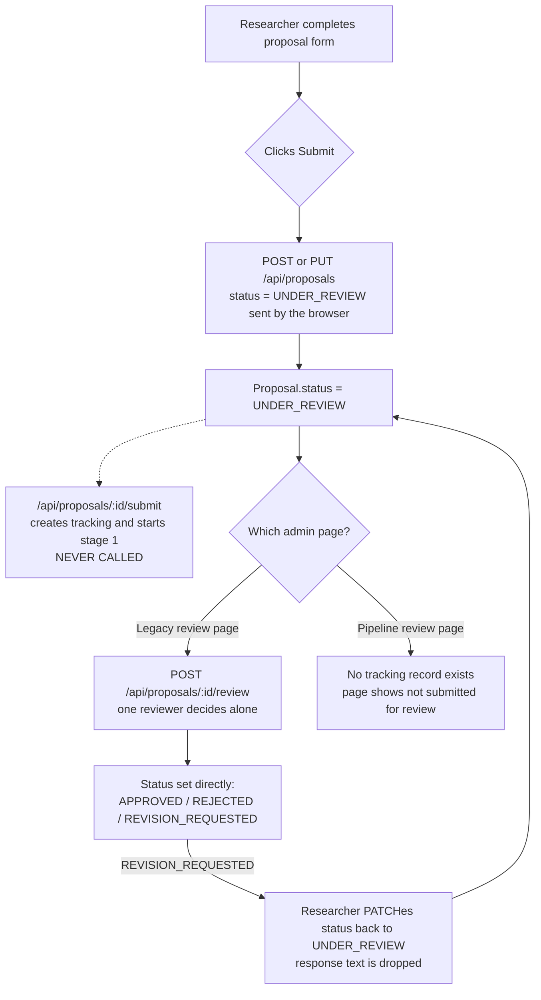
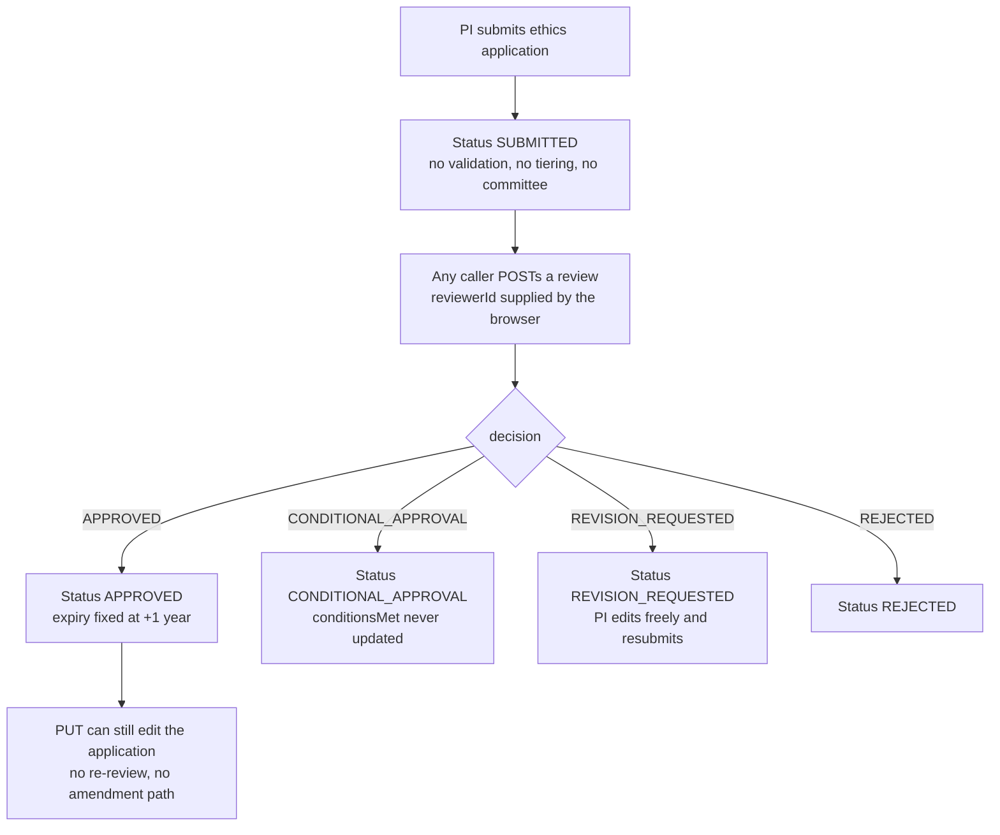
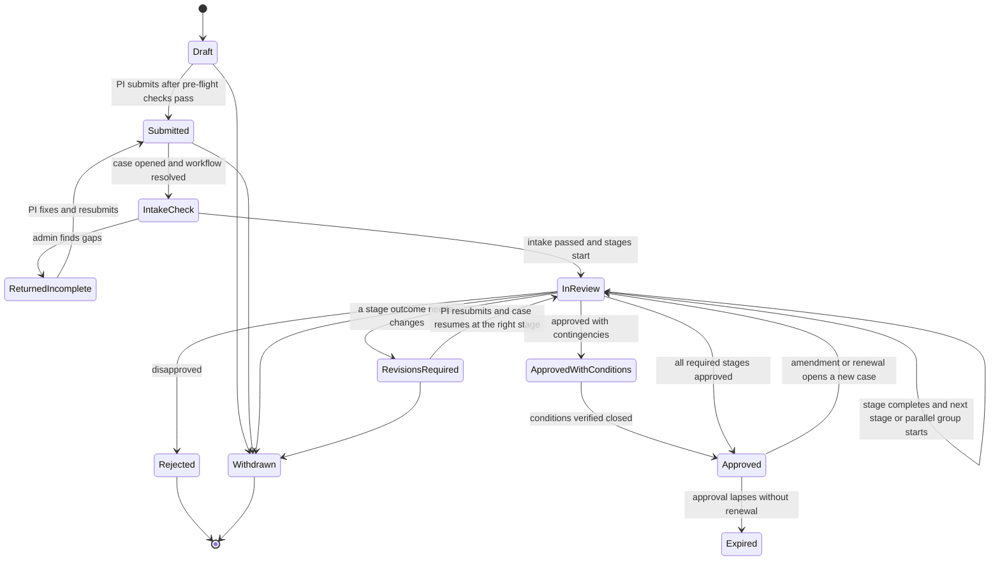
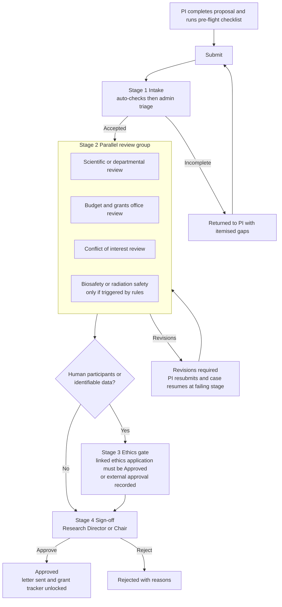
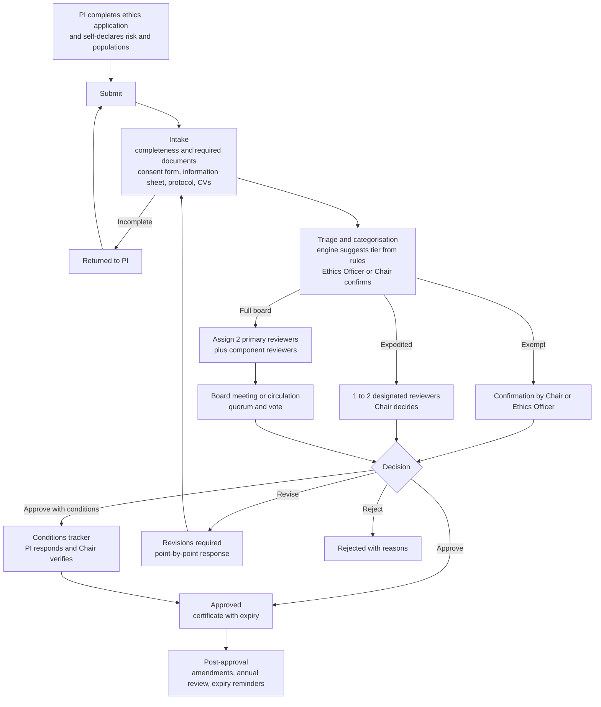
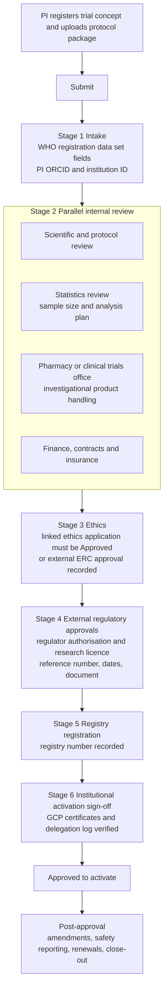
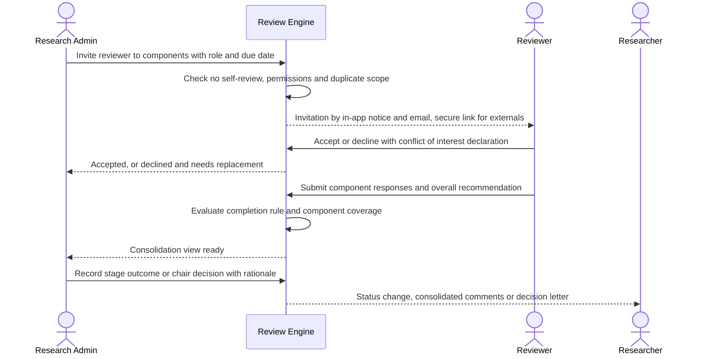

# HospitiumRIS — Review Process Analysis & Target-State Design

**Project Proposals · Ethics Applications · Clinical Trials — from submission to approval**

**Prepared for:** Stephen Gaita, HospitiumRIS
**Date:** September 19, 2026
**Perspectives covered:** Researcher (PI / study team) and Research Administrator (Research Office / Institution Admin)
**Method:** Static code and documentation review only. No live testing was done, so behaviours described as "likely" are inferences from reading the code. Every finding cites a file (and line where useful) so it can be verified.
**Companion reports:** builds on the *Security & Data-Privacy Gap Analysis* (Sept 18) and the *Image Integrity* report (Sept 17). Where a process problem is really an authentication problem, this report points to those findings rather than repeating them.

---

## Contents

1. Executive summary
2. Scope, method and what "submission to approval" means here
3. Current state — how the system works today
4. Findings register
5. Target-state review process
6. Component-level reviewer assignment
7. Administration → Workflow Automation (what the Research Admin can tailor)
8. Data model and engine design
9. Notifications, SLAs, audit and decision letters
10. Roles and permissions
11. Regulatory alignment (ICH-GCP, Declaration of Helsinki, Kenya)
12. Implementation roadmap
13. Decisions needed from you
14. Appendices (evidence index, status mapping, starter workflows, component catalogues, Prisma sketch)

---

## 1. Executive summary

HospitiumRIS already contains most of the *ingredients* of a configurable review process: an admin-facing workflow builder, a stage/reviewer/validation-parameter data model, a per-stage review table, a status vocabulary for ethics, notification templates for "review assigned" events, and a token-based invitation flow (built for manuscripts) that could serve external reviewers. What is missing is the **wiring**. In the current code, the review process a researcher actually triggers is not the one an administrator configures.

**The five headline findings**

1. **The configurable proposal pipeline never starts.** When a researcher clicks *Submit*, the page saves the proposal with `status: 'UNDER_REVIEW'` through the ordinary create/update endpoint (`researcher/projects/proposals/create/page.js:827`). The endpoint that actually creates review tracking and starts stage 1 (`api/proposals/[id]/submit/route.js`) has **no callers anywhere in the codebase**. Whatever pipeline the admin builds, submitted proposals bypass it.
2. **Status is client-controlled.** `POST`/`PUT` on proposals accept `status` from the request body (`api/proposals/route.js:233`, `api/proposals/[id]/route.js:268`), `PATCH` sets any status (`[id]/route.js:346`), and `api/proposals/[id]/status/route.js` maps "Active" to `APPROVED` for any signed-in user with no ownership check. A researcher can approve their own proposal. The same pattern lets any caller record an ethics decision (`api/ethics/applications/[id]/review/route.js`).
3. **Ethics has no review process, only a decision button.** There is no triage or tiering (exempt / expedited / full board), no committee, no reviewer assignment, no quorum, and no `UNDER_REVIEW` transition. A single `POST` with `decision: "APPROVED"` from anyone approves the application and stamps a hard-coded one-year expiry. Applications remain editable after submission and even after approval.
4. **Clinical trials have no backend at all.** There is no `ClinicalTrial` model and no API route. The trial "approvals" and "intake" screens render hard-coded mock arrays, and the "submit new approval" button navigates to a route that does not exist. The only real trial-related path today is an ethics application whose `researchType` free-text happens to say "Clinical Trial".
5. **Reviewer assignment is design-time only.** Reviewers are attached to a *stage* by the admin (`StageReviewer`, or `reviewerEmails[]` on a pipeline stage). There is no way to invite a reviewer to a *specific submission*, and no way to scope a reviewer to specific *components* (budget, statistics, consent, safety). Invitation fields (`invitedAt`, `acceptedAt`, `declinedAt`) exist in the schema but have no endpoints, emails or UI.

**What this report proposes**

- **One engine, not three.** Consolidate on the existing `AutoReviewWorkflow` family (it already covers `RESEARCH_PROPOSAL`, `ETHICS_APPLICATION` and `CLINICAL_TRIAL`), extend it, and retire `ProposalReviewPipeline` and the legacy direct-review endpoint after migration (Section 8).
- **A single, common lifecycle** for all three submission types — intake check → review stages → decision → (revisions loop) → approval → ongoing obligations — with type-specific starter templates (Section 5 and Appendix C).
- **Admin-tailorable workflows** under *Administration → Workflow Automation*: stages, order, parallel groups, routing rules, reviewer pools, completion rules, SLAs, letters and per-type components, with versioning and a dry-run simulator (Section 7).
- **Component-level review assignments**: the admin invites a named reviewer (internal or external) to specific components of a specific submission, with due date, conflict-of-interest declaration and scoped visibility; a stage cannot complete until every required component is covered (Section 6).
- **A single-writer rule**: only the review engine may change a submission's status. Every other route loses the ability to set it (Section 8).
- **A phased roadmap** — a 1–2 week "stop the bleeding" phase first, then foundation, proposals, ethics, component assignment, and clinical trials (Section 12).

**Readiness at a glance**

| | Proposals | Ethics | Clinical trials |
|---|---|---|---|
| Researcher can submit | Yes (but bypasses pipeline) | Yes (no validation) | No (mock UI) |
| Admin can configure workflow | Two separate UIs | Config UI exists, nothing consumes it | Config UI exists, nothing consumes it |
| Workflow actually executes | No (unreachable from researcher path) | No | No |
| Reviewers assigned to *this* submission | No | No | n/a |
| Component-level review | Fixed 6-section checklist (legacy UI only) | 3 fixed text fields | n/a |
| Revision → resubmission loop | Broken | Partial (status only) | n/a |
| Approval propagates & notifies | Status only; no notification | Status + fixed 1-year expiry; no notification | n/a |
| Audit trail of decisions | Partial | Review rows only | n/a |

---

## 2. Scope, method and what "submission to approval" means here

**In scope.** For each of the three submission types, the journey from the researcher's *Submit* action to the point where the institution can say "approved" (or "rejected", "revisions required", "withdrawn"), viewed from both the researcher and research-administrator sides. Ongoing obligations after approval (amendments, continuing review, expiry) are covered only where they change the definition of "approved".

**Reviewed.** The Prisma schema (proposal, ethics, pipeline, auto-review, notification models); API routes under `api/proposals`, `api/ethics`, `api/institution/auto-review`, `api/institution/proposal-review-pipeline`, `api/institution/ethics`, `api/notifications`; the researcher and institution pages that call them; `useDashboardConfig.js` (navigation); and the project's own design documents (`docs/AUTO_REVIEW_IMPLEMENTATION.md`, `NEXT_STEPS_AUTO_REVIEW.md`, `docs/PROPOSAL_REVIEW_PIPELINE.md`, `docs/hospitiumris_clinical trial workflow.md`, `docs/PYTHON_BACKEND_MIGRATION.md`).

**Not reviewed.** Grants lifecycle, internal-grant review, manuscript workflow (used only as a pattern source), training, image integrity, and runtime behaviour.

**Terminology.** *Submission* = a proposal, ethics application or clinical-trial record. *Case* = one review run of a submission through a workflow. *Stage* = one step in a workflow. *Component* = a reviewable part of a submission (e.g. budget). *Assignment* = an invitation for a named reviewer to review specific components at a stage.

**Stack assumptions** (from your preferences and the repository): Next.js (JavaScript) + MUI, Prisma + Postgres, with a Python (FastAPI) backend migration planned in `docs/PYTHON_BACKEND_MIGRATION.md`. The engine in Section 8 is therefore designed as **framework-agnostic domain logic** (pure functions plus a thin persistence layer) so it can live in `src/lib/review-engine/` now and be ported to FastAPI later without redesign.

---

## 2a. Assets worth keeping

These already exist and should be reused rather than rebuilt:

| Asset | Where | Reuse for |
|---|---|---|
| Workflow → stage → parameter → reviewer schema for all three types | `AutoReviewWorkflow`, `AutoReviewStage`, `ValidationParameter`, `StageReviewer`, `ReviewerRole`, `WorkflowExecution`, `StageExecution`, `ValidationResult`, `ReviewDecision` (`prisma/schema.prisma` ≈2180–2500) | Foundation of the unified engine |
| Stage-type taxonomy | `ReviewStageType` (administrative, scientific, IRB/ethics, biosafety, radiation, COI, sponsored programs, clinical trials office, custom) | Stage "kind" labels and starter templates |
| Stage outcomes vocabulary | `ReviewStageStatus` (approved, approved with contingencies, deferred, disapproved, skipped) | Stage-level decision options |
| Admin builder UIs | `institution/administration/auto-review/*` (979 + 1,534 lines) and `proposal-review-pipeline` (657 lines) | Starting point for Workflow Automation v2 |
| Six-section compliance checklist | legacy `institution/proposals/review/[id]/page.js` (objectives, methodology, ethics, budget, timeline, team) | Seed for the component catalogue |
| Three ethics review sections | `EthicsReview.riskAssessmentReview / consentReview / dataProtectionReview` | Seed for ethics components |
| External-approval path for ethics | `EthicsApplication.source = EXTERNAL_CERTIFICATE`, `api/ethics/applications/certificate` | "External approval tracking" stage kind (important where an outside ERC is the system of record) |
| Token-based invitation flow | `api/manuscripts/invitations/*`, `lib/manuscript-invitations.js` | External/specialist reviewer invitations |
| Notification templates | `services/notificationTemplates.js` (`PROPOSAL_REVIEW_ASSIGNED`, `ETHICS_REVIEW_ASSIGNED`, `*_APPROVED`, `*_REVISION_REQUESTED`, `ETHICS_EXPIRING_SOON`…) | Event catalogue (currently never fired for reviews) |
| Compliance metrics | `lib/complianceMetrics.js` (expiry windows, active approvals) | Expiry/continuing-review dashboards |
| Institution helpers | `lib/institution-admin.js` (`requireInstitutionAdmin`, `getOwnedInstitution`) | Tenant scoping and role guard on every new route |
| Per-institution module toggles | `Institution.enabledModules` | Gate workflow automation per tenant |

---

## 3. Current state — how the system works today

### 3.1 Three overlapping review mechanisms

| # | Mechanism | Models / endpoints | Admin UI | Who triggers it | Actually used? |
|---|---|---|---|---|---|
| A | **Legacy direct review** | `ProposalReview`; `POST /api/proposals/[id]/review` | `institution/proposals/review/[id]` (2,019 lines) | Admin opens a proposal and decides | **Yes** — the only proposal review that runs end-to-end, but one reviewer decides alone and sets the status directly (`review/route.js:72–104`) |
| B | **Proposal review pipeline** | `ProposalReviewPipeline`, `ProposalReviewStage`, `ProposalReviewTracking`, `ProposalStageProgress`, `ProposalStageReview`; `/api/institution/proposal-review-pipeline/*`, `/api/proposals/[id]/{submit,review-stage,review-status}` | `institution/administration/proposal-review-pipeline` and `institution/proposals/[id]/review` | Intended: researcher submit → `/submit` | **No** — `/submit` has zero callers, so tracking is never created |
| C | **Auto-review workflow** | `AutoReviewWorkflow`, `AutoReviewStage`, `ValidationParameter`, `StageReviewer`, `ReviewerRole`, `WorkflowExecution`, `StageExecution`, `ValidationResult`, `ReviewDecision`; `/api/institution/auto-review/*` | `institution/administration/auto-review` (+ `[id]` builder) | Intended: any submission of type proposal / ethics / clinical trial | **No** — nothing ever creates a `WorkflowExecution`; the validation engine (Phase 5) and reviewer inbox (Phase 6) are marked *PENDING* in `docs/AUTO_REVIEW_IMPLEMENTATION.md` |

Both B and C appear side by side in the Administration menu under "Review Automation" (`hooks/useDashboardConfig.js:163–164`), so an administrator can invest effort in configuring either one, and neither will change what happens when a researcher submits.

### 3.2 Project proposals — as built

**Researcher side**

1. Fill the multi-section form (`researcher/projects/proposals/create/page.js`, 4,730 lines): core info, objectives, methodology, milestones, funding, ethics overview, files.
2. *Save draft* → `POST/PUT /api/proposals` with `status: 'DRAFT'`. *Submit* → the same endpoint with `status: 'UNDER_REVIEW'` (line 827).
3. The page then fires three notification requests (to the submitter, to "RESEARCH_ADMIN", to co-investigators). Their payloads use `recipientId` / `recipientRole` / `recipientEmail`, but `notificationService.createNotification` requires a `userId` (`services/notificationService.js:16–17`), so these calls most likely fail server-side; the page catches and swallows the error.
4. Tracking: the list page calls `review-status` once per proposal (`list/page.js:136`, an N+1 fetch). Because tracking never exists (finding PR-1), the stepper shows "not yet submitted".
5. If the admin requests revisions, the researcher writes a response; the page `PATCH`es `{ revisionResponse, status: 'UNDER_REVIEW' }` (`list/page.js:341`). The PATCH handler destructures only `status`, `awardedAmount` and `notes` (`[id]/route.js:338`), so **the response text is discarded** and the status flips straight back to under review.

**Research-admin side**

1. Queue: `institution/proposals/review/page.js` calls `GET /api/proposals?limit=100`. For non-researchers the query has no filter at all (`api/proposals/route.js:44–51`), so an admin sees proposals from every institution. `Proposal` has no `userId` or `institutionId` (the schema has a `TODO: Add userId when authentication is implemented`), so tenant scoping is currently impossible.
2. Review, legacy path: a six-section compliance checklist (objectives, methodology, ethics, budget, timeline, team — `review/[id]/page.js:85–92`; total hard-coded to 6 at line 213) plus decision. `POST /api/proposals/[id]/review` writes a `ProposalReview` and sets `Proposal.status` directly. Reviewer identity comes from the request body (`reviewer`) or a `'system'` fallback.
3. Review, pipeline path: `institution/proposals/[id]/review/page.js` shows the current stage and a form where the reviewer **types their own name and email** (lines 96, 220–227) and submits to `review-stage`.



**Pipeline engine behaviour (if it were reached)** — `api/proposals/[id]/review-stage/route.js`:

- Stage completes when `minimumApprovals` approvals exist (or, with `requiresAllReviewers`, when approvals ≥ `reviewerEmails.length || 1`, line 93). Approvals are counted as **review rows, not distinct reviewers**, and there is no uniqueness constraint, so one person voting twice can satisfy a two-approval stage.
- Any `DISAPPROVED` row ends the whole pipeline and rejects the proposal (lines 107–111, 165–178).
- `DEFERRED` and other non-approval outcomes change nothing: the stage stays open with no route back to the researcher.
- Next stage is strictly `order + 1` (line 128): no parallel stages, no skipping, no conditional routing.
- `isRequired`, `autoApprove`, `daysToComplete` and `allowSkip` are stored and editable in the admin UI but **read by no code** outside the config screens.
- The reviewer's `reviewerId/Name/Email` come from the body (lines 15–18, 72–74); nothing checks that the caller is assigned to the stage or is who they claim to be. Several updates run outside a transaction.
- The pipeline is looked up with `findFirst({ isDefault: true, isActive: true })` (`submit/route.js:30–34`), globally, and pipelines are created with `institutionId: 'default'` (`proposal-review-pipeline/route.js:67`, `// TODO: Get from session`). Setting one pipeline as default clears the default on **every** institution's pipelines (lines 58–62).

### 3.3 Ethics applications — as built

**Researcher side**

1. Multi-section form (`researcher/ethics/applications/create`, 777 + 1,070 lines): study details, participants, risks, consent, data protection, documents.
2. `POST /api/ethics/applications` maps the form to the schema. Notable mapping defects: `riskLevel` is **hard-coded to `'MINIMAL'`** (`route.js:109`), `consentWaiverRequested` to `false`, and the PI line (`route.js:87`) has an operator-precedence bug — `a || b ? 'Current User' : ''` — so the PI name is always "Current User" or empty.
3. `POST …/[id]/submit` moves `DRAFT`/`REVISION_REQUESTED` → `SUBMITTED` and generates a reference number `ETH-YYYY-NNNN` from a count of *all* applications submitted this year, across all tenants (`submit/route.js:31–40`). **No completeness or document check** runs, although `consentFormAttached`, `informationSheetAttached` and required-field lists already exist.
4. `PUT …/[id]` has **no status guard** (`[id]/route.js:163–249`): an application can be edited while under review and after approval.
5. `EthicsAmendment` exists in the schema but no route or page uses it — amendments cannot be filed.

**Research-admin side**

1. Review queue: `institution/ethics/review/page.js:92` fetches `GET /api/ethics/applications`, which is unauthenticated and returns every application in the system (see Security report C5).
2. The institution-scoped alternative, `api/institution/ethics/applications/route.js`, filters on `user: { institutionId }` and reads `app.applicationNumber` — but `EthicsApplication` has no `user` relation and no `applicationNumber` (it has `referenceNumber`), and `User` has no `institutionId`. It will fail validation as written. The page that uses it (`institution/ethics/applications/page.js`) also `DELETE`s to `/api/institution/ethics/applications/[id]`, which does not exist.
3. Decision: `institution/ethics/review/[id]/review/page.js` pre-fills reviewer name/role from the logged-in user and posts to `POST /api/ethics/applications/[id]/review`. The handler (`review/route.js`) accepts `reviewerId`, `decision` etc. from the body, writes an `EthicsReview`, and applies the decision to the application at once: `APPROVED` sets `approvalDate` and `expiryDate = +1 year` (lines 46–51); `CONDITIONAL_APPROVAL` copies conditions; `REJECTED` and `REVISION_REQUESTED` set the status.
4. Nothing in `api/ethics` ever sets `UNDER_REVIEW`, although the review button is shown only for `SUBMITTED`/`UNDER_REVIEW`. `conditionsMet` is displayed on the researcher view but never written. `EXPIRED` is never set; expiry is only computed at read time in `lib/complianceMetrics.js`.



### 3.4 Clinical trials — as built

- **Schema:** no `ClinicalTrial` model. The only mentions are enum values used as *configuration labels*: `WorkflowType.CLINICAL_TRIAL`, `ReviewStageType.CLINICAL_TRIALS_REVIEW`, and the free-text `WorkflowExecution.submissionType` comment `'clinical_trial'`.
- **API:** no route under `api/` for trials.
- **UI:** roughly 25 pages under `researcher/clinical-trials/*` and `institution/clinical-trials/*` (10,771 lines across the 20 main pages alone). Data is hard-coded: `researcher/clinical-trials/intake/page.js:135` (`mockTrials`), `researcher/clinical-trials/approvals/page.js:82` (`mockApprovals`), `institution/clinical-trials/approvals/page.js:41` (`mockApplications`). The intake page carries `// TODO: Implement CTMS/EDC integration and save to database` (line 988). The "Submit" button on the researcher approvals page navigates to `/researcher/clinical-trials/approvals/submit` (line 168), a route that does not exist.
- **Design intent:** `docs/hospitiumris_clinical trial workflow.md` defines an eleven-phase lifecycle in which HospitiumRIS is an *orchestration layer* above CTMS/EDC/eTMF. Phases 1–2 (intake, ethics and regulatory clearance) are the review path this report cares about, and they are entirely unimplemented.
- **Indirect path:** an ethics application with `researchType = "Clinical Trial"` (free text) is the only real record a trial can have today, and nothing links it to trial-specific requirements (investigator's brochure, IMP handling, insurance, DSMB, registry).

### 3.5 Workflow automation (admin configuration) — as built

What an administrator can configure today, and whether it takes effect:

| Setting | Model | Configurable in UI | Enforced at runtime |
|---|---|---|---|
| Workflow per type, default flag, active flag | `AutoReviewWorkflow` | Yes | No — no consumer |
| Auto-route on pass, require human review | `AutoReviewWorkflow` | Yes | No |
| Stage order, required, allow-skip | `AutoReviewStage` | Yes | No (pipeline B ignores `isRequired`) |
| Days to complete | `AutoReviewStage` / `ProposalReviewStage` | Yes | No — no SLA clock, reminders or escalation |
| Minimum approvals / all reviewers | both | Yes | Pipeline B only, with the defects above |
| Validation parameters (8 types, weight 1–10, fail-on-error) | `ValidationParameter` | Yes | No — validators do not exist |
| Reviewer roles and permissions (`canApprove`, `canOverride`…) | `ReviewerRole` | Seeded by script | No |
| Reviewers per stage (internal user or external email) | `StageReviewer` | Yes | No (no invitation flow) |
| Pipeline stage reviewers (roles + emails) | `ProposalReviewStage` | Yes | Assigned list only stored, never checked |

Additional gaps in the config layer:

- `AutoReviewWorkflow` has **no `institutionId`**. `GET /api/institution/auto-review/workflows` has no authentication or scoping (`workflows/route.js`), and `GET …/reviewers` returns up to 50 active users of type researcher / research admin / institution admin from **all** institutions (`reviewers/route.js:11–16`). `ReviewerRole.name` is globally unique.
- `StageExecution.stageId` references the *live* stage row. There is no snapshot of the workflow at submission time, so editing a workflow while cases are in flight would silently change them (the API blocks *deleting* a stage with executions, but not editing it).

### 3.6 Reviewer assignment — as built

| Capability | Status |
|---|---|
| Admin attaches reviewers to a stage (design-time) | Yes (two different ways: `StageReviewer` rows, or `reviewerEmails[]`/`reviewerRoles[]` arrays) |
| Admin picks reviewers for *this* submission | No |
| Reviewer receives an invitation / accepts / declines | Fields exist (`invitedAt`, `acceptedAt`, `declinedAt`); no endpoint, email or UI |
| Reviewer inbox ("My reviews") | Not built (Phase 6 pending in the docs) |
| Scope reviewer to specific components | No — legacy UI has 6 fixed sections; ethics has 3 fixed fields; pipeline reviews are free text |
| Conflict-of-interest declaration; block PI/co-I from reviewing their own submission | No |
| External reviewer access without an account | Not built (email stored only); a working token pattern exists for manuscripts |
| Reassign, replace or withdraw a reviewer; workload view | No |

### 3.7 Notifications — as built

- Templates exist for review-assigned, reviewed, approved, rejected, revision-requested and expiring events (`services/notificationTemplates.js`), but **no review route calls the notification service**. The only server-side use of `notificationService.createFromTemplate` in `api/` is the manuscript status route.
- `submit/route.js:86` still has `// TODO: Send notifications to reviewers of first stage`.
- Browser-initiated notification posts on proposal submit use a payload shape the service does not accept (see 3.2).
- Approvals, rejections and revision requests on proposals and ethics therefore notify nobody.

---

## 4. Findings register

Severity reflects impact on *review-process integrity* (can a submission reach the wrong outcome, or skip review?), not effort to fix. "Roadmap" points to the work item in Section 12 that resolves it.

### 4.1 Cross-cutting: authentication and integrity

| ID | Sev | Finding | Evidence | Roadmap |
|---|---|---|---|---|
| XC-1 | Critical | None of the review-decision endpoints authenticate the caller or check role, assignment or ownership. Reviewer identity is taken from the request body. Combined with the forgeable session cookie (Security report C3) and unauthenticated ethics routes (C5), review decisions cannot be attributed or trusted. | `proposals/[id]/review-stage/route.js:15–18`, `proposals/[id]/review/route.js:83`, `ethics/applications/[id]/review/route.js:26–29`, `proposals/[id]/submit/route.js` (no auth), auto-review routes (no auth) | P0-2 |
| XC-2 | Critical | **No single owner of status.** Any route can write `status` on a proposal, and ethics status is written by whichever caller posts a decision. There is no state machine, so illegal transitions (DRAFT → APPROVED, APPROVED → DRAFT) are accepted. | `proposals/route.js:233`, `proposals/[id]/route.js:268,346`, `proposals/[id]/status/route.js:5–11,33` | P0-1, P1-4 |
| XC-3 | High | Four unrelated status vocabularies (`ProposalStatus` 6 values, `EthicsApplicationStatus` 9, `ReviewStageStatus` 7, `StageExecutionStatus` 8) plus a "project status" mapping (Planning/Active/Review/On Hold/Completed → proposal status). Researchers and admins see different words for the same situation. | `schema.prisma` enums; `proposals/[id]/status/route.js:5–11` | P1-4 |
| XC-4 | High | No append-only audit trail of review events (who did what, when, from which state to which). Activity logging exists on some routes only, and the legacy review records reviewer as `'system'` when unauthenticated. | `proposals/[id]/review/route.js:83`; no event table in schema | P1-3 |

### 4.2 Project proposals

| ID | Sev | Finding | Evidence | Roadmap |
|---|---|---|---|---|
| PR-1 | Critical | Researcher *Submit* sets `UNDER_REVIEW` via the generic save endpoint; `/submit` (which creates tracking and starts stage 1) is never called. Configured pipelines never run. | `create/page.js:827`; grep of `src/` finds no caller of `proposals/*/submit` | P0-1 |
| PR-2 | Critical | Client can set any status on create, update, patch; the project-status endpoint lets any signed-in user set `APPROVED` (via "Active"/"Completed") with no ownership check; PATCH to `APPROVED` also fabricates a "Research Administrator" approval review. | see XC-2; `[id]/route.js:353–366` | P0-1 |
| PR-3 | High | Two competing admin review UIs with different semantics; the legacy one lets a single reviewer approve or reject without any stage. Menu links do not make clear which is authoritative. | `institution/proposals/review/[id]` vs `institution/proposals/[id]/review` | P0-8, P2-1 |
| PR-4 | High | Pipeline decision logic defects: counts rows not distinct reviewers; no uniqueness; no check that the reviewer is assigned; `DEFERRED` is a dead end; no "return to researcher" outcome; strict `order + 1`; non-transactional multi-step updates. | `review-stage/route.js:68–180` | P1-2 |
| PR-5 | High | `Proposal` has no owner or institution, so it cannot be tenant-scoped; researchers are filtered by ORCID (a researcher without an ORCID iD gets no filter at all), admins see everything platform-wide. | `schema.prisma` Proposal (`TODO` for `userId`); `proposals/route.js:44–51` | P1-1 |
| PR-6 | Medium | No pre-submission gate: no completeness check, no rule that human-subjects research needs an approved (or in-progress) ethics application. `ProposalEthicsLink` is informational; the "link ethics" picker offers `SUBMITTED` applications as valid (`create/page.js:477`); `ethicsApprovalStatus` is free text. | `submit/route.js:11–50`; `link-ethics/route.js` | P2-3 |
| PR-7 | High | Revision loop is broken: the researcher's response text is discarded, the status is flipped without re-entering the workflow at the right stage, and `/submit` accepts only `DRAFT` while `ProposalReviewTracking.proposalId` is unique, so a second round cannot start. | `list/page.js:341`; `[id]/route.js:338`; `submit/route.js:22`; schema `proposalId @unique` | P2-4 |
| PR-8 | Medium | Approve/reject/revise outcomes generate no notification and no decision letter. | 3.7 | P2-5 |
| PR-9 | Low | Legacy checklist is hard-wired to six sections and `total: 6`; useful but not configurable. | `review/[id]/page.js:85–92,213` | P4-1 |

### 4.3 Ethics applications

| ID | Sev | Finding | Evidence | Roadmap |
|---|---|---|---|---|
| ET-1 | High | Submission has no validation; create hard-codes `riskLevel = 'MINIMAL'` and `consentWaiverRequested = false`; PI name expression is wrong (always "Current User" or empty). | `ethics/applications/route.js:87,109,119`; `[id]/submit/route.js:11–50` | P0-9, P3-1 |
| ET-2 | High | No review categorisation: nothing decides exempt / expedited / full board, so every application follows the same non-process. `vulnerablePopulations` is captured and never used for routing. | `EthicsApplication` fields unused by any route | P3-2 |
| ET-3 | Critical | One unassigned caller can approve; no committee, quorum, vote, chair sign-off; `UNDER_REVIEW` is never set. | `[id]/review/route.js:24–67`; grep of `api/ethics` for `UNDER_REVIEW` returns nothing | P0-5, P3-3 |
| ET-4 | High | Application is editable in any status, including after approval (no re-review, no amendment trigger). | `[id]/route.js:163–249` | P0-3 |
| ET-5 | High | Approval lifecycle incomplete: fixed 1-year expiry; conditions never closed (`conditionsMet` never written); `EXPIRED` never set; `EthicsAmendment` unused; no annual continuing review or progress report. | `review/route.js:46–51`; grep `conditionsMet`, `ethicsAmendment` | P3-5, P3-6 |
| ET-6 | High | Admin queue reads the global unauthenticated list; the institution-scoped endpoint is broken (nonexistent relation and field); the delete call targets a nonexistent route. | `institution/ethics/review/page.js:92`; `api/institution/ethics/applications/route.js:21–24,43`; `institution/ethics/applications/page.js:132` | P0-6 |
| ET-7 | Medium | Reference numbers count all submissions this year across tenants and are race-prone (count then insert, no unique retry). | `[id]/submit/route.js:31–40` | P3-1 |
| ET-8 | Medium | No committee entity: `committeeId`/`committeeName` are free text; no membership, meetings, agenda, minutes, quorum or conflict-of-interest recusal. | `EthicsApplication.committeeId/committeeName` | P3-3 |
| ET-9 | Medium | Where an outside ERC is the system of record, only an upload path (`EXTERNAL_CERTIFICATE`) exists; it does not create a tracked external-approval stage with reference, dates and expiry that gates the proposal or trial. | `api/ethics/applications/certificate` | P3-7 |

### 4.4 Clinical trials

| ID | Sev | Finding | Evidence | Roadmap |
|---|---|---|---|---|
| CT-1 | Critical (for your goal) | No data model, API or workflow; all screens are mock. Clinical-trial review cannot exist until a record and a submission action exist. | schema model list; mock arrays at `intake/page.js:135`, `approvals/page.js:82`, `institution/.../approvals/page.js:41` | P5-1 |
| CT-2 | High | Broken navigation: "Submit" leads to a route that does not exist. | `researcher/clinical-trials/approvals/page.js:168` | P0-7 |
| CT-3 | High | Trial-specific gates are not modelled: ethics approval before regulator submission, national regulator authorisation, registry registration, investigator's brochure/IMP handling, insurance, DSMB, GCP certificates. | `docs/hospitiumris_clinical trial workflow.md` Phases 1–4 (design only) | P5-2 |
| CT-4 | Medium | Config scaffolding without consumers: `WorkflowType.CLINICAL_TRIAL`, `ReviewStageType.CLINICAL_TRIALS_REVIEW`, `WorkflowExecution.submissionType` string. | schema | P1-2 |

### 4.5 Workflow automation and reviewer assignment

| ID | Sev | Finding | Evidence | Roadmap |
|---|---|---|---|---|
| AD-1 | Critical | Three overlapping mechanisms and none runs end-to-end (see 3.1). | 3.1 | P1-2, P2-1 |
| AD-2 | High | Two config UIs in the same menu, different data models, only one has a consumer and it is unreachable. | `useDashboardConfig.js:163–164` | P2-1 |
| AD-3 | High | Config is not tenant-scoped: `AutoReviewWorkflow` lacks `institutionId`; pipelines use `'default'`; default-flag update is global; reviewer picker lists users from all institutions; reviewer roles are globally unique. | `workflows/route.js`; `proposal-review-pipeline/route.js:58–67`; `reviewers/route.js:11–16`; `ReviewerRole @@unique([name])` | P1-1 |
| AD-4 | Medium | Stored-but-unenforced settings: `isRequired`, `allowSkip`, `autoApprove*`, `daysToComplete`, validation parameters, `requireHumanReview`, `autoRouteOnPass`. | 3.5 table | P1-2, P6-1 |
| AD-5 | High | No workflow versioning or snapshotting: in-flight cases point at live stage rows. | `StageExecution.stageId`; `stages/[id]/route.js:62–70` (delete guarded, edit not) | P1-2 |
| AD-6 | Medium | Config cannot express parallel review, conditional routing (risk tier, budget, study type), completion rules other than count, SLA escalation, revision policy, component scope or reviewer pools. | schema fields | P1-2, P6-2 |
| RV-1 | High | Assignment is design-time only; no per-submission reviewer selection, reassignment or replacement. | 3.6 | P4-2 |
| RV-2 | High | No invitation lifecycle (invite → accept/decline → remind → submit) and no reviewer inbox. Notification templates for "review assigned" are never fired. | `StageReviewer` fields; `notificationTemplates.js` | P4-3, P4-4 |
| RV-3 | High | No component scoping, so a statistician cannot be asked to review only the analysis plan, or finance only the budget. Reviews are whole-submission or fixed-field. | 3.6 | P4-1, P4-5 |
| RV-4 | Medium | No conflict-of-interest declaration, no "PI/co-I cannot review own submission" rule, no blinding option, no reviewer workload view. | 3.6 | P4-6 |
| RV-5 | Medium | External reviewers are stored as an email only; no secure account-less access, though `manuscripts/invitations/token` shows the pattern. | `StageReviewer.externalEmail` | P4-3 |
| RV-6 | High | Pipeline review form asks reviewers to type their own name and email. | `institution/proposals/[id]/review/page.js:96,220–227` | P0-2 |

### 4.6 Researcher experience, notifications and SLAs

| ID | Sev | Finding | Evidence | Roadmap |
|---|---|---|---|---|
| RS-1 | Medium | No single "where is my submission and what do I need to do" view across proposals, ethics and trials; proposal tracker is an N+1 fetch. | `list/page.js:136` | P2-3 |
| RS-2 | Medium | No withdraw, no versioned resubmission with point-by-point response, no consolidated feedback letter. | 3.2, 3.3 | P2-4 |
| NT-1 | High | No server-side notification on any review event; browser-initiated notifications use a payload the service rejects (likely silent failure). | `create/page.js:834–880`; `notificationService.js:16–17` | P0-4 |
| NT-2 | Medium | No SLA clock, reminders, overdue flags or escalation, and no scheduler to run them. | `daysToComplete` unused | P6-1 |
| NT-3 | Medium | Ethics expiry warnings exist as a template and a metric but no job sends them. | `ETHICS_EXPIRING_SOON`; `complianceMetrics.js` | P3-6 |

**Severity count:** 7 Critical · 21 High · 14 Medium · 1 Low (43 findings).

---

## 5. Target-state review process

### 5.1 Design principles

1. **One engine, three submission types.** Proposals, ethics applications and clinical trials share a lifecycle, a status vocabulary, an assignment model and an audit trail. Only the *workflow template* and the *component catalogue* differ.
2. **Configuration over code.** Stage order, parallelism, routing rules, reviewer pools, completion rules, SLAs and letters are data an administrator edits, not logic a developer changes.
3. **Single writer.** Only the review engine changes a submission's status. `PUT`/`PATCH`/`POST` on submissions can never set it.
4. **Snapshot on submit.** A case runs on a frozen copy of the published workflow, so later edits never alter cases in flight.
5. **Assign to a person and a scope.** A reviewer is invited to *this* submission, for *these* components, by *this* date, after declaring conflicts.
6. **Human decisions, machine assistance.** Automatic checks (completeness, documents, budget sanity) can pass or block *intake*; approvals and rejections are recorded human decisions with a rationale.
7. **Everything is an event.** Each state change writes an append-only event and triggers the right notification. The researcher can always see the current step and what is expected of them.
8. **Tenant-scoped everywhere.** Workflows, reviewer pools, cases and queues belong to an institution.

### 5.2 Common lifecycle (all three types)



**Canonical case states**

| Case state | Meaning | Moved out by | Researcher sees | Research Admin sees |
|---|---|---|---|---|
| Draft | Being prepared | PI (submit, after pre-flight) | Editable form, checklist of gaps | Not visible |
| Submitted / Intake check | Awaiting admin triage | Admin (pass or return) or auto-check | "Received, being checked" | Intake queue with SLA clock |
| Returned – incomplete | Missing items | PI (fix and resubmit) | Itemised list of what is missing | Waiting on PI |
| In review | One or more stages active | Engine (stage rules) | Stepper with current stage(s), owner-less anonymised progress | Case workbench |
| Revisions required | Reviewers need changes | PI resubmit | Consolidated comments, point-by-point response form | Waiting on PI, clock paused |
| Approved with conditions | Approved but obligations open | Admin verifies conditions | Conditions checklist and deadlines | Conditions tracker |
| Approved | Fully approved | Expiry, amendment or closure | Decision letter, certificate, expiry date | Registry of approvals |
| Rejected | Not approved | — (PI may start a new submission) | Decision letter with reasons | Archive |
| Withdrawn | Pulled by PI or admin | — | Confirmation | Archive |
| Expired | Approval lapsed | Renewal opens a new case | Renewal prompt | Compliance dashboard |

**Mapping to existing enums** (the entity keeps its own status field for compatibility, but the engine is its only writer; full table in Appendix B):

| Case state | `Proposal.status` | `EthicsApplication.status` | Trial status (new) |
|---|---|---|---|
| Draft | DRAFT | DRAFT | DRAFT |
| Submitted / Intake / In review | SUBMITTED → UNDER_REVIEW | SUBMITTED → UNDER_REVIEW | SUBMITTED → UNDER_REVIEW |
| Returned / Revisions required | REVISION_REQUESTED | REVISION_REQUESTED | REVISION_REQUESTED |
| Approved with conditions | *add* CONDITIONAL_APPROVAL | CONDITIONAL_APPROVAL | *new* |
| Approved | APPROVED | APPROVED | APPROVED (ready to activate) |
| Rejected | REJECTED | REJECTED | REJECTED |
| Withdrawn | *add* WITHDRAWN | WITHDRAWN | WITHDRAWN |
| Expired | — | EXPIRED | SUSPENDED / EXPIRED |

### 5.3 Stage kinds

A stage is one step in a workflow. Giving stages a *kind* lets one engine run very different steps:

| Kind | Purpose | Typical reviewers | Typical outcomes |
|---|---|---|---|
| Auto-check | Machine validation (fields, documents, budget arithmetic, dates, team) | none | Pass / Fail with itemised results |
| Admin triage | Human intake check, categorisation, routing | Research Office staff | Accept / Return / Categorise |
| Peer review | Scientific, departmental, statistical, pharmacy, biosafety, finance, legal | Named reviewers, optionally scoped to components | Recommend approve / approve with conditions / revise / reject |
| Committee decision | Board or panel decision with quorum and vote | Committee members, chair | Approve / conditional / defer / reject |
| External approval | Tracks an approval owned by another body (external ERC, national regulator, licence) | Admin records evidence | Approved (reference, dates, document) / Pending / Refused |
| Sign-off | Final institutional endorsement | Research director, DVC Research, Chair | Approve / Return |
| Condition verification | Confirms contingencies were met | Admin or chair | Closed / Still open |

### 5.4 Stage completion rules and outcomes

Each stage carries a **completion rule** and an **outcome set**, both admin-editable:

| Rule | Completes when | Use for |
|---|---|---|
| `ANY_ONE` | any one required assignment responds | Quick checks, expedited review |
| `ALL` | every required assignment responds | Specialist checks where each expert matters |
| `N_OF_M` | at least N of M invited reviewers respond | Peer review with redundancy |
| `MAJORITY_QUORUM` | quorum present and majority decision recorded | Full-board ethics |
| `CHAIR_DECIDES` | chair records decision after reviewers respond | Expedited ethics, sign-off |

Additional stage-level invariants enforced by the engine (not by the UI):

- **Coverage:** every component marked *required* for the stage has at least one submitted response (Section 6).
- **No self-review:** a reviewer may not be a PI, co-investigator or study-team member on the submission.
- **Distinct reviewers:** one reviewer counts once, whatever number of responses they save.
- **Blocking concerns:** a response flagged *major concern* on a component prevents automatic approval until the chair or admin resolves it with a recorded reason.
- **Human-in-the-loop:** `requireHumanReview` cannot be bypassed by auto-checks; auto-check *pass* can skip intake triage only where the workflow explicitly allows it.

Sketch of the pure function at the heart of the engine (inputs are plain data, so it is trivially unit-testable and portable to Python):

```js
// evaluateStage(stage, assignments, responses, coverage) -> { complete, outcome, reasons }
function evaluateStage({ stage, assignments, responses, requiredComponents }) {
  const active = assignments.filter(a => !['DECLINED', 'WITHDRAWN', 'EXPIRED'].includes(a.status));
  const submitted = responses.filter(r => r.status === 'SUBMITTED');
  const reviewers = new Set(submitted.map(r => r.reviewerKey));          // distinct reviewers
  const covered = new Set(submitted.flatMap(r => r.componentKeys));
  const missing = requiredComponents.filter(c => !covered.has(c));

  if (missing.length) return { complete: false, reasons: [`Uncovered components: ${missing.join(', ')}`] };

  const required = active.filter(a => a.isRequired);
  const requiredDone = required.every(a => reviewers.has(a.reviewerKey));
  const approvals = submitted.filter(r => r.recommendation === 'APPROVE').length;

  switch (stage.completionRule) {
    case 'ANY_ONE': /* ... */
    case 'ALL':       return requiredDone ? decide(submitted) : pending();
    case 'N_OF_M':    return reviewers.size >= stage.requiredCount ? decide(submitted) : pending();
    case 'MAJORITY_QUORUM': /* quorum + votes, recused members excluded */
    case 'CHAIR_DECIDES':   /* waits for a chair decision record */
  }
}
```

### 5.5 Journey A — Project proposal, submission to approval



Key behaviours: intake blocks incomplete submissions early; stage 2 runs in parallel so no reviewer waits on another; the ethics gate is *data-driven* (a rule decides whether it applies) rather than hard-wired; revisions resume at the failing stage instead of restarting; approval unlocks the existing grant-tracker fields on `Proposal`.

### 5.6 Journey B — Ethics application, submission to approval



**Default categorisation rules** (shipped as an editable rule set; the *engine proposes, a human confirms*):

| Tier | Default rule (institution can change) |
|---|---|
| Full board | Vulnerable populations = yes, **or** risk level ≥ Moderate, **or** interventional or invasive procedures, **or** research type = Clinical trial, **or** identifiable sensitive data with no anonymisation |
| Expedited | Minimal risk **and** no vulnerable populations **and** not interventional (e.g. surveys, interviews, non-invasive measures) |
| Exempt | No participant contact and only public, previously anonymised or aggregate data |

The applicant's self-declaration is an input, not the decision. The triage stage records who confirmed or overrode the tier and why, which is what an auditor will ask for.

### 5.7 Journey C — Clinical trial, submission to approval to activation

Clinical trials are the one type where the institution usually approves *and* depends on other bodies. The template therefore mixes internal review stages with **external approval** stages that record evidence rather than run a review.



The sequence and names of the external stages must be confirmed with your regulatory-affairs office; Section 11 lists what published Kenyan guidance says today. Because the stages are data, changing the order for a different country needs no code change.

### 5.8 What each side experiences

**Researcher (PI)**

1. **Pre-flight checklist** before *Submit*: required fields, required documents (per type), team eligibility (GCP certificate on file for trials), linked ethics status. *Submit* is disabled until blocking items pass.
2. **Tracker**: one page listing all submissions across the three types, each with its stepper, current stage names, days in stage, and "what is needed from me".
3. **Inbox items**: returned-incomplete, revisions requested, conditions to satisfy, expiring approval, amendment needed.
4. **Revision workspace**: consolidated reviewer comments (author-facing only), a point-by-point response for each, a new version of the submission, and a diff summary.
5. **Decision letter and certificate**, downloadable, with reference number and expiry.
6. **Withdraw** at any time before decision, with reason.

**Research Administrator**

1. **Intake queue** with SLA clock, completeness results and one-click *Accept / Return / Categorise*.
2. **Case workbench** per submission: stages, components × reviewers matrix, comments, timeline, documents.
3. **Assignment**: invite reviewers to components with due dates (Section 6); see declines and overdue items; reassign.
4. **Consolidation and decision**: side-by-side reviewer responses per component, conflict highlighting, decision form with rationale, letter preview, send.
5. **Dashboards**: cycle time by stage, overdue reviews, reviewer workload, approvals expiring in 30/60/90 days.
6. **Workflow Automation** (Section 7): edit workflows, reviewer pools, rules, components, templates.

---

## 6. Component-level reviewer assignment

The requirement: *a reviewer can be invited to review specific components of a submission, not the whole thing.* This section defines how that works end to end.

### 6.1 Concept

Every submission type publishes a **component catalogue**: the reviewable parts of the submission, each mapped to the fields and attachments that make it up (Appendix D). A stage can declare which components it covers and which are *required*. When the administrator assigns reviewers, each **assignment** carries a **scope** (a list of components). The reviewer sees, and responds to, only that scope. The engine tracks **coverage**: a stage cannot complete until every required component has at least one submitted response.

This solves three practical problems: specialists (statistician, pharmacist, finance officer, legal) review only what they are qualified to judge; confidential parts are not shown to everyone; and the administrator can see at a glance which parts of a submission are still unreviewed.

### 6.2 Assignment lifecycle

```
Drafted ─► Invited ─► Accepted ─► In progress ─► Submitted
              │          │
              │          └─► Declined ─► (admin replaces reviewer, new assignment)
              ├─► Expired (no reply by deadline) ─► (admin replaces or extends)
              └─► Withdrawn (admin cancels)
```

| Field | Notes |
|---|---|
| Case, stage | Which submission and step this belongs to |
| Reviewer | Internal user, or external person identified by email with a secure link |
| Reviewer role | From the institution's role list (e.g. Primary reviewer, Statistician, Pharmacist, Finance, Ethics member, Chair) |
| Scope | List of component keys; optionally "full submission, read-only context" |
| Required? | Whether the stage waits for this reviewer |
| Due date | Defaults from the stage SLA; editable |
| COI declaration | Required on accept: none / declared (with detail); a declared conflict routes to the admin |
| Invitation message | Optional note from the administrator |

### 6.3 Sequence



### 6.4 Administrator experience — the case workbench

The assignment surface is a **components × reviewers matrix** on the case page:

```
Case ETH-2026-0042  ·  Full board  ·  Stage 3: Board review  ·  Due 12 Oct
┌──────────────────────┬───────────────┬───────────────┬───────────────┬──────────┐
│ Component            │ Dr A. Mwangi  │ Dr S. Otieno  │ J. Kamau      │ Coverage │
│                      │ (Primary)     │ (Biostatist.) │ (Pharmacist)  │          │
├──────────────────────┼───────────────┼───────────────┼───────────────┼──────────┤
│ Study design         │ ● Responded   │ ◐ Pending     │       –       │ ✔        │
│ Participants         │ ● Responded   │       –       │       –       │ ✔        │
│ Risk and benefit     │ ● Responded   │       –       │ ◐ Pending     │ ✔        │
│ Consent              │ ● Responded   │       –       │       –       │ ✔        │
│ Data protection      │ ◐ Pending     │       –       │       –       │ ✖ open   │
│ Documents            │ ● Responded   │       –       │       –       │ ✔        │
└──────────────────────┴───────────────┴───────────────┴───────────────┴──────────┘
● responded   ◐ pending   – not assigned      Stage waits on: Data protection (uncovered) and 2 required specialist responses
[+ Invite reviewer]   [Reassign]   [Send reminder]   [Extend due date]   [Open consolidation]
```

*Invite reviewer* dialog: choose person (search within the institution's pool, or enter an external email), choose role, tick components (pre-ticked from the stage's default scope), set due date, add message, mark required/optional. The dialog blocks people listed on the submission's team and warns about reviewers with overdue work or a recorded conflict.

### 6.5 Reviewer experience

- **My Reviews** inbox: invitations (accept / decline), in progress, submitted, overdue. Filter by type and due date.
- **Scoped view:** only the assigned components' fields and attachments are shown (enforced server-side by field projection, not by hiding UI). An optional read-only *context* section can show, for example, the abstract, if the administrator allows it.
- **Response form per component:** rating (Adequate / Minor concerns / Major concerns / Not applicable), *comments to author*, *confidential comments to committee*, and an overall recommendation (Approve / Approve with conditions / Revise / Reject) for the scope reviewed. Drafts can be saved; submit is final unless the administrator reopens.
- **External reviewers** use a secure link (token pattern already built for manuscripts) with no account required, limited to their scope and expiry, with an option to require sign-in later.

### 6.6 Engine rules for assignments

1. A reviewer may not be a PI, co-investigator or team member on the submission; the check uses the user ID or the normalised email.
2. A declared conflict of interest blocks the assignment until an administrator accepts or replaces the reviewer, and the decision is recorded.
3. A stage completes only when all required components are covered *and* the stage's completion rule is satisfied.
4. A declined, expired or withdrawn assignment leaves its components uncovered, so the stage stays open and the administrator is alerted.
5. Blinding is an option per stage: hide PI identity from reviewers, and reviewer identity from the PI (the default for author-facing comments).
6. Responses are immutable once submitted; corrections are new versions with a reason, so the audit trail stays intact.
7. Reviewers see only their own responses until the stage completes, unless the stage is configured for open discussion.

### 6.7 Worked example — a clinical-trial ethics application

A full-board ethics application for a Phase II malaria trial is submitted. Triage categorises it as *Full board* (clinical trial). The administrator invites:

- **Dr A. Mwangi**, primary reviewer: all six ethics components, required.
- **Dr S. Otieno**, biostatistician: *Study design* only (sample size and analysis plan), required.
- **J. Kamau**, hospital pharmacist: *Risk and benefit* only (investigational product handling), required.

The coverage matrix (6.4) shows that Dr Mwangi has not yet answered *Data protection*, so that component is uncovered and the board cannot vote. The administrator can send a reminder, or use *Invite reviewer* to add **Dr R. Njeri**, the data-protection officer, for that one component only, with a five-day due date. Once Njeri responds, coverage is complete; when the two required specialists have also responded, the stage is ready for the board. The chair then sees all responses side by side per component, records the vote, and the engine sends a decision letter with consolidated author-facing comments.

---

## 7. Administration → Workflow Automation

### 7.1 One place, one model

Replace the two current menu entries (*Auto-Review Configuration* and *Review Pipeline*) with a single **Workflow Automation** area under Administration, backed by the unified engine. Suggested tabs:

| Tab | Purpose |
|---|---|
| **Workflows** | One workflow per submission type (multiple allowed, one default per type). Visual stage builder with drag-to-reorder and parallel groups. |
| **Stage library** | Reusable stage definitions (e.g. "Statistics review", "Finance check") that workflows reference. |
| **Reviewer pools & roles** | Institution's reviewers grouped by expertise and role, with availability and workload. External reviewer directory. |
| **Components** | The component catalogue per type: labels, mapped fields, required flags. |
| **Rules** | Routing and trigger rules (e.g. add Finance stage when budget exceeds a threshold). |
| **SLAs & reminders** | Default days per stage, reminder cadence, escalation contacts. |
| **Letters & templates** | Decision letters, invitation emails, certificates, in each supported language. |
| **Simulator** | Dry-run a sample submission through a draft workflow and see which stages, reviewers and rules apply. |
| **Audit** | Who changed what in workflow configuration and when. |

### 7.2 What the Research Admin can tailor

| Control | What it does | Guardrail |
|---|---|---|
| Stage list and order | Add, remove, reorder stages; group stages to run in parallel | Platform-mandated stages (e.g. an ethics gate for human-subjects research) can be locked by a global admin |
| Stage kind | Auto-check, triage, peer review, committee, external approval, sign-off, condition verification | — |
| Entry conditions | Rule that decides whether a stage applies | Simulator must run before publish |
| Completion rule | Any one, all, N of M, majority with quorum, chair decides | Quorum and independence rules are validated |
| Required count / quorum | Numbers for the rule above | Cannot exceed the reviewer pool size |
| Reviewer source | Fixed list, role pool, admin picks per submission, external invite | Institution scope only |
| Component scope per stage | Which components a stage covers, which are required | Coverage invariant enforced by the engine |
| SLA and reminders | Days to complete, reminder schedule, escalation | Clock pauses while the case waits on the PI |
| Outcomes | Which decisions the stage offers (approve, approve with conditions, revise, reject, defer) | At least one approving and one non-approving outcome |
| Revision policy | Revisions resume at the same stage, restart the workflow, or re-review only affected components | — |
| Auto-check parameters | Field completeness, document requirements, budget/timeline validation, regulatory checklist | Auto-check can fail intake; it cannot approve alone |
| Conflict-of-interest and blinding options | Require declaration, block same-department reviewers, blind PI or reviewer identity | — |
| Letters and templates | Wording of decisions, conditions, invitations, certificates | Variables validated at save |
| Publishing | Save draft → simulate → publish with effective date | Only designated roles can publish; in-flight cases stay on their snapshot |

### 7.3 Routing rules

Rules are small, declarative and evaluated against the submission and its case context. Example (stored as JSON, edited through a form rather than raw text):

```json
{
  "name": "Add finance review for larger budgets",
  "appliesTo": "RESEARCH_PROPOSAL",
  "when": { "all": [ { "field": "totalBudgetAmount", "op": ">", "value": 50000 } ] },
  "then": { "addStage": "finance-review" }
}
```

```json
{
  "name": "Full board for vulnerable populations or clinical trials",
  "appliesTo": "ETHICS_APPLICATION",
  "when": { "any": [
    { "field": "vulnerablePopulations", "op": "=", "value": true },
    { "field": "researchType", "op": "in", "value": ["Clinical Trial", "Interventional"] },
    { "field": "riskLevel", "op": "in", "value": ["MODERATE", "HIGH"] }
  ] },
  "then": { "setCategory": "FULL_BOARD", "confirmBy": "ETHICS_OFFICER" }
}
```

Rules can add or skip stages, set a category, change a completion rule, or assign a reviewer pool. They cannot approve or reject a submission.

### 7.4 Publish model and versioning

1. Editing creates or updates a **draft version**; the live version is untouched.
2. **Simulate** against sample submissions (including edge cases like "budget exactly on threshold").
3. **Publish** with an effective date. New cases pick up the new version; each case stores a **snapshot** of the version it started on.
4. Moving in-flight cases to a newer version is an explicit, audited admin action per case, never automatic.
5. A version is archived, not deleted, once any case has used it.

### 7.5 Workflow builder sketch

```
Workflow: Ethics — Standard (v3, published 01 Sep 2026)                 [Simulate] [Publish]
────────────────────────────────────────────────────────────────────────────────────────
 1  Intake check           kind: Auto-check + Admin triage    SLA 3 d    required
 2  Triage & categorise    kind: Admin triage                 SLA 2 d    rule: ethics tiering
 3a Board review (full)    kind: Committee    MAJORITY_QUORUM    SLA 21 d   when: FULL_BOARD
 3b Expedited review       kind: Peer review  CHAIR_DECIDES       SLA 10 d   when: EXPEDITED
 3c Exempt confirmation    kind: Sign-off     ANY_ONE            SLA 3 d    when: EXEMPT
 4  Conditions verification kind: Condition verification             SLA 14 d   when: CONDITIONAL
 5  Certificate issued     kind: Sign-off                      SLA 2 d
────────────────────────────────────────────────────────────────────────────────────────
 Components covered by stage 3a: study design*, participants*, risk & benefit*, consent*, data protection*, documents
 Reviewer pool: Ethics board (12)   Quorum: 5, incl. 1 non-scientific and 1 independent   Blinding: reviewer identity hidden from PI
```

---

## 8. Data model and engine design

### 8.1 Foundation decision

Three ways to reach one engine:

| Option | Description | Pros | Cons |
|---|---|---|---|
| **A. Evolve `AutoReviewWorkflow` (recommended)** | Keep its tables, add the missing fields and the assignment/response/event tables; port the useful bits of the proposal pipeline into it; retire `ProposalReviewPipeline` | Already models all three submission types, validation parameters, reviewers with roles, executions and per-stage results; admin UI exists (2,500 lines) | Needs tenant scoping, snapshotting and several new columns; `WorkflowExecution` uniqueness must allow multiple rounds |
| B. Evolve `ProposalReviewPipeline` | Generalise the pipeline to ethics and trials | Only mechanism with a consumer; has stage-type taxonomy | Proposal-specific naming (`ProposalReviewTracking`), reviewers as string arrays, no validation-parameter model, no execution model for other types |
| C. Build a new engine | Clean sheet | No legacy baggage | Discards working config UIs and the schema you already migrated; longest path to value |

**Recommendation: A.** Carry over two things from B: the `ReviewStageType` taxonomy (as a `legacyStageType` / label on stages) and the consumer logic that advances stages (rewritten, with the defects in 3.2 fixed). Migrate any existing pipeline rows to workflows, then drop the pipeline tables once no cases reference them.

### 8.2 Schema changes at a glance

Full Prisma sketch is in Appendix E. Summary:

| Area | Change |
|---|---|
| Tenancy | Add `institutionId` to `AutoReviewWorkflow`, `ReviewerRole` (make name unique per institution), and to `Proposal`, `EthicsApplication` and the new trial model; add `userId` (owner) to `Proposal` and a proper relation from `EthicsApplication.userId` to `User` |
| Workflow versioning | `AutoReviewWorkflow`: `status` (DRAFT/PUBLISHED/ARCHIVED), `versionNo`, `effectiveFrom`, `familyId` (groups versions of one workflow), `rules` (JSON) |
| Stage configuration | `AutoReviewStage`: `kind`, `parallelGroup`, `entryCondition` (JSON), `completionRule`, `requiredCount`, `quorum` (JSON), `slaDays`, `reminderPolicy` (JSON), `outcomes` (JSON), `revisionPolicy`, `reviewerSource`, `componentScope` (JSON), `blinding` (JSON), `legacyStageType` |
| Cases | Rename semantics of `WorkflowExecution` to **case**: add `institutionId`, `submissionVersion`, `roundNo`, `workflowSnapshot` (JSON), `category` (e.g. ethics tier), `decisionLetterId`; change uniqueness to `(submissionType, submissionId, roundNo)` |
| Stage runs | `StageExecution`: add `snapshotStage` (JSON), `dueAt`, `pausedAt`, `outcome`, `outcomeReason`, `decidedById` |
| Components | New `ReviewComponent` (per institution and submission type; key, label, field mapping, default required flag) |
| Assignments | New `ReviewAssignment` (case, stage run, reviewer user or external email + token hash, role, scope, required, due, status, COI declaration, invite/accept/decline/submit timestamps). `StageReviewer` becomes the *default reviewer pool* for a stage |
| Responses | New `ReviewResponse` and `ReviewComponentResponse` (rating, comments to author, confidential comments, recommendation), immutable once submitted, with versioning |
| Audit | New append-only `ReviewEvent` (case, actor, type, from/to state, payload, timestamp) |
| Letters | New `DecisionLetter` (case, template, rendered content, sent at, certificate number, expiry) |
| Ethics extras | `EthicsApplication`: `reviewCategory`, `version`, `approvalExpiresAt` (rename or keep `expiryDate`), `conditions` as structured rows; activate `EthicsAmendment` with its own case |
| Clinical trials | New `ClinicalTrial` and `TrialApproval` (external approvals and registry numbers) — see Appendix E |
| Reference numbers | New `ReferenceCounter` (institution, type, year) updated in a transaction to avoid race and cross-tenant collisions |

### 8.3 Engine module (`src/lib/review-engine/`)

Framework-agnostic domain logic with a thin Prisma adapter, so the same design ports to FastAPI/SQLAlchemy later (Section 2, stack note).

```
src/lib/review-engine/
├── index.js                 // public API used by route handlers
├── states.js                // canonical states, transitions table, mapping to entity enums
├── resolveWorkflow.js       // pick published workflow + apply rules for a submission
├── rules.js                 // declarative rule evaluation (no eval)
├── evaluateStage.js         // pure: completion rules, quorum, coverage (see 5.4)
├── transitions.js           // submit, startStage, completeStage, returnToPI, resubmit, decide, withdraw
├── assignments.js           // invite, accept, decline, replace, remind (COI and self-review checks)
├── components.js            // component catalogue + field projection for scoped reviewers
├── validators/              // completeness, documents, budget, timeline, regulatory (Phase 5 in docs)
├── notify.js                // maps events to notification templates
├── events.js                // append-only ReviewEvent writer
├── adapters/prisma.js       // persistence; every transition runs in one transaction
└── __tests__/               // unit tests for pure functions + transition table
```

**Public operations** (each authorises the caller, runs in a transaction, locks the case row, writes an event, emits notifications):

`submitForReview` · `openIntake` · `returnToSubmitter` · `startStage` · `inviteReviewer` · `respondToInvitation` · `submitResponse` · `recordStageDecision` · `requestRevisions` · `resubmit` · `finalizeDecision` · `withdraw` · `verifyConditions` · `expireApproval` · `reopenForAmendment`

**Route handlers become thin.** Suggested REST surface (all institution-scoped and authenticated):

| Area | Endpoint | Caller |
|---|---|---|
| Submission | `POST /api/review/cases` (`{ type, submissionId }`) → runs pre-flight, freezes snapshot, opens intake | Owner PI |
| | `POST /api/review/cases/[id]/resubmit`, `POST …/withdraw` | Owner PI |
| | `GET /api/review/my-submissions` | PI |
| Admin | `GET /api/review/queue?stage=&status=&type=` | Research Admin |
| | `POST /api/review/cases/[id]/triage` (`accept` / `return` / `categorise`) | Research Admin |
| | `POST /api/review/cases/[id]/assignments`, `PATCH …/assignments/[aid]` (replace, remind, extend, withdraw) | Research Admin |
| | `POST /api/review/cases/[id]/stages/[sid]/decision` | Chair / Admin per stage config |
| | `POST /api/review/cases/[id]/finalize` | Sign-off role |
| Reviewer | `GET /api/review/my-reviews`, `POST /api/review/assignments/[aid]/respond` (accept/decline + COI), `PUT …/responses` (draft), `POST …/responses/submit` | Reviewer (internal) |
| | `GET/POST /api/review/external/[token]/…` | External reviewer |
| Config | `/api/workflow-automation/{workflows,stages,components,roles,pools,rules,templates,simulate}` | Research Admin / Institution Admin |

Existing routes (`proposals/[id]/submit`, `review-stage`, `review`, `ethics/.../review`) become thin wrappers that call the engine and are then deprecated.

### 8.4 Single-writer rule and status handling

- `Proposal.status`, `EthicsApplication.status` and trial status are written only inside `review-engine` transitions, using the mapping in Appendix B.
- Generic update routes explicitly strip `status` from payloads. The "project status" endpoint (`proposals/[id]/status`) is limited to *post-approval* project states (Active, On Hold, Completed) stored in a separate field and never touches review status.
- `PATCH /api/proposals/[id]` no longer creates approval reviews.
- Edit locks: a submission is editable only in `DRAFT`, `REVISION_REQUESTED` or `RETURNED_INCOMPLETE`, and only by its owner/team; any edit after approval must go through an amendment case.

### 8.5 Migration of existing data

1. Create default institution workflows from the current pipeline stages (map `ReviewStageType` → stage labels, `reviewerEmails` → role pool members).
2. Backfill `Proposal.userId` from `principalInvestigatorOrcid` (the repo already has `scripts/link-proposals-to-user.js`) and `institutionId` from the owner's membership (`scripts/backfill-institution-links.js` is a precedent).
3. Convert existing `ProposalReview` and `EthicsReview` rows into `ReviewResponse` + `ReviewEvent` records, and open a closed "legacy" case for each submission that already has a final status, so history is uniform.
4. Leave in-flight submissions on the legacy path until Phase 2 cut-over, then open engine cases for them at their current stage.
5. Drop `ProposalReviewPipeline*` tables after a verification period.

### 8.6 Tenancy and security in the engine

- Every query includes `institutionId`; helper `getOwnedInstitution` (`lib/institution-admin.js`) and a new `requireReviewCapability(user, capability)` guard are the only entry points.
- Reviewer pools are institution-scoped; external reviewers are identified per institution and case.
- Scoped reviewers get a **projected copy** of the submission (only fields mapped to their components) built server-side.
- Session and role fixes from the Security report (C3, C5, C7) are prerequisites for trusting reviewer identity; the engine assumes a verified `user.id`.

### 8.7 Testing strategy

The repository has no test script today (`package.json`). Add one, and start with the parts that carry the risk:

- **Unit tests** for `evaluateStage` (each completion rule, quorum, coverage, distinct-reviewer counting, declined/expired assignments) and for the transitions table (every illegal transition is rejected).
- **Property test** for rules: a rule can never produce an approve/reject outcome.
- **Integration tests** against a test Postgres: submit → intake → parallel stage → revision → resubmit → approve for each type; concurrency test (two reviewers submit at once).
- **Authorisation tests**: PI cannot approve own case; reviewer cannot see unassigned components; institution A cannot see institution B's cases.
- **Smoke E2E** (e.g. Playwright) for the three journeys.

---

## 9. Notifications, SLAs, audit and decision letters

### 9.1 Notification matrix

Uses the existing notification model, templates and preferences; add the missing template types (e.g. `REVIEW_INVITATION`, `REVIEW_REMINDER`, `REVIEW_OVERDUE`, `CASE_RETURNED`, `CONDITIONS_DUE`, `TRIAL_APPROVED`). All sent by the engine, never by the browser.

| Event | Researcher | Research Admin | Reviewer | Channels |
|---|---|---|---|---|
| Submitted | Confirmation | New intake item | — | In-app, email |
| Returned – incomplete | Itemised gaps | — | — | In-app, email |
| Reviewer invited | — | — | Invitation (secure link for externals) | In-app, email |
| Invitation accepted / declined | — | Update; declined = action required | — | In-app |
| Reminder (T-3 days, T-1 day) | — | — | Reminder | In-app, email |
| Overdue | — | Overdue list and escalation | Overdue notice | In-app, email |
| Stage completed | Stepper update | Next stage started | — | In-app |
| Revisions requested | Consolidated comments and deadline | Waiting on PI | — | In-app, email |
| Resubmitted | Confirmation | Re-review needed | Notice to affected reviewers | In-app, email |
| Approved / conditional / rejected | Decision letter | Record | Thank-you (optional) | In-app, email |
| Conditions due / closed | Reminder / confirmation | Tracker | — | In-app, email |
| Approval expiring (90/60/30 days) | Renewal prompt | Compliance list | — | In-app, email |
| Amendment case opened | Confirmation | Intake item | — | In-app |

### 9.2 SLA behaviour

- Each stage has `slaDays`; the clock **starts when the stage starts and pauses** while the case waits on the researcher.
- Reminder cadence and escalation contacts are configurable per stage; overdue stages appear on a dashboard, sorted by days late.
- A scheduled job (cron container or scheduled endpoint protected by a secret, both consistent with the existing Docker setup) evaluates reminders, overdue items and approval expiry daily.
- Reviewer-level and stage-level cycle times feed analytics: median days per stage, percentage overdue, bottleneck stages, reviewer turnaround.

### 9.3 Audit events (append-only)

`CASE_OPENED`, `INTAKE_ACCEPTED`, `INTAKE_RETURNED`, `CATEGORY_SET`, `CATEGORY_OVERRIDDEN`, `STAGE_STARTED`, `REVIEWER_INVITED`, `INVITATION_ACCEPTED`, `INVITATION_DECLINED`, `COI_DECLARED`, `RESPONSE_SUBMITTED`, `STAGE_OUTCOME_RECORDED`, `REVISIONS_REQUESTED`, `RESUBMITTED`, `DECISION_FINALIZED`, `CONDITION_CLOSED`, `APPROVAL_EXPIRED`, `WITHDRAWN`, `WORKFLOW_PUBLISHED`, `CASE_MIGRATED_TO_VERSION`. Each event stores actor, timestamp, from/to state, and a payload. There is no update or delete path; corrections are new events.

### 9.4 Decision letters and certificates

- Templates per type, per outcome, per language (the project already supports multiple locales).
- Variables: submission title, PI, reference number, decision, consolidated author-facing comments, conditions with deadlines, approval dates and expiry, committee name, signatory.
- Output: HTML preview, downloadable PDF, stored on the case; ethics certificates carry the reference number and expiry.
- Ethics approvals default to a configurable validity (12 months default, as today) with **continuing-review** and **amendment** obligations, replacing the hard-coded `+1 year` (`ethics/.../review/route.js:51`).

---

## 10. Roles and permissions

Use the existing account types (`RESEARCHER`, `RESEARCH_ADMIN`, `INSTITUTION_ADMIN`) and the dynamic `AccountType.permissions` JSON to grant **review capabilities**, rather than adding many new account types. Committee membership and reviewer roles are institution data (Reviewer pools), not account types.

| Capability | Researcher (PI/team) | Reviewer (internal) | External reviewer | Committee chair | Research Admin | Institution Admin |
|---|---|---|---|---|---|---|
| Create / edit own draft, submit, withdraw | ✔ (owner/team) | — | — | — | — | — |
| See own tracker, letters, certificates | ✔ | — | — | — | — | — |
| Respond to revisions / conditions | ✔ | — | — | — | — | — |
| Intake triage, categorise | — | — | — | optional | ✔ | ✔ |
| Assign / replace reviewers, extend due dates | — | — | — | optional | ✔ | ✔ |
| View assigned components and submit responses | — | ✔ | ✔ (scoped, via link) | ✔ | — | — |
| Record stage outcome / committee decision | — | — | — | ✔ (if configured) | ✔ (if configured) | ✔ |
| Final sign-off and letters | — | — | — | ✔ (if configured) | ✔ (if configured) | ✔ |
| Configure workflows, components, rules, templates | — | — | — | — | ✔ | ✔ |
| Publish workflow versions | — | — | — | — | if granted `review.publish` | ✔ |
| Lock mandatory stages (platform policy) | — | — | — | — | — | Global admin only |
| View institution-wide dashboards | — | — | — | — | ✔ | ✔ |

Hard rules regardless of role: nobody reviews their own submission; a reviewer sees only their scope; changes to workflow config are audited.

Note on the current code: `requireInstitutionAdmin` allows both `INSTITUTION_ADMIN` and `RESEARCH_ADMIN`, while `institution/ethics/applications` demands `INSTITUTION_ADMIN` only. Decide deliberately (Section 13) whether the Research Admin is the day-to-day operator and the Institution Admin the policy owner, then encode that in capabilities.

---

## 11. Regulatory alignment (ICH-GCP, Declaration of Helsinki, Kenya)

This is a design alignment, not legal advice. Requirements change and vary by trial type and funder; confirm the current text with your regulatory-affairs office before configuring institution templates. Because every stage, rule and letter is configurable data, adjusting to a different requirement should not need code changes.

**Reference points checked for this report**

- **ICH E6(R3) Good Clinical Practice**: per the EMA's ICH E6 page, the Principles and Annex 1 took effect on 23 July 2025, and Annex 2 was adopted in June 2026 with an effective date of 15 January 2027. Section numbering for IRB/IEC responsibilities changed between R2 and R3, so the mapping below is by *topic*, not clause number.
- **Declaration of Helsinki, 2024 revision**: widely reported as adopted by the World Medical Association in October 2024. The full text could not be retrieved during this review, so only long-standing, well-known principles (independent ethics review before start, oversight of ongoing studies, no protocol changes without committee approval) are used.
- **Kenya**: per the NIAID ClinRegs country summary, clinical-trial authorisation is granted by the **Pharmacy and Poisons Board (PPB)** through its Expert Committee on Clinical Trials (under the Pharmacy and Poisons Act, the Conduct of Clinical Trials Rules 2022 and PPB's clinical-trials guidelines); **NACOSTI** issues research licences and accredits ethics committees; ethics committee approval must precede PPB review (the two do not run in parallel); trials are registered in the PPB registry and in the **Pan African Clinical Trials Registry (PACTR)**. Kenya's **Data Protection Act, 2019** also applies to participant data (not covered in that summary).

| Requirement (topic) | Source | How the target design meets it |
|---|---|---|
| Independent ethics review **before** a study starts | Helsinki; ICH-GCP | Ethics gate stage in proposal and trial templates; trial cannot reach "approved to activate" without an approved (or externally recorded) ethics approval |
| Committee composition, quorum and independence; only independent members vote | ICH-GCP (IRB/IEC) | `MAJORITY_QUORUM` rule with composition checks (minimum members, at least one non-scientific and one independent member, configurable); recusal removes conflicted members from quorum |
| Written procedures and records of decisions | ICH-GCP | Versioned workflows (procedures as data), append-only audit events, decision letters stored on the case |
| Review of consent documents and information sheets | Helsinki; ICH-GCP | *Consent* component with required documents (consent form, participant information sheet) and auto-check for presence |
| Extra protection for vulnerable groups | Helsinki | Vulnerable-population flag forces *Full board* categorisation by default; override requires a recorded reason |
| Oversight of ongoing research, including continuing review at least at intervals appropriate to risk (commonly annual) | Helsinki; ICH-GCP | Approval expiry with configurable validity, renewal case, reminders at 90/60/30 days, `EXPIRED` state set by the daily job |
| No protocol changes without committee approval | Helsinki; ICH-GCP | Post-approval edit lock; amendment case type (activates the unused `EthicsAmendment` model) |
| Reporting of serious adverse events to the committee | Helsinki; ICH-GCP | Out of scope for *approval*, but the amendment/safety case type and trial "Safety" pages should create events on the same engine (later phase) |
| Ethics approval **precedes** PPB authorisation; NACOSTI research licence needed before starting | Kenya (ClinRegs summary) | Trial template orders *Ethics* before *External regulatory approvals*, with the second stage's entry condition set to "ethics approved"; external approvals recorded with reference, dates, document |
| Registration in PPB registry and PACTR | Kenya (ClinRegs summary) | *Registry registration* stage stores registry numbers; the existing trial registry pages can link to it |
| Accredited ethics committee | Kenya | Ethics stage records committee name and NACOSTI accreditation reference; where an outside accredited ERC is the system of record, use the *External approval* stage kind |
| Data protection for participant data | Kenya Data Protection Act 2019 | *Data protection* component, optional specialist reviewer role, and an auto-check for a data-management plan |
| Traceability of electronic records and decisions | ICH-GCP; US 21 CFR Part 11 (as noted in your trial workflow doc) | Immutable events, actor identity from verified sessions, optional e-signature on sign-off |

---

## 12. Implementation roadmap

Effort scale: **S** ≤ 2 days · **M** 3–5 days · **L** 1–2 weeks · **XL** 2–4 weeks, for one experienced full-stack developer. These are order-of-magnitude estimates from reading the code, not commitments.

### Phase 0 — Stop the bleeding (≈ 1.5–2 weeks)

Small changes that close the process-integrity holes without waiting for the new engine.

| ID | Work item | Resolves | Effort |
|---|---|---|---|
| P0-1 | Strip `status` from proposal `POST`/`PUT`/`PATCH` payloads; make *Submit* call `POST /api/proposals/[id]/submit` (from create, edit and list pages); remove approval fabrication from `PATCH`; restrict `proposals/[id]/status` to post-approval states and add an owner check | PR-1, PR-2, XC-2 | M |
| P0-2 | Authenticate and authorise: owner on `submit`; institution role on `review`, `review-stage`, ethics `review`; reviewer identity from the session, not the body; remove the type-your-own-name fields | XC-1, RV-6 | M |
| P0-3 | Ethics `PUT`: only owner, only in `DRAFT`/`REVISION_REQUESTED` | ET-4 | S |
| P0-4 | Fix notification payloads (server resolves `userId`; role/email recipients resolved on the server); fire review-assigned and decision notifications from the routes | NT-1, PR-8 | M |
| P0-5 | Ethics review: require status `SUBMITTED`/`UNDER_REVIEW`, restrict to institution roles, set `UNDER_REVIEW` on first assignment/open, validate the decision enum | ET-3 (interim) | S |
| P0-6 | Repair or remove `api/institution/ethics/applications` (use `referenceNumber`, add an owner→institution relation or join through membership); point the ethics review queue to it; remove the dead DELETE call | ET-6 | M |
| P0-7 | Mark clinical-trial approval/intake screens as "Preview – sample data"; remove or disable the broken *Submit* button | CT-2, CT-1 (honesty) | S |
| P0-8 | Choose one proposal review UI (pipeline-based) and redirect the legacy page; keep its six-section checklist for reuse | PR-3 | S |
| P0-9 | Fix PI precedence bug and stop hard-coding `riskLevel`/waiver in ethics create; validate required fields and documents at submit | ET-1 | S |

**Exit criteria:** a researcher cannot change status; only authenticated, authorised reviewers can record decisions; the ethics queue loads; no screen presents mock data as real.

### Phase 1 — Foundation (≈ 3–4 weeks)

| ID | Work item | Resolves | Effort |
|---|---|---|---|
| P1-1 | Tenancy migration: `institutionId`/`userId` on proposals, ethics, workflows, roles; ethics → user relation; backfill scripts; scoped queries and helper guards | PR-5, AD-3, ET-6 | L |
| P1-2 | Engine core in `src/lib/review-engine/`: states and transitions table, `resolveWorkflow`, snapshotting, `evaluateStage` (all completion rules), transactions and row locking, workflow versioning fields; unit tests | AD-1, AD-4, AD-5, AD-6, PR-4, CT-4 | XL |
| P1-3 | `ReviewEvent` audit table and writer; event hooks in every transition | XC-4 | M |
| P1-4 | Single-writer enforcement and unified status mapping (Appendix B); add `CONDITIONAL_APPROVAL` and `WITHDRAWN` to proposals | XC-2, XC-3 | M |

**Exit criteria:** a case can be opened for any of the three types (via API) and advanced through stages by tests; every transition writes an event.

### Phase 2 — Proposals on the engine, and the first vertical slice (≈ 3–4 weeks)

Recommended **prototype slice**: proposal workflow *Intake → parallel review (scientific + budget, each scoped to components) → sign-off → approved*, with researcher tracker, admin workbench and one external reviewer. It exercises every core idea before ethics and trials are built.

| ID | Work item | Resolves | Effort |
|---|---|---|---|
| P2-1 | Workflow Automation v2 (single menu entry): workflows, stage library, stage config for kinds/rules/SLA; retire the two old config UIs; migrate pipelines | AD-1, AD-2, PR-3 | XL |
| P2-2 | Reviewer inbox ("My Reviews") and response form (whole-submission first) | RV-2 (part) | L |
| P2-3 | Researcher tracker across types; pre-flight checklist; ethics gate rule | RS-1, PR-6 | L |
| P2-4 | Revision loop: consolidated comments, point-by-point response, versioned resubmit, resume-at-stage | PR-7, RS-2 | L |
| P2-5 | Decision letters for proposals; approval unlocks grant tracker | PR-8 | M |
| P2-6 | Data migration and cut-over of in-flight proposals | AD-1 | M |

**Exit criteria:** every proposal submission runs on the engine; legacy review endpoint is read-only.

### Phase 3 — Ethics (≈ 4–5 weeks)

| ID | Work item | Resolves | Effort |
|---|---|---|---|
| P3-1 | Ethics submit pre-flight (required fields, documents), reference counter table, form-mapping fixes | ET-1, ET-7 | M |
| P3-2 | Tiering rules (exempt / expedited / full board), suggestion plus confirmation and override reason | ET-2 | M |
| P3-3 | Committee model (members, roles, independence flags, quorum), assignment to reviewers, `MAJORITY_QUORUM` and `CHAIR_DECIDES`, optional meeting/agenda record | ET-3, ET-8 | XL |
| P3-4 | Decision letters and approval certificate with reference and expiry | ET-5 | M |
| P3-5 | Structured conditions and verification stage (`conditionsMet` becomes derived) | ET-5 | M |
| P3-6 | Amendments and renewals as new cases; daily expiry job (`EXPIRED`, reminders); continuing review | ET-5, NT-3 | L |
| P3-7 | *External approval* stage kind for outside ERCs, reusing the certificate upload | ET-9 | M |

**Exit criteria:** an ethics application follows its tier end to end, with recorded quorum and decision, and lapses or renews on schedule.

### Phase 4 — Component-level assignment (≈ 3–4 weeks; can start after P1-2 and run in parallel with Phases 2–3)

| ID | Work item | Resolves | Effort |
|---|---|---|---|
| P4-1 | Component catalogue per type (seeded from Appendix D) with admin editor and field mapping | RV-3, PR-9 | L |
| P4-2 | `ReviewAssignment` API and admin workbench (components × reviewers matrix, invite/replace/remind/extend) | RV-1 | XL |
| P4-3 | Invitation lifecycle and external reviewer secure links (reuse manuscript token pattern), email templates | RV-2, RV-5 | L |
| P4-4 | Reviewer inbox upgrades: accept/decline with COI, scoped response form | RV-2 | M |
| P4-5 | Server-side field projection for scoped reviews; coverage invariant in `evaluateStage` | RV-3 | M |
| P4-6 | Self-review block, COI handling, optional blinding, workload view | RV-4 | M |

**Exit criteria:** an administrator can invite a reviewer to specific components; the stage cannot complete until required components are covered.

### Phase 5 — Clinical trials (≈ 3–4 weeks)

| ID | Work item | Resolves | Effort |
|---|---|---|---|
| P5-1 | `ClinicalTrial` (+ `TrialApproval`) model, intake form and submit action replacing the mock intake/approvals pages; link to ethics applications and proposals | CT-1 | XL |
| P5-2 | Trial workflow template: intake → internal parallel review → ethics → external regulatory approvals → registry → activation sign-off; gates and entry conditions per Section 5.7 | CT-3 | L |
| P5-3 | Institution-side trial approvals dashboard on live data | CT-1 | M |

**Exit criteria:** a trial can be submitted, reviewed, gated on ethics and external approvals, and marked approved to activate, with no mock data.

### Phase 6 — Automation, analytics, polish (≈ 2–3 weeks)

| ID | Work item | Resolves | Effort |
|---|---|---|---|
| P6-1 | SLA clock with pause, reminders, escalation; scheduled job; overdue dashboard; auto-check validators (completeness, documents, budget, timeline) | NT-2, AD-4 | L |
| P6-2 | Rule builder UI, simulator, starter template library (Appendix C), workflow diff between versions | AD-6 | L |
| P6-3 | Localised letters and templates, PDF rendering, cycle-time analytics | — | M |

### Suggested order and effort summary

| Phase | Focus | Rough effort |
|---|---|---|
| 0 | Close integrity holes | 1.5–2 weeks |
| 1 | Foundation (tenancy, engine, audit) | 3–4 weeks |
| 2 | Proposals + vertical slice | 3–4 weeks |
| 3 | Ethics | 4–5 weeks |
| 4 | Component-level assignment | 3–4 weeks (parallelisable) |
| 5 | Clinical trials | 3–4 weeks |
| 6 | Automation and analytics | 2–3 weeks |
| **Total** | | **≈ 20–26 developer-weeks** (roughly 3–4 months with two developers if Phase 4 runs in parallel) |

---

## 13. Decisions needed from you

Recommended defaults are in bold; each choice changes scope, not the overall design.

1. **Who is the system of record for ethics?** Does HospitiumRIS *conduct* the ethics review (internal committee), *track* an external accredited ERC's decision, or both depending on institution? **Both** — the *External approval* stage kind supports the second without extra code.
2. **Research Admin vs Institution Admin.** Should the Research Admin run day-to-day review operations while the Institution Admin owns policy and publishing? **Yes**, encoded as capabilities (Section 10).
3. **Hard or soft ethics gate on proposals.** Must an approved ethics application exist before proposal approval, or only a declared plan? **Configurable per workflow; default hard gate for human-subjects research.**
4. **Reviewers from outside the institution.** Allowed for all types, or only specialist roles? **Allowed via secure link, configurable per stage, with blinding option.**
5. **Committees.** One ethics committee per institution, or several (e.g. clinical, social science)? **Several, each with its own pool, quorum and workflow.**
6. **Timing relative to the Python backend migration** (`docs/PYTHON_BACKEND_MIGRATION.md`). Build the engine now in JS as a portable module (**recommended**), or wait? Waiting leaves the integrity gaps in Phase 0 open for months.
7. **Decision letters.** Are branded PDF letters and certificates a requirement for launch, or is in-app display enough for the first release? **In-app + HTML first, PDF in Phase 6.**
8. **Clinical-trial scope.** Should HospitiumRIS own only *approval and activation* (this report) and leave conduct (recruitment, safety, results) to the existing placeholder pages and external CTMS/EDC, as `docs/hospitiumris_clinical trial workflow.md` intends? **Yes.**

---

## 14. Appendices

### Appendix A — Evidence index

Paths are relative to `src/` unless they start with `prisma/` or `docs/`. Line numbers refer to the repository as reviewed on 19 Sept 2026.

| Topic | File (line) | What it shows |
|---|---|---|
| Submit sets status from browser | `app/researcher/projects/proposals/create/page.js` (827) | `saveDraftToDatabase('UNDER_REVIEW', true)` |
| `/submit` has no callers | repository-wide search of `src/` | Only the route file itself references it |
| Status accepted from payload | `app/api/proposals/route.js` (233); `app/api/proposals/[id]/route.js` (268) | `status: proposalData.status \|\| 'DRAFT'` |
| Arbitrary status via PATCH | `app/api/proposals/[id]/route.js` (338–366) | Sets any `status`; creates an "approved" review on `APPROVED` |
| Project status → proposal status | `app/api/proposals/[id]/status/route.js` (5–11, 33) | `Active` / `Completed` → `APPROVED`; no ownership check |
| Legacy review sets status | `app/api/proposals/[id]/review/route.js` (72–104) | Single reviewer decision applied directly |
| Reviewer identity from body | `app/api/proposals/[id]/review-stage/route.js` (15–18, 72–74) | `reviewerId/Name/Email` accepted as sent |
| Approvals counted per row | same (83–104) | No distinct-reviewer logic; no unique constraint in schema |
| Strict next stage | same (128) | `order + 1` only |
| Default pipeline is global | `app/api/proposals/[id]/submit/route.js` (30–34); `app/api/institution/proposal-review-pipeline/route.js` (58–67) | `findFirst({ isDefault })`; `institutionId: 'default'` |
| Notification TODO | `app/api/proposals/[id]/submit/route.js` (86) | Reviewers not notified |
| Notification payload mismatch | `app/researcher/projects/proposals/create/page.js` (834–880); `services/notificationService.js` (16–17) | `recipientId/Role/Email` vs required `userId` |
| Revision response discarded | `app/researcher/projects/proposals/list/page.js` (341); `app/api/proposals/[id]/route.js` (338) | PATCH ignores `revisionResponse` |
| Admin sees all proposals | `app/api/proposals/route.js` (44–51) | Filter applied only for researchers with ORCID |
| Proposal has no owner | `prisma/schema.prisma` (Proposal, `TODO: Add userId`) | Cannot scope by user or institution |
| Reviewer free-text identity | `app/institution/proposals/[id]/review/page.js` (96, 220–227) | Reviewer types own name and email |
| Legacy six sections | `app/institution/proposals/review/[id]/page.js` (85–92, 213) | Fixed checklist; `total: 6` |
| Ethics PI/risk defects | `app/api/ethics/applications/route.js` (87, 109, 119) | Precedence bug; `riskLevel: 'MINIMAL'`; waiver `false` |
| Ethics submit | `app/api/ethics/applications/[id]/submit/route.js` (11–50) | No validation; counter across tenants |
| Ethics single-reviewer decision | `app/api/ethics/applications/[id]/review/route.js` (24–67) | Applies decision at once; `+1 year` expiry (46–51) |
| Ethics edit unguarded | `app/api/ethics/applications/[id]/route.js` (163–249) | No status or owner check |
| Ethics queue global | `app/institution/ethics/review/page.js` (92) | Calls unauthenticated list |
| Institution ethics API broken | `app/api/institution/ethics/applications/route.js` (21–24, 43) | `user: { institutionId }` and `applicationNumber` do not exist in schema |
| Dead DELETE call | `app/institution/ethics/applications/page.js` (132) | Route does not exist |
| `UNDER_REVIEW` never set for ethics | search of `app/api/ethics` | No match |
| `conditionsMet` never written | search of `src/` | Only read in a view page |
| Amendments unused | search of `src/` for `ethicsAmendment` | No route or page |
| Trial mock data | `app/researcher/clinical-trials/intake/page.js` (135); `.../approvals/page.js` (82); `app/institution/clinical-trials/approvals/page.js` (41) | Hard-coded arrays |
| Trial dead navigation | `app/researcher/clinical-trials/approvals/page.js` (168) | Route `approvals/submit` missing |
| Two admin config entries | `hooks/useDashboardConfig.js` (163–164) | Both under "Review Automation" |
| Auto-review unscoped | `app/api/institution/auto-review/workflows/route.js`; `.../reviewers/route.js` (11–16) | No auth/institution filter; platform-wide user list |
| Config flags unused | search of `src/` for `autoApprove`, `daysToComplete`, `allowSkip`, `.isRequired` | No consumers outside admin screens |
| Auto-review not executed | `docs/AUTO_REVIEW_IMPLEMENTATION.md` (Phases 5–6); search for `workflowExecution` | Only count/read references |
| Invitation fields unused | `prisma/schema.prisma` (`StageReviewer.invitedAt/acceptedAt/declinedAt`) | No endpoints |
| Reviewer notification templates never fired | `services/notificationTemplates.js` (208–330) | Templates only |
| Session cookie is raw user ID | `lib/auth-server.js` (9–43) | See Security report C3 |

### Appendix B — Status mapping

| Case state | Proposal | Ethics | Trial (new) | Stage-level (`StageExecutionStatus`) | Words shown to users |
|---|---|---|---|---|---|
| Draft | `DRAFT` | `DRAFT` | `DRAFT` | — | Draft |
| Submitted, awaiting intake | `SUBMITTED` | `SUBMITTED` | `SUBMITTED` | `NOT_STARTED` / `AUTO_CHECKING` | Received |
| Returned incomplete | `REVISION_REQUESTED` | `REVISION_REQUESTED` | `REVISION_REQUESTED` | — | Action needed: missing items |
| In review | `UNDER_REVIEW` | `UNDER_REVIEW` | `UNDER_REVIEW` | `AWAITING_REVIEW` / `IN_REVIEW` | In review — {stage name} |
| Revisions required | `REVISION_REQUESTED` | `REVISION_REQUESTED` | `REVISION_REQUESTED` | `REQUIRES_CHANGES` | Action needed: revisions |
| Approved with conditions | `CONDITIONAL_APPROVAL` (add) | `CONDITIONAL_APPROVAL` | `CONDITIONAL_APPROVAL` (add) | `APPROVED` (+ open conditions) | Approved with conditions |
| Approved | `APPROVED` | `APPROVED` | `APPROVED` | `APPROVED` | Approved |
| Rejected | `REJECTED` | `REJECTED` | `REJECTED` | `REJECTED` | Not approved |
| Withdrawn | `WITHDRAWN` (add) | `WITHDRAWN` | `WITHDRAWN` | — | Withdrawn |
| Expired | — | `EXPIRED` | `EXPIRED` (add) | — | Expired — renewal needed |
| Skipped (stage only) | — | — | — | `SKIPPED` | (not shown) |
| Deferred (committee) | `UNDER_REVIEW` | `UNDER_REVIEW` | `UNDER_REVIEW` | `IN_REVIEW` (deferred to next meeting) | In review — deferred to next meeting |

The project-status vocabulary in `proposals/[id]/status/route.js` (*Planning, Active, Review, On Hold, Completed*) should be stored separately as a **post-approval project state** and stop mapping onto review status.

### Appendix C — Starter workflow templates

Shipped as clonable templates; each institution edits stage names, reviewers, SLAs and rules.

**C1. Proposal — standard**

| # | Stage | Kind | Runs when | Completion rule | SLA | Components covered (required *) | Default reviewers |
|---|---|---|---|---|---|---|---|
| 1 | Intake | Auto-check + admin triage | always | admin accepts | 3 d | all fields, attachments | Research Office |
| 2a | Scientific / departmental | Peer review | always | `N_OF_M` (2 of 3) | 14 d | summary*, objectives*, methodology*, timeline*, team* | Department pool |
| 2b | Budget and grants office | Peer review | always | `ANY_ONE` | 10 d | budget_funding* | Grants office |
| 2c | Conflict of interest | Peer review | always | `ANY_ONE` | 7 d | team* | COI officer |
| 2d | Biosafety / radiation safety | Peer review | rule: biological or radiation use declared | `ANY_ONE` | 14 d | methodology | Safety committees |
| 3 | Ethics gate | External approval or engine check | rule: human participants or identifiable data | linked ethics `Approved` (or external record) | — | ethics_data* | (system) |
| 4 | Sign-off | Sign-off | always | `CHAIR_DECIDES` | 5 d | all | Research Director |

Stages 2a–2d form one **parallel group**.

**C2. Ethics — tiered**

| # | Stage | Kind | Runs when | Completion rule | SLA | Components | Default reviewers |
|---|---|---|---|---|---|---|---|
| 1 | Intake | Auto-check + admin triage | always | admin accepts | 3 d | all + required documents | Ethics secretariat |
| 2 | Categorisation | Admin triage | always | Ethics Officer/Chair confirms suggested tier | 2 d | risk_benefit*, participants* | Ethics Officer |
| 3a | Full board review | Committee decision | tier = Full board | `MAJORITY_QUORUM` | 21 d | study_design*, participants*, risk_benefit*, consent*, data_protection*, documents | Ethics board + specialists |
| 3b | Expedited review | Peer review | tier = Expedited | `CHAIR_DECIDES` after 1–2 reviewers | 10 d | study_design*, risk_benefit*, consent* | Designated reviewers |
| 3c | Exempt confirmation | Sign-off | tier = Exempt | `ANY_ONE` | 3 d | study_design | Chair / Officer |
| 4 | Conditions verification | Condition verification | outcome has conditions | Officer verifies | 14 d | as conditioned | Ethics Officer |
| 5 | Certificate and expiry | Sign-off | always after approval | `ANY_ONE` | 2 d | — | Chair |

**C3. Clinical trial — approval to activation**

| # | Stage | Kind | Runs when | Completion rule | SLA | Components | Default reviewers |
|---|---|---|---|---|---|---|---|
| 1 | Intake and registry pre-check | Auto-check + admin triage | always | admin accepts | 5 d | regulatory_registry*, team_gcp* | Research Office / Trials Office |
| 2a | Scientific and protocol | Peer review | always | `N_OF_M` (2 of 3) | 21 d | protocol_science* | Senior investigators |
| 2b | Statistics | Peer review | always | `ANY_ONE` | 14 d | statistics* | Biostatistician |
| 2c | Pharmacy / trials office | Peer review | investigational product used | `ANY_ONE` | 14 d | investigational_product* | Pharmacist |
| 2d | Finance, contracts, insurance | Peer review | always | `ALL` | 14 d | budget_contracts_insurance* | Finance, legal |
| 3 | Ethics | External approval or engine check | always | linked ethics `Approved` (or external record) | — | participants_consent* | (system) |
| 4 | External regulatory approvals | External approval | after ethics approved | evidence recorded: authorisation and licence | — | regulatory_registry* | Regulatory affairs |
| 5 | Registry registration | External approval | always | registry number recorded | — | regulatory_registry* | Regulatory affairs |
| 6 | Activation sign-off | Sign-off | always | `CHAIR_DECIDES` | 5 d | team_gcp*, sites_facilities* | Research Director |

Stage 4 entry condition "after ethics approved" reflects the Kenya sequence described in Section 11; change it in the workflow for other jurisdictions.

### Appendix D — Component catalogues

**D1. Project proposal** (mapped to `Proposal` fields)

| Key | Label | Fields and attachments | Typical reviewers |
|---|---|---|---|
| `summary` | Summary and fit | `title`, `abstract`, `researchAreas`, `departments`, `publicationRelevance` | Scientific / departmental |
| `objectives` | Objectives | `researchObjectives` | Scientific |
| `methodology` | Methodology | `methodology`, `otherRelatedFiles` | Scientific, statistician |
| `timeline` | Timeline and deliverables | `startDate`, `endDate`, `milestones`, `deliverables` | Scientific, grants office |
| `team` | Team and qualifications | `principalInvestigator`, `principalInvestigatorOrcid`, `coInvestigators` | Department head, COI officer |
| `budget_funding` | Budget and funding | `totalBudgetAmount`, `fundingSource`, `fundingInstitution`, `grantNumber`, `grantStartDate`, `grantEndDate` | Grants office, finance |
| `ethics_data` | Ethics and data | `ethicalConsiderationsOverview`, `consentProcedures`, `dataSecurityMeasures`, `ethicsApproval*`, `ethicsDocuments`, `dataManagementPlan` | Ethics officer, data-protection officer |
| `impact` | Impact and dissemination | `impactStatement`, `disseminationPlan` | Scientific |

**D2. Ethics application** (mapped to `EthicsApplication` fields)

| Key | Label | Fields and attachments | Typical reviewers |
|---|---|---|---|
| `study_design` | Study design | `researchSummary`, `researchObjectives`, `methodology`, `studyDuration`, `researchType` | Primary reviewer, biostatistician |
| `participants` | Participants and recruitment | `participantPopulation`, `participantCount`, `ageRange`, `inclusionCriteria`, `exclusionCriteria`, `recruitmentMethod`, `vulnerablePopulations`, `vulnerablePopulationDesc`, Recruitment Materials | Primary reviewer, lay member |
| `risk_benefit` | Risk and benefit | `riskLevel`, `potentialRisks`, `riskMitigation`, `potentialBenefits`, `riskBenefitRatio` | Primary reviewer, clinician, pharmacist |
| `consent` | Consent | `consentProcess`, `consentFormAttached`, `informationSheetAttached`, `consentWaiverRequested`, `consentWaiverJustification`, Consent Form, Participant Information Sheet | Lay member, legal |
| `data_protection` | Data protection | `dataCollectionMethods`, `dataStorageMethods`, `dataSecurityMeasures`, `dataRetentionPeriod`, `dataAnonymization`, `dataSharingPlans` | Data-protection officer |
| `documents` | Supporting documents | Research Protocol, Data Collection Tools, Letters of Support, Investigator CVs | Secretariat, primary reviewer |

These map directly onto the existing `EthicsReview` fields (`riskAssessmentReview`, `consentReview`, `dataProtectionReview`), so historical reviews can be converted.

**D3. Clinical trial** (proposed for the new model)

| Key | Label | Contents | Typical reviewers |
|---|---|---|---|
| `protocol_science` | Protocol and scientific rationale | Protocol, phase, objectives, endpoints | Senior investigators |
| `statistics` | Statistics | Sample size, analysis plan, randomisation | Biostatistician |
| `investigational_product` | Investigational product | Investigator's brochure, storage, blinding, dispensing | Pharmacist, trials office |
| `safety_monitoring` | Safety and monitoring | Safety reporting plan, DSMB, stopping rules | Safety reviewer |
| `participants_consent` | Participants and consent | Eligibility, consent documents, vulnerable groups | Ethics reviewer (links to ethics case) |
| `regulatory_registry` | Regulatory and registry | Registry intent, regulator submissions, licences | Regulatory affairs |
| `budget_contracts_insurance` | Budget, contracts and insurance | Budget, sponsor agreement, insurance certificate | Finance, legal |
| `team_gcp` | Team and GCP | Team roles, GCP certificates, delegation log | Trials office |
| `sites_facilities` | Sites and facilities | Participating sites, facilities, capacity | Department head |

### Appendix E — Prisma sketch (illustrative, for design discussion)

Names follow existing conventions (`cuid()` ids, `@@map` snake_case tables). This is a sketch to show shape and relationships, not a ready migration.

```prisma
enum WorkflowStatus     { DRAFT PUBLISHED ARCHIVED }
enum StageKind          { AUTO_CHECK ADMIN_TRIAGE PEER_REVIEW COMMITTEE_DECISION EXTERNAL_APPROVAL SIGN_OFF CONDITION_VERIFICATION }
enum CompletionRule     { ANY_ONE ALL N_OF_M MAJORITY_QUORUM CHAIR_DECIDES }
enum RevisionPolicy     { RESUME_AT_STAGE RESTART REREVIEW_AFFECTED }
enum ReviewerSource     { FIXED_LIST ROLE_POOL ADMIN_PICKS EXTERNAL_INVITE }
enum AssignmentStatus   { DRAFTED INVITED ACCEPTED DECLINED IN_PROGRESS SUBMITTED EXPIRED WITHDRAWN REPLACED }
enum ReviewRecommendation { APPROVE APPROVE_WITH_CONDITIONS REVISE REJECT }
enum ComponentRating    { ADEQUATE MINOR_CONCERNS MAJOR_CONCERNS NOT_APPLICABLE }

// --- Changes to existing models (shown as additions) ---
// AutoReviewWorkflow: institutionId String, status WorkflowStatus, versionNo Int, effectiveFrom DateTime?, familyId String, rules Json
// AutoReviewStage:    kind StageKind, parallelGroup String?, entryCondition Json?, completionRule CompletionRule,
//                     requiredCount Int?, quorum Json?, slaDays Int?, reminderPolicy Json?, outcomes Json,
//                     revisionPolicy RevisionPolicy, reviewerSource ReviewerSource, componentScope Json, blinding Json?
// WorkflowExecution:  institutionId String, submissionVersion Int, roundNo Int @default(1), workflowSnapshot Json,
//                     category String?   // change @@unique to [submissionType, submissionId, roundNo]
// StageExecution:     snapshotStage Json, dueAt DateTime?, pausedAt DateTime?, outcome String?, outcomeReason String?, decidedById String?
// ReviewerRole:       institutionId String  // @@unique([institutionId, name])
// Proposal:           userId String, institutionId String
// EthicsApplication:  institutionId String, reviewCategory String?, version Int @default(1)
//                     + relation to User via userId

model ReviewComponent {
  id            String  @id @default(cuid())
  institutionId String
  submissionType String            // RESEARCH_PROPOSAL | ETHICS_APPLICATION | CLINICAL_TRIAL
  key           String
  label         String
  fieldPaths    String[]           // e.g. ["researchObjectives"]
  documentTypes String[]           // e.g. ["Consent Form"]
  requiredByDefault Boolean @default(false)
  sortOrder     Int     @default(0)
  @@unique([institutionId, submissionType, key])
  @@map("review_components")
}

model ReviewAssignment {
  id              String   @id @default(cuid())
  executionId     String                      // the case
  stageExecutionId String
  reviewerUserId  String?
  externalEmail   String?
  externalName    String?
  tokenHash       String?  @unique            // secure link for external reviewers
  roleId          String
  scope           String[]                    // component keys
  contextReadOnly Boolean  @default(false)
  isRequired      Boolean  @default(true)
  dueAt           DateTime?
  status          AssignmentStatus @default(DRAFTED)
  coiDeclared     Boolean?
  coiDetails      String?  @db.Text
  message         String?  @db.Text
  invitedById     String
  invitedAt       DateTime?
  respondedAt     DateTime?
  submittedAt     DateTime?
  replacedById    String?
  createdAt       DateTime @default(now())
  updatedAt       DateTime @updatedAt
  responses       ReviewResponse[]
  @@index([executionId, stageExecutionId])
  @@index([reviewerUserId, status])
  @@map("review_assignments")
}

model ReviewResponse {
  id             String   @id @default(cuid())
  assignmentId   String
  version        Int      @default(1)
  recommendation ReviewRecommendation?
  commentsToAuthor String? @db.Text
  confidentialComments String? @db.Text
  status         String   @default("DRAFT")   // DRAFT | SUBMITTED
  submittedAt    DateTime?
  assignment     ReviewAssignment @relation(fields: [assignmentId], references: [id], onDelete: Cascade)
  components     ReviewComponentResponse[]
  @@unique([assignmentId, version])
  @@map("review_responses")
}

model ReviewComponentResponse {
  id           String  @id @default(cuid())
  responseId   String
  componentKey String
  rating       ComponentRating?
  commentsToAuthor String? @db.Text
  confidentialComments String? @db.Text
  majorConcern Boolean @default(false)
  response     ReviewResponse @relation(fields: [responseId], references: [id], onDelete: Cascade)
  @@unique([responseId, componentKey])
  @@map("review_component_responses")
}

model ReviewEvent {                       // append-only
  id          String   @id @default(cuid())
  executionId String
  actorId     String?
  actorLabel  String?
  type        String
  fromState   String?
  toState     String?
  payload     Json?
  createdAt   DateTime @default(now())
  @@index([executionId, createdAt])
  @@map("review_events")
}

model DecisionLetter {
  id           String   @id @default(cuid())
  executionId  String
  outcome      String
  templateKey  String
  locale       String   @default("en")
  content      String   @db.Text
  certificateNo String?
  validUntil   DateTime?
  sentAt       DateTime?
  createdAt    DateTime @default(now())
  @@map("decision_letters")
}

model ReferenceCounter {
  institutionId String
  type          String
  year          Int
  lastValue     Int     @default(0)
  @@id([institutionId, type, year])
  @@map("reference_counters")
}

model ClinicalTrial {
  id            String  @id @default(cuid())
  institutionId String
  userId        String                       // owner (PI)
  internalTrialId String?  @unique
  title         String
  phase         String?
  interventionType String?
  sponsor       String?
  fundingSource String?
  plannedSampleSize Int?
  registryIntent String[]                    // e.g. PACTR, ClinicalTrials.gov, PPB registry
  status        String  @default("DRAFT")
  summary       Json                         // WHO trial registration data set fields
  linkedEthicsIds String[]
  linkedProposalId String?
  createdAt     DateTime @default(now())
  updatedAt     DateTime @updatedAt
  approvals     TrialApproval[]
  @@index([institutionId, status])
  @@map("clinical_trials")
}

model TrialApproval {                          // external approvals and registry numbers tracked as evidence
  id          String   @id @default(cuid())
  trialId     String
  kind        String                          // ETHICS | REGULATOR | RESEARCH_LICENCE | REGISTRY
  body        String                          // issuing body name
  reference   String?
  approvedOn  DateTime?
  expiresOn   DateTime?
  documentUrl String?
  trial       ClinicalTrial @relation(fields: [trialId], references: [id], onDelete: Cascade)
  @@map("trial_approvals")
}
```

### Appendix F — Sources used for regulatory context

- NIAID ClinRegs, *Kenya* country summary — regulators, sequence of approvals, registration: https://clinregs.niaid.nih.gov/country/kenya
- European Medicines Agency, *ICH E6 Good clinical practice* — adoption status and effective dates of E6(R3): https://www.ema.europa.eu/en/ich-e6-good-clinical-practice-scientific-guideline
- Further reading identified during research but not read in full (page retrieval failed): *The 2024 revision of the Declaration of Helsinki* — https://pubmed.ncbi.nlm.nih.gov/39671397/ ; NACOSTI ethics accreditation and national biomedical research guidelines — https://www.nacosti.go.ke/nacosti/Docs/QUICK%20DOWNLOADS/National%20Guidelines%20for%20Ethical%20Conduct%20of%20Biomedical%20Research%20Involving%20Human%20Participants%20in%20Kenya.pdf

---

*End of report.*
